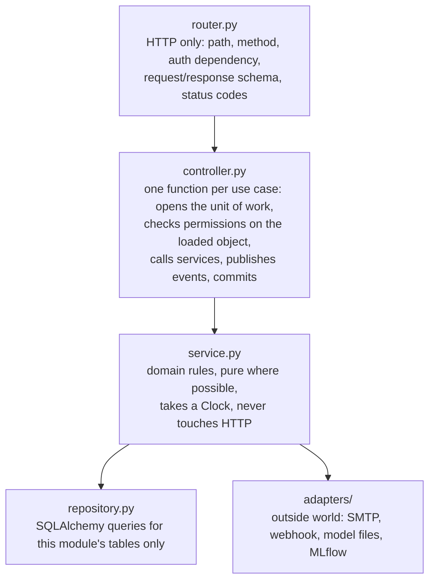

# 02. Backend Design: Modules, Routers, Controllers, Services

Part of the production design. Architecture context is in [01-system-architecture.md](01-system-architecture.md); tables are in [03-database-design.md](03-database-design.md).

---

## 1. Layering inside every module

Each bounded-context module uses the same five layers. A request only ever flows downward.



| Layer | May import | Must not | Tested with |
| --- | --- | --- | --- |
| Router | its controller, its schemas, `app.deps` | services, repositories, ORM | FastAPI TestClient (API tests) |
| Controller | own service and repository, other modules' `service.py`, event bus, unit of work | FastAPI `Request` objects, raw SQL | Integration tests on SQLite |
| Service | own repository interface, `core` (clock, calendar, ids) | HTTP, other modules' repositories | Unit tests with fake clock and fake repos |
| Repository | ORM models of own module | business rules | Integration tests |
| Adapter | third-party SDKs | business rules | Contract tests with fakes |

**Naming note.** In FastAPI terms a "controller" is the use-case layer between the router and the domain services. Keeping it separate means the same use case runs from HTTP, from the scheduler and from tests without HTTP.

---

## 2. Repository layout

This extends the PRD's section 10 layout. PRD paths are kept where they exist (`src/data`, `src/features`, `src/models`, `src/monitoring`, `configs/`, `ui/`), and the PRD's `src/serving` and `src/workflow` become modules under `src/app/modules`.

```
ticket-router/
  src/
    app/
      main.py                 app factory: routers, middleware, static SPA, lifespan
      settings.py             pydantic-settings (env vars, see section 10)
      lifespan.py             migrate -> seed -> load model -> start scheduler
      deps.py                 get_db, get_current_user, require_role(...), get_clock
      errors.py               DomainError hierarchy -> {code, message, field?}
      middleware.py           request id, structured access log, timing, body size limit
      api_v1.py               mounts every module router under /api/v1
    core/
      clock.py                Clock protocol, SystemClock, FakeClock (tests)
      business_calendar.py    business seconds between two instants, add business time
      events.py               DomainEvent base, in-process EventBus (sync handlers, after-commit)
      uow.py                  UnitOfWork (one SQLAlchemy session + after-commit hooks)
      security.py             JWT encode/decode, password hashing, service-token check
      ids.py                  T-1042 style public ids, ULIDs
      logging.py              structlog config
    db/
      base.py  session.py
      migrations/             Alembic env + versions
    modules/
      identity/       router.py controller.py service.py repository.py models.py schemas.py
      directory/      ...                    (roster, teams, leave, workload)
      inference/      router.py controller.py schemas.py   (thin; engine lives in src/ml)
      tickets/        ...                    (lifecycle, messages, state machine)
      assignment/     service.py repository.py   (no router; called by tickets/escalation)
      sla/            service.py repository.py jobs.py   (clocks, ladder, ETA)
      escalation/     ...
      approvals/      ...
      feedback/       ...
      notifications/  ... adapters/{email.py, webhook.py, inapp.py} templates/
      audit/          service.py repository.py handlers.py
      kpis/           router.py controller.py queries.py
      config/         router.py controller.py service.py   (admin runtime config)
      internal/       router.py controller.py   (service-token endpoints for jobs)
    ml/                         shared by training AND serving (PRD FR-03)
      preprocess.py             normalize -> tokenize -> stopwords -> lemmatize
      bundle.py                 ModelBundle: load/save, manifest, version
      predictor.py              Predictor.predict(text) -> RawPrediction
      decision.py               apply threshold, multi-issue check, routing map
      priority_rules.py         keyword overrides (PRD 9.2)
      explain.py                top terms (Could)
    data/       ingest.py validate.py split.py           (PRD)
    models/     train.py evaluate.py sweep.py register.py promote.py   (PRD)
    monitoring/ export.py drift_report.py check_thresholds.py          (PRD)
    workers/
      scheduler.py              APScheduler setup + DB lease
  configs/
    params.yaml  routing_map.yaml  roster.yaml  sla.yaml  escalation_rules.yaml
    priority_rules.yaml  notifications.yaml  calendar.yaml
  frontend/                     React app (frontend plan section 8)
  ui/                           Streamlit console + Dockerfile
  models/champion.json          pointer to the champion bundle (written by promotion PRs)
  tests/  unit/ integration/ api/ workflow/ ml/ e2e/
  scripts/  simulate_traffic.py  seed_demo.py  export_openapi.py
  .github/workflows/  ci.yml cd.yml monitor.yml retrain.yml sla-tick.yml
  dvc.yaml  params.yaml  Dockerfile  docker-compose.yml  pyproject.toml  alembic.ini
```

---

## 3. Module catalogue

Each row is one bounded context. "Owns" means only this module writes those tables.

| Module | Responsibility | Owns tables | Publishes events | Consumes events | PRD |
| --- | --- | --- | --- | --- | --- |
| identity | Login, signup, sessions, current user, demo login | users | `UserCreated` | | FE 7 |
| directory | Teams, members, skills, shifts, leave, delegates, workload view, roster seeding | teams, members, member_skills, member_leave | | `TicketAssigned`, `TicketClosed` (workload cache) | FR-19 |
| inference | `/predict`, `/predict/batch`, `/model-info`; wraps `src/ml` | predictions | `PredictionMade` | | FR-08, 09, 10, 11 |
| tickets | Ticket create, read, list, status changes, messages, confirm, reopen, triage, state machine | tickets, ticket_messages | `TicketCreated`, `TicketTriaged`, `TicketStatusChanged`, `TicketResolved`, `TicketReopened`, `TicketClosed`, `MessagePosted` | `EscalationAccepted`, `ApprovalDecided`, `SlaBreached` | FR-22, 23 |
| assignment | Pick a named engineer (4B.2), reassign, record assignment history | assignments | `TicketAssigned`, `TicketReassigned` | | FR-20 |
| sla | Business-hours calendar, SLA clocks, ETA, pause and resume, ladder evaluation | sla_clocks, sla_events, eta_changes | `SlaClockStarted`, `EtaChanged`, `SlaThresholdReached`, `SlaBreached`, `FirstResponseMissed` | `TicketAssigned`, `TicketStatusChanged`, `ApprovalDecided` | FR-21, 24, 32 |
| escalation | Requester-chosen escalation, guardrails, responses, timeouts, automatic E2 to E4 records | escalations | `EscalationRaised`, `EscalationAccepted`, `EscalationReassigned`, `EscalationDeclined`, `EscalationTimedOut` | `SlaBreached`, `TicketResolved` | FR-25, 26, 27 |
| approvals | Approval step for admin rights and purchases | approvals | `ApprovalRequested`, `ApprovalDecided` | `TicketTriaged` | FR-30 |
| feedback | Agent corrections, "Wrong team" escalations, requester "Not quite" | feedback | `FeedbackRecorded` | `EscalationRaised` (reason = wrong_team), `TicketTriaged` (category changed) | FR-12, 29 |
| notifications | Build messages from templates, in-app inbox, outbox dispatch to email and webhook | notifications, outbox | | every user-facing event in PRD 4B.1 | FR-22, 33 |
| audit | Append-only audit trail | audit_log | | every domain event | FR-28 |
| kpis | Read-only aggregates for the dashboard and landing strip | none (reads others via SQL views) | | | FR-31, PRD 12 |
| config | Runtime config (threshold, routing map, SLA, ladder, guardrails) with versions | app_settings | `ConfigChanged` | | FR-09, 10 |
| internal | Service-token endpoints for GitHub Actions jobs | monitoring_runs, model_deployments | | | FR-16, 17 |

---

## 4. API catalogue

All endpoints live under `/api/v1` (the SPA owns `/`). `/health` and `/ready` are also exposed at the root for the host's health check. Auth column: **P** public, **U** any signed-in user, role names otherwise, **S** service token (GitHub Actions), **A** Platform Admin.

Legend for origin: **PRD** = PRD section 10, **FE** = frontend plan section 7, **NEW** = added by this design (see [frontend-handoff.md](frontend-handoff.md)).

### 4.1 Identity

| Method and path | Auth | Controller use case | Origin |
| --- | --- | --- | --- |
| `POST /auth/login` | P | `login(email, password)` → sets httpOnly cookie, returns `Me` | FE |
| `POST /auth/signup` | P | `signup(...)` → creates a Requester | FE |
| `POST /auth/logout` | U | `logout()` → clears cookie | NEW |
| `GET /auth/me` | U | `get_me()` → id, name, role, team, permissions | FE |
| `POST /auth/demo-login` | P (only when `DEMO_MODE=true`) | `demo_login(role)` → signs in as a seeded demo user | NEW |

### 4.2 Inference and feedback

| Method and path | Auth | Use case | Origin |
| --- | --- | --- | --- |
| `POST /predict` | U (rate limited 30/min) | `predict(text, ticket_id?)` → `PredictionOut` | PRD |
| `POST /predict/batch` | Agent, A (max 100 items) | `predict_batch(items)` | PRD (Could) |
| `GET /model-info` | U | active model versions, metrics, threshold, loaded_at, degraded flag | PRD |
| `POST /feedback` | Agent, Lead, Requester (own ticket, "Not quite") | `record_feedback(ticket_id, predicted, corrected, kind)` | PRD |

### 4.3 Tickets

| Method and path | Auth | Use case | Origin |
| --- | --- | --- | --- |
| `POST /tickets` | Requester, Agent | `create_ticket(subject, description, blocking_team?, idempotency_key)` → `TicketCreatedOut` (requester view of 4B.1) | PRD |
| `GET /tickets` | U (scoped by role) | `list_tickets(view, status, team, assignee, priority, q, sort, cursor)`; `view` ∈ `mine`, `review_queue`, `my_queue`, `team`, `all`, `waiting_on_me` | FE |
| `GET /tickets/{id}` | owner requester or staff | `get_ticket(id)` → status, assignee, ETA, SLA state, escalation level, prediction (role-filtered), timeline, allowed actions, escalation eligibility | PRD |
| `POST /tickets/{id}/triage` | Agent | `triage(id, category, priority, assignee_id?)` → corrects prediction, records feedback, assigns (engine pick unless given) | NEW |
| `GET /tickets/{id}/assignment-suggestion` | Agent, Lead | `suggest_assignee(id, category?)` → engine's pick with rule trace and runner-ups | NEW |
| `POST /tickets/{id}/status` | Assigned engineer, Lead, Agent | `change_status(id, to_status, note, new_eta?, eta_reason?)` | PRD |
| `POST /tickets/{id}/request-info` | Assigned engineer | `request_info(id, question)` → Waiting on requester, clock paused | NEW |
| `POST /tickets/{id}/hand-back` | Assigned engineer | `hand_back(id, reason)` → back to Team Lead / review queue | NEW |
| `POST /tickets/{id}/reassign` | Agent, Lead (own team), Manager | `reassign(id, assignee_id, reason, new_eta?)` | PRD |
| `POST /tickets/{id}/confirm` | owner requester | `confirm_resolution(id)` → Closed | FE |
| `POST /tickets/{id}/reopen` | owner requester | `reopen(id, reason)` → Reopened → In progress, clock resumes | FE |
| `GET /tickets/{id}/messages` | owner requester or staff | thread; internal notes hidden from requester | FE |
| `POST /tickets/{id}/messages` | owner requester or staff | `post_message(id, body, internal?)`; a requester reply on a paused ticket resumes the clock | FE |
| `GET /tickets/{id}/audit` | Staff | full audit log for one ticket | NEW |

### 4.4 Approvals

| Method and path | Auth | Use case | Origin |
| --- | --- | --- | --- |
| `GET /approvals?status=` | Approver | pending and decided approvals for the caller | NEW (FE screen 6.12) |
| `POST /tickets/{id}/approve` | Approver for that ticket | `decide(id, approve, note)` → starts SLA clock and assigns | FE |
| `POST /tickets/{id}/reject` | Approver for that ticket | `decide(id, reject, reason)` → Resolved with reason "Rejected" | FE |

### 4.5 Escalations

| Method and path | Auth | Use case | Origin |
| --- | --- | --- | --- |
| `POST /tickets/{id}/escalate` | owner requester | `escalate(id, target_user_id, reason_code, note)` → guardrails, creates escalation, starts response timer | PRD |
| `GET /escalations?status=&team=&kind=&level=` | Lead, Manager | escalation board | FE |
| `GET /escalations/{id}` | chosen member, Lead, Manager, owner requester | detail for the respond screen | NEW |
| `POST /escalations/{id}/respond` | chosen member | `respond(id, action, new_eta?, reassign_to?, reason?)`; action ∈ accept, reassign, decline | PRD |

### 4.6 Directory and roster

| Method and path | Auth | Use case | Origin |
| --- | --- | --- | --- |
| `GET /directory/members?q=&team=&eligible=&for_ticket=` | U | searchable directory; with `for_ticket` returns suggested first and disabled rows with reasons | PRD |
| `GET /teams` | U | teams with lead, manager, category list | NEW |
| `GET /roster/workload?team=` | Lead, Manager, Agent | open weighted workload vs capacity per member, shift and leave state | PRD |

### 4.7 Notifications

| Method and path | Auth | Use case | Origin |
| --- | --- | --- | --- |
| `GET /notifications?unread=&cursor=` | U | caller's inbox | FE |
| `POST /notifications/{id}/read` | U | mark one read | FE |
| `POST /notifications/read-all` | U | mark all read | NEW |

### 4.8 KPIs

| Method and path | Auth | Use case | Origin |
| --- | --- | --- | --- |
| `GET /kpis?from=&to=&team=` | Manager, Lead | all PRD 12 KPIs + chart series | FE |
| `GET /kpis/public` | P (cached 5 min) | 5 headline numbers for the landing strip | FE |

### 4.9 Admin (Platform Admin, used by the Streamlit console)

| Method and path | Auth | Use case | Origin |
| --- | --- | --- | --- |
| `GET /admin/config` | A | all runtime config keys with version and source (yaml seed or db override) | NEW |
| `PUT /admin/config/{key}` | A | `update_config(key, value, expected_version)`; keys: `threshold`, `routing_map`, `sla_policy`, `escalation_rules`, `guardrails`, `priority_rules`; validated by schema, audited | NEW |
| `POST /admin/roster/import` | A | upsert roster from uploaded YAML (same schema as roster.yaml) | NEW |
| `PATCH /admin/members/{id}` | A, Manager | leave dates, shift, capacity, eligibility | NEW |
| `GET /admin/audit?entity=&actor=&from=` | A, Manager | global audit search | NEW |
| `POST /admin/model/reload` | A | re-read `/app/models` (dev and drills only) | NEW |
| `GET /admin/monitoring-runs?limit=` | A, Manager | latest monitoring results for the console's Monitoring page | NEW |

### 4.10 Internal (GitHub Actions, service token in `X-Service-Token`)

| Method and path | Use case | Called by |
| --- | --- | --- |
| `POST /internal/sla/tick` | run the same SLA job the scheduler runs; idempotent | `sla-tick.yml` every 15 min |
| `GET /internal/exports/predictions?since=&until=` | NDJSON of prediction log (hash, truncated text, probs, decision, model version) | `monitor.yml` |
| `GET /internal/exports/feedback?since=&unexported_only=` | NDJSON of labelled corrections with full ticket text | `retrain.yml` |
| `POST /internal/exports/feedback/ack` | mark exported rows so they are not reused | `retrain.yml` |
| `POST /internal/monitoring-runs` | store a monitoring result (metrics, drift flag, report URL, issue URL) | `monitor.yml` |
| `POST /internal/model-deployments` | record which model version an image carries | `cd.yml` after deploy |

### 4.11 Health

| Method and path | Auth | Returns |
| --- | --- | --- |
| `GET /health` | P | liveness: 200 if the process is up (PRD) |
| `GET /ready` | P | readiness: DB reachable, migrations at head, model loaded; 503 with reasons otherwise (NEW) |
| `GET /metrics` | S | Prometheus metrics (Could) |

**Count:** 54 endpoints. PRD had 13; the frontend plan added 15; this design adds the rest, mostly admin, internal and the agent triage actions the screens already imply.

---

## 5. Key schemas (Pydantic)

Only the contracts other parts depend on are shown. All timestamps are ISO 8601 with offset, UTC on the wire.

```python
class PredictionOut(BaseModel):
    category: Category                 # enum of the 8 dataset categories
    category_confidence: float         # 0..1
    top_categories: list[ScoredLabel]  # top 3, for the review screen
    priority: Priority                 # Low | Medium | High | Critical
    priority_confidence: float
    priority_source: Literal["model", "rule", "agent"]
    decision: Literal["auto_route", "human_review"]
    review_reason: ReviewReason | None # low_confidence | multi_issue | miscellaneous | model_unavailable
    routed_team: TeamRef               # resolver team, or Service Desk for human_review
    threshold: float
    model_version: str                 # e.g. "routing:7"
    priority_model_version: str
    prediction_id: UUID

class TicketCreateIn(BaseModel):
    subject: constr(min_length=3, max_length=200)
    description: constr(min_length=1, max_length=5000)   # PRD NFR limit
    blocking_team: bool = False                          # feeds priority_rules
    channel: Literal["portal", "chat", "email_sim"] = "portal"

class TicketCreatedOut(BaseModel):          # the PRD 4B.1 confirmation
    id: str                                 # "T-1042"
    status: TicketStatus
    category: Category
    priority: Priority
    decision: Literal["auto_route", "human_review"]
    assignee: MemberRef | None              # None while in human review or awaiting approval
    team: TeamRef
    first_response_due: datetime | None
    resolution_due: datetime | None
    awaiting_approval_from: MemberRef | None
    review_promise_by: datetime | None      # human_review: owner named within 30 min
    can_escalate: bool

class EscalateIn(BaseModel):
    target_user_id: UUID
    reason_code: Literal["no_response", "wrong_team", "business_critical", "deadline_at_risk", "other"]
    note: constr(min_length=10, max_length=500)

class EscalationRespondIn(BaseModel):
    action: Literal["accept", "reassign", "decline"]
    new_eta: datetime | None = None         # required for accept and reassign
    reassign_to: UUID | None = None         # required for reassign
    reason: constr(max_length=500) | None   # required for decline

class EscalationEligibility(BaseModel):     # embedded in GET /tickets/{id}
    allowed: bool
    used_last_24h: int
    max_per_24h: int
    next_allowed_at: datetime | None        # cooldown end
    blocked_reason: Literal["ticket_closed", "rate_limit", "cooldown"] | None

class ErrorOut(BaseModel):                  # every 4xx/5xx
    code: str                               # stable machine code, e.g. "ESCALATION_COOLDOWN"
    message: str                            # human sentence the UI can show
    field: str | None = None
    details: dict | None = None
    request_id: str
```

**Error codes** (the frontend maps these to inline messages, frontend plan 6.7):

| HTTP | code | When |
| --- | --- | --- |
| 400 | `TEXT_EMPTY`, `TEXT_TOO_LONG` | PRD NFR reliability |
| 401 | `AUTH_REQUIRED`, `AUTH_INVALID` | missing or bad cookie |
| 403 | `FORBIDDEN_ROLE`, `NOT_TICKET_OWNER` | RBAC or row-level check failed |
| 404 | `NOT_FOUND` | also returned instead of 403 when a requester asks for someone else's ticket, so ids cannot be probed |
| 409 | `INVALID_TRANSITION` | state machine rejects the move |
| 409 | `STALE_VERSION` | optimistic lock lost; client refetches |
| 409 | `ESCALATION_ALREADY_RESPONDED` | second respond on the same escalation |
| 422 | `ESCALATION_TARGET_SELF`, `ESCALATION_TARGET_OWNER`, `ESCALATION_TARGET_INELIGIBLE`, `ESCALATION_TARGET_ON_LEAVE` (details carry `delegate`), `ESCALATION_RATE_LIMIT`, `ESCALATION_COOLDOWN` (details carry `next_allowed_at`) | PRD 4B.6 guardrails |
| 422 | `VALIDATION_ERROR` | Pydantic, with `field` |
| 429 | `RATE_LIMITED` | slowapi |
| 503 | `MODEL_UNAVAILABLE` | `/predict` only; `/tickets` degrades to human review instead |

---

## 6. Controller walk-through of the hardest use cases

### 6.1 `create_ticket`

```text
create_ticket(cmd, user, clock, idem_key):
  if idem_key seen for user: return stored response              # double-submit safe
  pred = inference.predict(cmd.text)            # OUTSIDE the transaction, ~20-60 ms
         on ModelUnavailable -> pred = HUMAN_REVIEW(reason=model_unavailable)
  pred = priority_rules.apply(pred, cmd)        # outage / all users / blocking_team raise priority
  with uow:                                     # ONE transaction
    ticket = tickets.new(status=New, ...)
    predictions.save(pred, ticket_id)           # FR-11
    if pred.decision == auto_route:
        ticket.triage(category, priority, source="model")      # New -> Triaged
        if category.requires_approval:          # Admin rights, Purchase
            approvals.request(ticket)           # -> Awaiting approval, no clock yet
        else:
            a = assignment.pick(ticket)         # 4B.2 rules, falls back to Team Lead
            ticket.assign(a)                    # Triaged -> Assigned
            sla.start_clock(ticket, clock.now())   # first_response_due, resolution_due
    else:
        ticket.queue_for_review(pred.review_reason)   # stays New, review promise = now + 30 business min
    uow.collect(events)                         # TicketCreated, TicketAssigned, SlaClockStarted ...
    uow.commit()                                # audit rows + notifications + outbox written by
                                                # after-commit handlers in the SAME db transaction
  store idem response
  return TicketCreatedOut(...)                  # p95 target < 1 s, PRD target 5 s
```

Why the model call is outside the transaction: it is the slowest step and needs no DB locks. Why everything else is inside: the requester must never see a ticket with an owner but no ETA, or an ETA with no audit row.

**Event handling inside the transaction.** The event bus runs handlers in two phases: `in_transaction` handlers (audit, in-app notifications, outbox rows) run before commit using the same session, so they commit or roll back together with the ticket. `after_commit` handlers (anything that leaves the process, which is only the outbox dispatcher) run after. This is the transactional outbox pattern: no email is ever sent for a ticket that was rolled back, and no committed ticket ever loses its notification.

### 6.2 `escalate` (requester-chosen)

```text
escalate(ticket_id, cmd, user, clock):
  with uow:
    t = tickets.get_for_update(ticket_id)           # row lock on Postgres; SQLite serialises writes
    require t.requester_id == user.id               # else 404
    require t.status not in {Resolved, Closed}      # else ticket_closed
    rules = config.get("guardrails")                # max 2 / 24 h, 1 h cooldown
    recent = escalations.requester_escalations(t, since=now-24h)
    require len(recent) < rules.max_per_24h         # ESCALATION_RATE_LIMIT
    require now >= last(recent).created_at + cooldown   # ESCALATION_COOLDOWN
    target = directory.get_member(cmd.target_user_id)
    require target.id != user.id                    # ESCALATION_TARGET_SELF
    require target.id != t.assignee_id              # ESCALATION_TARGET_OWNER
    require target.active and target.escalation_eligible
    if directory.on_leave(target, now): raise ON_LEAVE(delegate=target.delegate)
    window = 30 min if t.priority == Critical else 2 business h
    e = escalations.create(kind=requester, level=t.escalation_level, target, reason, note,
                           response_due=calendar.add(now, window))
    t.flag_escalated()
    events: EscalationRaised  -> notifications to target, assignee, Team Lead (4B.6 step 4)
                              -> audit
                              -> feedback (if reason == wrong_team, FR-29)
    commit
```

### 6.3 `respond_to_escalation`

```text
respond(esc_id, cmd, user):
  with uow:
    e = escalations.get_for_update(esc_id)
    require e.target_user_id == user.id
    require e.status == pending                     # else ESCALATION_ALREADY_RESPONDED (409)
    match cmd.action:
      accept   -> assignment.reassign(t, user, reason="escalation_accept"); sla.set_eta(t, cmd.new_eta, reason)
      reassign -> assignment.reassign(t, cmd.reassign_to, ...); sla.set_eta(...)
      decline  -> assignment.reassign(t, team_lead_of(t), reason="escalation_decline")
    e.close(cmd.action, user, now)
    events: EscalationAccepted | Reassigned | Declined -> requester notified with owner + ETA
```

The `require e.status == pending` check under a row lock (or a conditional `UPDATE ... WHERE status='pending'` on SQLite) makes the respond-versus-timeout race safe: whichever commits first wins, the other gets 409 or skips.

---

## 7. Domain services in detail

### 7.1 Assignment engine (FR-20, PRD 4B.2)

```text
pick(ticket, now) -> AssignmentDecision:
  team    = routing_map[ticket.category].team
  members = directory.members(team, role in {engineer})
  avail   = [m for m in members if on_shift(m, now) and not on_leave(m, now) and m.active]
  load(m) = Σ weight[p] for open tickets of m       # weights from config: C=4, H=3, M=2, L=1
  under   = [m for m in avail if assigned_today(m) < m.daily_capacity]
  if ticket.priority == Critical:
      pool = under or avail                         # least-loaded available, lead notified at once
  else:
      skilled = [m for m in under if m.skills ∩ ticket_skill_tags(ticket) ≠ ∅]
      pool = skilled or under
  if not pool: return Decision(assignee=team.lead, flagged=True, reason="no_eligible_member")
  best = min(load(m) for m in pool)
  tied = [m for m in pool if load(m) == best]
  pick = round_robin(team, tied)                    # cursor stored per team in app_settings
  return Decision(assignee=pick, trace=[each filter step and counts])
```

`ticket_skill_tags` comes from keyword matching against the team's skill vocabulary in `roster.yaml` (for example "vpn", "mfa", "printer"). The rule trace is saved in `assignments.rule_trace` so the agent's "why this person" tooltip and the audit log can show it.

### 7.2 SLA and calendar (FR-21, 24)

- `business_calendar.business_seconds(a, b)` counts only working hours in the configured timezone (default placeholder: `Asia/Kolkata`, Mon to Fri 09:00 to 18:00, holiday list in `calendar.yaml`; PRD open question 7).
- `business_calendar.add(start, seconds)` returns the instant after adding that many business seconds. Critical tickets use a **24x7 calendar** by default (a 15-minute first response cannot wait for Monday); configurable per priority in `sla.yaml`.
- An SLA clock stores `started_at`, `paused_seconds`, `paused_at`, and the two due instants. Due instants are recomputed only when the clock resumes (`due += paused business time`) or an ETA is changed with a reason.
- **State is derived, never counted.** `used_pct(now) = business_seconds(started_at, now - open_pause) - paused_seconds) / target`. Nothing depends on a timer having fired, which is the PRD's sleeping-host rule.

**Ladder tick** (every 60 s in-process, every 15 min from GitHub cron, both idempotent):

```text
tick(now):
  acquire lease "sla_tick" (skip if another holder within 90 s)
  for clock in open clocks (running, not stopped) using an index on next_check_at:
    for rule in ladder (ordered: first_response_miss, pct50_no_update, pct75, breach, manager_timeout):
      if rule.condition(clock, now) and not exists sla_events(ticket, rule.key, clock.cycle):
          insert sla_events(...)                    # UNIQUE(ticket_id, rule_key, cycle) -> fires once
          run rule.action                           # reassign / remind / warn / escalate E3 / E4
    clock.next_check_at = earliest future threshold
  for e in escalations where status=pending and response_due <= now:
      e.time_out(); create follow-up escalation to e.target.manager (or SD Manager)
  release lease
```

**Catch-up after sleep.** If a woken host finds a ticket at 110%, it fires `pct50`, `pct75` and `breach` in order (each gets its audit row and its `sla_events` row) but sends **one** combined notification for the highest step, so people are not spammed with three stale warnings.

**First-response miss.** Reassigns once to the next engineer (cycle becomes 2, fresh first-response window); a second miss notifies the Team Lead without another reassignment, so a ticket cannot bounce forever.

### 7.3 Ticket state machine (enforced in `tickets/service.py`)

Allowed transitions are a table, and every change goes through `transition(ticket, to, actor, reason)`, which checks the table, the actor's role, and writes the audit row. The diagram is in [05-end-to-end-flows.md](05-end-to-end-flows.md#2-state-machines).

| From | To | Who | Side effect |
| --- | --- | --- | --- |
| New | Triaged | system (auto_route) or Agent (triage) | prediction or correction recorded |
| Triaged | Awaiting approval | system | approval requested, no SLA clock |
| Awaiting approval | Assigned | Approver (approve) | assignment + clock start |
| Awaiting approval | Resolved | Approver (reject) | resolution note "Rejected: reason" |
| Triaged | Assigned | system or Agent | clock start |
| Assigned | In progress | assignee | first response met |
| Assigned, In progress | Waiting on requester | assignee (request info) | clock paused |
| Waiting on requester | In progress | requester reply or assignee | clock resumed, due dates shifted |
| Assigned, In progress | Assigned | Lead, Agent, Manager, ladder, escalation (reassign) | new assignment row |
| In progress | Resolved | assignee, Agent (resolve directly) | clock stopped, met or breached stored |
| Resolved | Closed | requester confirm, or auto after 3 business days | |
| Resolved | Reopened → In progress | requester | clock resumes from where it stopped (default) |

`is_escalated` and `escalation_level` are flags, not states, as in PRD 4B.4.

---

## 8. Authentication and authorisation

- **Session.** `POST /auth/login` returns a JWT (HS256, 8-hour expiry, claims `sub`, `role`, `team_id`) in an `httpOnly`, `Secure`, `SameSite=Lax` cookie. The SPA is same-origin, so no token is ever readable by JavaScript and CSRF is covered by SameSite plus a required `X-Requested-With` header on mutations.
- **Roles.** `requester`, `agent`, `engineer`, `team_lead`, `approver`, `sd_manager`, `delivery_manager`, `admin`. Staff roles come from the roster; signups are always requesters. A person can hold one role in v1.
- **Two checks on every request.** `require_role(...)` in the router (coarse), then a row-level check in the controller on the loaded object (requester owns the ticket, lead's team matches, chosen member matches the escalation).
- **Service token.** GitHub Actions call `/internal/*` with `X-Service-Token` from GitHub Secrets; compared in constant time.

**RBAC matrix (main actions)**

| Action | Req | Agent | Eng | Lead | Appr | Mgr | Admin |
| --- | --- | --- | --- | --- | --- | --- | --- |
| Create ticket | ✓ | ✓ | | | | | |
| View ticket | own | all | assigned + team | team | pending for them | all | read-only all |
| Triage / correct category | | ✓ | | ✓ | | ✓ | |
| Change status / ETA | | ✓ | assigned | team | | ✓ | |
| Reassign | | ✓ | | team | | ✓ | |
| Escalate (requester-chosen) | own | | | | | | |
| Respond to escalation | if chosen | if chosen | if chosen | if chosen | | if chosen | |
| Approve / reject | | | | | ✓ | | |
| KPIs | | | | team | | ✓ | ✓ |
| Runtime config | | | | | | SLA view | ✓ |
| Internal endpoints | | | | | | | service token only |

---

## 9. Background jobs

| Job | Schedule | Entry point | Idempotency |
| --- | --- | --- | --- |
| SLA tick + escalation timeouts | 60 s in-process; 15 min GitHub cron | `sla.jobs.tick(now)` | `sla_events` unique key; lease row |
| Outbox dispatch | 15 s | `notifications.jobs.dispatch()` | `outbox.status`, attempts with exponential backoff (1, 2, 4, 8, 16 min), dead-letter after 6 |
| Auto-close resolved tickets | hourly | `tickets.jobs.auto_close(now)` | state check |
| Prediction log retention | daily | `inference.jobs.prune(older_than=90d)` | delete by date |
| Review-promise watcher | inside SLA tick | human_review tickets past the 30-minute promise notify the agents' channel | `sla_events` with rule `review_promise` |

**Single runner guarantee.** One Uvicorn worker in production, plus a `scheduler_leases` row (holder id, expires_at) taken with a conditional update before each run. If a second replica or the external cron runs at the same time, it sees the lease and skips.

---

## 10. Configuration

Two kinds of configuration, kept apart:

| Kind | Where | Changed by | Examples |
| --- | --- | --- | --- |
| Deployment settings | Environment variables (pydantic-settings) | Host dashboard / GitHub Secrets | `DATABASE_URL`, `JWT_SECRET`, `SERVICE_TOKEN`, `MODEL_DIR`, `DEMO_MODE`, `SMTP_URL`, `WEBHOOK_URL`, `CORS_ORIGINS`, `LOG_LEVEL`, `TZ_BUSINESS` |
| Business config | YAML in `configs/` as the versioned seed; DB `app_settings` holds runtime overrides with a version number | Pull request (YAML), or the admin console (DB override) | threshold, routing map, SLA targets, ladder thresholds, guardrails, priority rules, workload weights |

Load order: YAML seed → DB override (if any) → in-memory cache refreshed on `ConfigChanged`. Every override write is schema-validated, audited with before and after, and protected with `expected_version` so two admins cannot overwrite each other. "Changeable without code changes" (FR-09, FR-10) is met by both paths.

**Example `escalation_rules.yaml`**

```yaml
ladder:
  first_response_miss: { action: reassign_next, max_auto_reassign: 1, notify: [team_lead] }
  pct50_no_update:     { at: 0.50, action: remind,  notify: [assignee] }
  pct75:               { at: 0.75, action: warn,    notify: [assignee, team_lead] }
  breach:              { at: 1.00, action: escalate, level: E3, notify: [sd_manager, team_lead, requester] }
  manager_timeout:     { after_breach: "2h", action: escalate, level: E4, notify: [delivery_manager] }
requester_escalation:
  max_per_24h: 2
  cooldown: "1h"
  response_window: { default: "2bh", Critical: "30m" }   # bh = business hours
  timeout_action: escalate_to_target_manager
  fallback_target: sd_manager
reasons: [no_response, wrong_team, business_critical, deadline_at_risk, other]
```

---

## 11. Cross-cutting concerns

| Concern | Design |
| --- | --- |
| Request IDs | Middleware assigns `X-Request-ID` (or accepts the client's), binds it to structlog, returns it in every response and `ErrorOut` |
| Logging | JSON lines: timestamp, level, request_id, user_id, route, status, latency_ms; ticket text is never logged, only `text_hash` (PRD NFR security) |
| Input limits | 5,000-character text limit in schemas; 64 KB request body limit in middleware |
| Rate limits | login 5/min/IP, predict 30/min/user, escalate 10/hour/user, signup 3/hour/IP |
| Idempotency | `Idempotency-Key` header on `POST /tickets` and `POST /tickets/{id}/escalate`; stored 24 h |
| Optimistic locking | `tickets.version` incremented on every update; mutations accept `If-Match` and return 409 `STALE_VERSION` |
| Time | Every service takes a `Clock`; tests use `FakeClock` to jump hours (PRD Phase 4 "fake clock") |
| Pagination | Cursor-based (`created_at, id`) for lists |
| OpenAPI | Exported in CI to `openapi.json`; the frontend generates types from it; a diff check fails CI on breaking changes without a version bump |
| CORS | Only for `web-dev` (localhost:5173) and an optional Netlify/Vercel origin; production SPA is same-origin |
