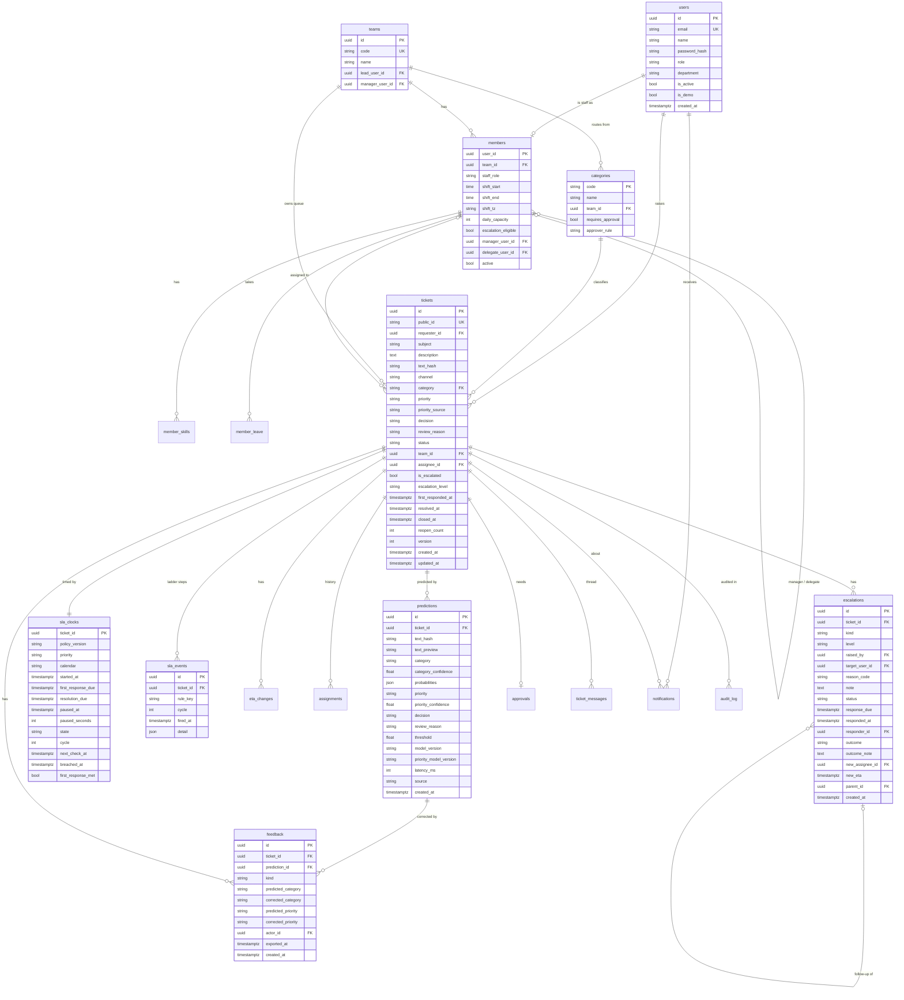

# 03. Database Design

Part of the production design. Modules that own each table are listed in [02-backend-design.md](02-backend-design.md#3-module-catalogue).

**Engine.** PostgreSQL 16 in production (Neon or Supabase free tier), SQLite for local quick runs and pytest. One set of SQLAlchemy 2.x models; Alembic migrations tested against both engines in CI. Types are chosen to work on both: `UUID` stored as `CHAR(36)` on SQLite, `JSON` instead of `JSONB` in models (Postgres gets `JSONB` through a type variant), enums as `VARCHAR` + `CHECK`.

---

## 1. Entity-relationship diagram

Smaller tables (`member_skills`, `member_leave`, `assignments`, `eta_changes`, `approvals`, `ticket_messages`, `notifications`, `outbox`, `audit_log`, `app_settings`, `idempotency_keys`, `scheduler_leases`, `monitoring_runs`, `model_deployments`) are specified in section 2.

---

## 2. Table specifications

Conventions: every table has `id UUID PK` unless noted, `created_at timestamptz NOT NULL DEFAULT now()`. All timestamps are UTC. Foreign keys are `ON DELETE RESTRICT` (nothing in this system is hard-deleted except retention jobs on logs).

### 2.1 Identity and directory

| Table | Key columns | Constraints and indexes |
| --- | --- | --- |
| `users` | email, name, password_hash (argon2), role, department, is_active, is_demo | `UNIQUE(lower(email))`; `CHECK role IN (...)` |
| `teams` | code (`ACCESS`, `HARDWARE`, ...), name, lead_user_id, manager_user_id | `UNIQUE(code)` |
| `members` | user_id (PK, FK users), team_id, staff_role (`engineer`, `team_lead`, `agent`, `approver`, `sd_manager`, `delivery_manager`), shift_start, shift_end, shift_tz, daily_capacity, escalation_eligible, manager_user_id, delegate_user_id, active | `INDEX(team_id, active)`; `CHECK daily_capacity > 0` |
| `member_skills` | user_id, skill (`vpn`, `mfa`, `printer` ...) | `PK(user_id, skill)`; `INDEX(skill)` |
| `member_leave` | user_id, start_date, end_date, note | `INDEX(user_id, start_date, end_date)`; `CHECK end_date >= start_date` |
| `categories` | code (PK: `Access`, `Administrative rights`, ...), name, team_id, requires_approval, approver_rule (`line_manager` or `security_owner`) | seeded from routing_map.yaml; runtime edits go through `app_settings` then re-sync |

### 2.2 Tickets and workflow

| Table | Key columns | Constraints and indexes |
| --- | --- | --- |
| `tickets` | see ERD | `UNIQUE(public_id)`; `INDEX(requester_id, status)`; `INDEX(assignee_id, status)`; `INDEX(team_id, status)`; partial `INDEX(created_at) WHERE decision='human_review' AND status='New'` (review queue); `CHECK status IN (...)`; `version` for optimistic locking |
| `ticket_messages` | ticket_id, author_id (nullable for system), kind (`public`, `internal`, `system`), body (≤ 5,000) | `INDEX(ticket_id, created_at)` |
| `assignments` | ticket_id, assignee_id, team_id, reason (`auto`, `agent_triage`, `lead_reassign`, `first_response_miss`, `escalation_accept`, `escalation_reassign`, `escalation_decline`, `fallback_lead`), assigned_by (nullable = system), rule_trace JSON, started_at, ended_at | `INDEX(ticket_id, started_at)`; `INDEX(assignee_id) WHERE ended_at IS NULL` (live workload) |
| `sla_clocks` | see ERD; `state` ∈ `pending_approval`, `running`, `paused`, `stopped`; `calendar` ∈ `business`, `24x7` | `PK(ticket_id)`; `INDEX(next_check_at) WHERE state='running'` (the tick only scans due rows) |
| `sla_events` | ticket_id, rule_key, cycle, fired_at, detail | **`UNIQUE(ticket_id, rule_key, cycle)`** is what makes every ladder step fire exactly once |
| `eta_changes` | ticket_id, old_resolution_due, new_resolution_due, reason, actor_id | `INDEX(ticket_id, created_at)` |
| `escalations` | see ERD; `kind` ∈ `requester`, `auto`; `level` ∈ `E1`..`E4`; `status` ∈ `pending`, `accepted`, `reassigned`, `declined`, `timed_out`, `superseded` | `INDEX(ticket_id, created_at)`; `INDEX(target_user_id, status)`; `INDEX(response_due) WHERE status='pending'`; `INDEX(raised_by, ticket_id, created_at)` for the guardrail count |
| `approvals` | ticket_id (UNIQUE), approver_id, status (`pending`, `approved`, `rejected`), reason, due_at, decided_at | `INDEX(approver_id, status)` |

### 2.3 ML data

| Table | Key columns | Constraints and indexes |
| --- | --- | --- |
| `predictions` | see ERD; `text_preview` = first 200 characters (PRD NFR: hash or truncated text only); `source` ∈ `predict_api`, `ticket_create`, `batch`, `console` | `INDEX(created_at)`; `INDEX(model_version, created_at)`; `INDEX(ticket_id)` |
| `feedback` | see ERD; `kind` ∈ `agent_correction`, `wrong_team_escalation`, `requester_not_quite`, `priority_correction` | `INDEX(created_at)`; partial `INDEX(created_at) WHERE exported_at IS NULL` |
| `monitoring_runs` | window_start, window_end, n_predictions, low_conf_rate, override_rate, drift_share, prediction_shift, breached (bool), breached_signals JSON, report_url, issue_url, git_sha | `INDEX(created_at)` |
| `model_deployments` | model_name, model_version, run_id, alias, metrics JSON, image_tag, deployed_at, deployed_by (`cd.yml`) | `INDEX(model_name, deployed_at)` |

Full ticket text lives only in `tickets.description` (the workflow needs it). Retraining reads it through the feedback export, which joins `feedback` to `tickets`. All data is synthetic or from public datasets (PRD 3.2).

### 2.4 Notifications, audit, platform

| Table | Key columns | Constraints and indexes |
| --- | --- | --- |
| `notifications` | user_id, ticket_id, event_type, title, body, link, read_at | `INDEX(user_id, read_at, created_at)` |
| `outbox` | event_type, channel (`email`, `webhook`), recipient, payload JSON, status (`pending`, `sent`, `failed`, `dead`), attempts, next_attempt_at, last_error, sent_at | `INDEX(status, next_attempt_at)` |
| `audit_log` | ticket_id (nullable), entity_type, entity_id, action, actor_type (`user`, `system`, `scheduler`, `service`), actor_id, before JSON, after JSON, reason, request_id | append-only: the app's DB role has `INSERT, SELECT` only on this table (Postgres); `INDEX(ticket_id, created_at)`; `INDEX(entity_type, entity_id)` |
| `app_settings` | key (PK), value JSON, version, source (`yaml_seed`, `admin`), updated_by, updated_at | optimistic check on version |
| `idempotency_keys` | key, user_id, request_hash, response_status, response_body JSON | `PK(user_id, key)`; pruned after 24 h |
| `scheduler_leases` | name (PK), holder, expires_at | conditional update to acquire |

---

## 3. Views for KPIs (read-only, owned by the kpis module)

| View | What it computes | Feeds |
| --- | --- | --- |
| `v_ticket_facts` | one row per ticket: category, team, priority, decision, created/first response/resolved times, breached flag, escalated flag, overridden flag (any feedback row) | every KPI |
| `v_kpi_daily` | per day and team: tickets, auto-route rate, override rate, average confidence, SLA compliance, escalation rate, mean time to first response | `GET /kpis` charts |
| `v_workload` | per active member: open tickets by priority, weighted load, assigned today, capacity, on shift, on leave | `GET /roster/workload`, assignment engine |
| `v_hours_saved` | PRD 12 formula with N, a, p from data and t, c, r from `app_settings` | insights calculator, landing strip |

Accuracy on auto-routed tickets (p) is measured as `1 - (auto-routed tickets later corrected or escalated as wrong_team) / auto-routed tickets`. This is a proxy and the dashboard labels it so.

If the dashboard gets slow, `v_kpi_daily` becomes a table refreshed hourly by a job. Not needed at demo volumes.

---

## 4. Migrations and seeding

- **Alembic** owns every schema change. `alembic upgrade head` runs at container start before Uvicorn binds the port (see 01 section 6). CI runs `upgrade head`, `downgrade -1`, `upgrade head` on both SQLite and Postgres to prove every migration is reversible.
- **Expand and contract** for changes on live data: add the new column nullable, deploy, backfill, then make it required in a later migration. Never rename a column in one step.
- **Seeds** (idempotent upserts keyed by natural keys):
  - `teams`, `categories` from `routing_map.yaml`
  - `users` + `members` + skills + leave from `roster.yaml` (about 15 members, PRD Phase 4)
  - `app_settings` rows with `source='yaml_seed'` for keys that have no admin override yet
  - demo requesters and one demo user per role when `DEMO_MODE=true`
- **Demo data reset.** `scripts/seed_demo.py --reset` truncates workflow tables (never `users`) for a clean demo run.

---

## 5. Data lifecycle and retention

| Data | Retention | Why |
| --- | --- | --- |
| tickets, messages, assignments, escalations, approvals | kept | business record |
| audit_log | kept, append-only | FR-28 |
| predictions | 90 days in DB; older rows exported to the DVC remote as monthly Parquet by `monitor.yml` before pruning | drift windows only need recent data; the free Postgres tier has a storage cap |
| feedback | kept | training data |
| notifications | 60 days | inbox only |
| outbox | 14 days after `sent` | debugging |
| idempotency_keys | 24 hours | |

**Backups.** Neon and Supabase free tiers include point-in-time restore for a short window (check current limits). On top, `monitor.yml` runs a weekly `pg_dump` of workflow tables to an Actions artifact (kept 30 days).

---

## 6. Concurrency rules

| Race | Guard |
| --- | --- |
| Two people update the same ticket | `tickets.version` optimistic lock → 409 `STALE_VERSION` |
| Escalation respond vs. timeout | `UPDATE escalations SET status=... WHERE id=? AND status='pending'`; zero rows updated = someone else won |
| Same ladder step from in-process tick and external cron | `UNIQUE(ticket_id, rule_key, cycle)` on `sla_events` |
| Two scheduler instances | `scheduler_leases` row |
| Double-click on Submit | `Idempotency-Key` on `POST /tickets` |
| Assignment picks the same engineer twice at once | assignment runs inside the ticket transaction; round-robin cursor updated with a version check |

SQLite note: SQLite serialises writers, so these guards are trivially safe in tests; they matter for Postgres in production.
