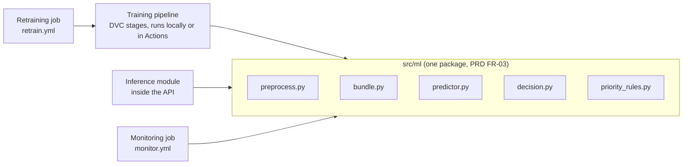
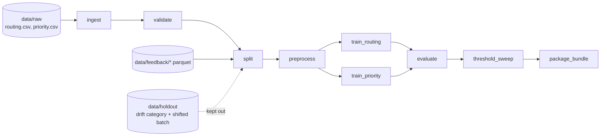
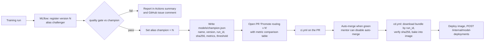

# 04. ML Services: Training, Serving, Monitoring, Retraining

Part of the production design. This turns PRD sections 9, 10 and 11 into concrete components and contracts.

The ML system has four parts with one shared package between them:



---

## 1. Training pipeline (DVC)

### 1.1 Stages



| Stage | Script | Inputs | Outputs | Fails the pipeline when |
| --- | --- | --- | --- | --- |
| ingest | `src/data/ingest.py` | `data/raw/*` | `data/interim/routing.parquet`, `priority.parquet` | columns missing |
| validate | `src/data/validate.py` (pandera) | interim | `reports/validation.json` | empty text, unknown labels, duplicates over limit (PRD FR-02) |
| split | `src/data/split.py` | interim + `data/feedback/*` | `data/processed/{train,val,test}.parquet` (70/15/15, seed from params), `data/holdout/*` | leakage between splits (hash overlap) |
| preprocess | `src/ml/preprocess.py` | processed | `data/features/*.parquet` (normalized text) | |
| train_routing | `src/models/train.py --task routing` | features | `artifacts/routing/model.pkl`, MLflow run | |
| train_priority | `src/models/train.py --task priority` | features (priority dataset, English only) | `artifacts/priority/model.pkl`, MLflow run | |
| evaluate | `src/models/evaluate.py` | models + test | `reports/metrics.json`, confusion matrix PNG, per-class report, slice report (rare classes, short tickets), messy-ticket report (Appendix A + 30 hand-written) | |
| threshold_sweep | `src/models/sweep.py` | routing model + val | `reports/sweep.csv`, `sweep.png`, `reports/threshold.json` (chosen value) | no threshold reaches p ≥ 0.90 (warning, not failure; reported honestly) |
| package_bundle | `src/ml/bundle.py` | both models + threshold + preprocess fingerprint | `artifacts/bundle/` (see 1.3) | |

`register` and `promote` are **not** DVC stages because they have side effects outside the repo (MLflow registry). They run as scripts after `dvc repro`.

**Feedback rows enter at `split`.** Corrected tickets exported from production are appended to the training set only (never to the fixed test set), so champion and challenger are always compared on the same test data. A separate small `feedback_test` slice (20% of feedback, time-ordered) measures improvement on recent real traffic.

### 1.2 `params.yaml` (excerpt)

```yaml
seed: 42
split: { train: 0.70, val: 0.15, test: 0.15, holdout_category: Storage }
preprocess: { lowercase: true, stopwords: nltk_english, lemmatizer: wordnet, min_len: 2 }
routing:
  model: logreg            # logreg | linear_svm | distilbert
  tfidf: { ngram_range: [1, 2], min_df: 2, max_features: 50000, sublinear_tf: true }
  logreg: { C: 4.0, class_weight: balanced, max_iter: 2000 }
  svm: { C: 0.5, calibration: sigmoid }
priority:
  model: logreg
  tfidf: { ngram_range: [1, 2], min_df: 3 }
  logreg: { C: 1.0, class_weight: balanced }
gate:
  min_macro_f1: 0.80
  max_per_class_drop: 0.05
  max_p95_latency_ms: 50   # model-only latency budget inside the 300 ms API budget
cost_model: { t_minutes: 3, c_minutes: 15, r_usd: 10, min_auto_accuracy: 0.90 }
```

### 1.3 Model bundle (the unit that moves from training to serving)

```
bundle/
  manifest.json         name, version, created_at, git_sha, dvc_data_hash, mlflow_run_ids,
                        labels, threshold, metrics, preprocess_fingerprint, python + sklearn versions
  routing.skops         sklearn Pipeline(TfidfVectorizer, LogisticRegression)  (skops format, safe load)
  priority.skops
  priority_rules.yaml   snapshot used at training time
  sample_inputs.json    5 tickets + expected outputs (serving smoke test)
```

`preprocess_fingerprint` is a hash of the preprocessing code and its parameters. The API refuses to load a bundle whose fingerprint differs from its own `src/ml/preprocess.py`, which turns the classic "training/serving skew" bug into a startup error instead of silent bad predictions.

**skops instead of pickle** so a tampered artifact cannot run code on load. If skops causes trouble with a model type, fall back to `joblib` and verify a SHA-256 from the manifest before loading.

### 1.4 Experiment tracking and registry (MLflow)

- Tracking server: **DagsHub hosted MLflow** (free) so local runs and GitHub Actions runs land in the same place. Fallback: local MLflow in docker compose, with training only run locally (then CI cannot retrain automatically; document the trade-off).
- Each training run logs params, metrics (macro-F1, weighted-F1, per-class F1, auto-route rate and accuracy at the chosen threshold, latency), the confusion matrix, the sweep chart, and the bundle as an artifact.
- Registry: models `ticket-routing` and `ticket-priority`. Aliases: `champion` (live), `challenger` (last candidate). PRD FR-07.
- At least 8 runs (PRD Phase 2): logreg × 3 C values, logreg without class weights, unigram only, linear SVM calibrated, SVM × 2 C values, optional DistilBERT.

### 1.5 Quality gate (`src/models/promote.py`)

```text
gate(challenger, champion | None, test_set):
  m_new = evaluate(challenger, test_set); m_old = evaluate(champion, test_set) if champion
  require m_new.macro_f1 >= params.gate.min_macro_f1                      # PRD 9.4
  if champion:
      require m_new.macro_f1 >= m_old.macro_f1                            # PRD 11.3
      for each class c: require m_old.f1[c] - m_new.f1[c] <= 0.05          # no class regresses > 5 pts
  require m_new.auto_route_accuracy >= 0.90 at its chosen threshold
  require p95 model latency <= params.gate.max_p95_latency_ms on 1,000 test rows
  require bundle smoke test passes (sample_inputs.json)
  return PASS / FAIL with a markdown report
```

The same function runs in three places: `ci.yml` (smoke-train on a small sample, gate with relaxed thresholds), `retrain.yml` (full gate), and locally.

---

## 2. Inference service (inside the API)

### 2.1 Components

| Component | Role |
| --- | --- |
| `ModelStore` | Loads the bundle from `MODEL_DIR` at startup, checks the manifest and fingerprint, warms up, holds the active `Predictor` behind a read-write lock so `/admin/model/reload` can swap it atomically |
| `Predictor` | `predict(text) -> RawPrediction`: preprocess once, then routing `predict_proba` and priority `predict_proba` on the same normalized text |
| `DecisionPolicy` | Applies the threshold, the multi-issue rule, the Miscellaneous rule and the routing map; returns decision, review reason and team |
| `PriorityRules` | Keyword and flag overrides that can only **raise** priority (outage, security breach, all users, whole team blocked); marks `priority_source='rule'` |
| `PredictionLogger` | Writes the `predictions` row; inside the ticket transaction for `POST /tickets`, as a background task for `POST /predict` |

### 2.2 Decision logic (PRD 9.3, made precise)

```text
raw   = predictor.predict(text)
top1, top2 = raw.top_categories[0], raw.top_categories[1]
if model unavailable:                         decision = human_review, reason = model_unavailable
elif top1.label == "Miscellaneous":           decision = human_review, reason = miscellaneous
elif top1.p < THRESHOLD:                      decision = human_review, reason = low_confidence
elif top2.p >= MULTI_ISSUE_P and has_conjunction(text):   # e.g. 0.30 and " and my ", " also "
                                              decision = human_review, reason = multi_issue
else:                                         decision = auto_route
team = routing_map[top1.label] if auto_route else SERVICE_DESK
priority = priority_rules.apply(raw.priority, text, flags)
```

`THRESHOLD` comes from config (`app_settings.threshold`, seeded from `reports/threshold.json` of the champion), so it changes without code (FR-09). `MULTI_ISSUE_P` is a config value too.

### 2.3 Latency budget for `POST /predict` (PRD target p95 < 300 ms)

| Step | Budget |
| --- | --- |
| HTTP + auth + validation | 10 ms |
| Preprocess (NLTK tokenize, stopwords, WordNet lemmatize; lemmatizer warmed at startup) | 15 ms |
| TF-IDF transform + two LogisticRegression `predict_proba` | 10 ms |
| Decision + rules | 1 ms |
| Prediction log (background task, not on the response path) | 0 ms |
| Headroom for a cold free-tier CPU | ~260 ms |

DistilBERT (optional) would use most of that headroom on CPU; it is only promoted if the gate's latency check passes.

### 2.4 Degradation and reload

- **No model at startup** (missing, corrupt, fingerprint mismatch): the API still starts, `/ready` returns 503 with `model_unavailable`, `/predict` returns 503, `POST /tickets` keeps working with every ticket sent to human review. The host's health check uses `/health`, so the container is not restarted in a loop.
- **Reload** (`POST /admin/model/reload`): loads the new bundle next to the old one, runs `sample_inputs.json`, swaps only if it passes. In production the normal path is a new image, not a reload.
- **Version in every response and log row** (`model_version`), so every decision can be traced to the exact MLflow run (FR-08, FR-11).

### 2.5 Explainability (Could)

For the linear models, `explain.py` returns the top 5 terms by `coef[class] × tfidf(term)` for the predicted class. Shown in the agent's prediction panel and the console playground. Cost is about 1 ms.

---

## 3. How the champion reaches production



Why a pull request instead of a direct redeploy:

- Git stays the single source of truth for what is live (`models/champion.json` in `main` = the model in production).
- Rollback is `git revert` of the promotion commit, which redeploys the previous bundle through the same pipeline.
- The mentor sees every promotion with its numbers, and can switch auto-merge off for a manual approval step. The PRD's "no manual code changes" in the drill still holds with auto-merge on.

---

## 4. Monitoring service (`monitor.yml`, PRD FR-16)

### 4.1 Steps

1. Pull the reference set: `dvc pull data/features/val.parquet` (training-time distribution).
2. Export current window: `GET /internal/exports/predictions?since=<7 days>` (or the last 500 predictions for the low-confidence rule), and feedback counts.
3. Compute signals:

| Signal | Computation | Threshold (config) | PRD |
| --- | --- | --- | --- |
| Low-confidence rate | share of last 500 predictions with confidence < threshold | > 25%, or > 1.5 × the test-set baseline | 11.3 |
| Text drift | transform both sets with the champion's TF-IDF, keep the top 300 features by reference variance, Evidently `DataDriftPreset` on those columns | drift on > 30% of features | 11.3 |
| Override rate | (agent corrections + wrong_team escalations) / reviewed tickets | > 15% | 11.3 |
| Prediction distribution shift | Evidently drift on the predicted-category column (PSI / chi-square) | p < 0.05 or PSI > 0.2 | 11.3 |
| Out-of-vocabulary rate (extra) | share of tokens unseen by the vectorizer | > 2 × baseline | early sign of a new category |

4. Render the Evidently HTML report, upload it as an Actions artifact and publish it to the `gh-pages` branch (stable URL for the console's Monitoring page).
5. `POST /internal/monitoring-runs` with the metrics, breached signals and report URL.
6. On breach: open (or update) a GitHub issue labelled `drift` with the numbers, then trigger `retrain.yml` with `workflow_dispatch` (or `repository_dispatch`) passing the reason.

Schedule: weekly cron plus manual dispatch (PRD); during the drift drill it is run manually after each simulator batch.

### 4.2 Why these signals catch a new category

A classifier cannot output a class it never saw (PRD 11.3). When the held-back Storage tickets arrive: confidence drops (low-confidence rate rises), OOV rate rises, agents correct "Hardware" to "Storage" (override rate rises). Any of these trips the alert; retraining can only succeed once the corrected Storage tickets exist as labelled feedback, which is exactly what the human review loop produces.

---

## 5. Retraining service (`retrain.yml`, PRD FR-17)

```text
on: workflow_dispatch(reason) | repository_dispatch(drift) | schedule (monthly, optional)
1. checkout, setup python, dvc pull
2. GET /internal/exports/feedback?unexported_only=true  -> data/feedback/<date>.parquet
3. validate feedback (same pandera schema + label set check; new label allowed only if listed in
   params.yaml labels, so a typo in a correction cannot create a class)
4. dvc add data/feedback/<date>.parquet
5. dvc repro                       # full pipeline -> new bundle + MLflow runs
6. python -m src.models.register   # register as challenger
7. python -m src.models.promote    # gate vs champion (section 1.5)
8. if PASS: set champion alias, write models/champion.json, dvc push,
            commit dvc.lock + data pointers + champion.json on branch retrain/<date>,
            open PR with the comparison table, enable auto-merge
   if FAIL: comment the gate report on the drift issue; keep champion
9. POST /internal/exports/feedback/ack for rows used (only after dvc push succeeded)
```

**New category support.** When the drill adds Storage back, `params.yaml` must list it in `labels` and `routing_map.yaml` must map it to a team. The drill script does both in its "new batch arrives" step so the retrain needs no manual code change (PRD Phase 6 exit criterion).

---

## 6. Drift drill (PRD Phase 6) as a scripted scenario

| Step | Command | Expected evidence |
| --- | --- | --- |
| 1. Normal traffic | `scripts/simulate_traffic.py --batch normal --n 500` | low-confidence rate near baseline; monitor run green |
| 2. Drift | `--batch shifted --n 300` then `--batch holdout_storage --n 300` | low-confidence and OOV rates rise |
| 3. Human loop | `--auto-correct` (simulates agents correcting from ground truth for review-queue tickets) | override rate rises; feedback rows exist |
| 4. Alert | run `monitor.yml` manually | issue opened with numbers; `monitoring_runs.breached = true` |
| 5. Retrain | triggered automatically | MLflow challenger run; gate report |
| 6. Promote | PR auto-merges, cd.yml deploys | `/model-info` shows the new version |
| 7. Recovery | replay the same drift batches | low-confidence rate back near baseline; before/after table for the report |

---

## 7. Streamlit console data sources (backend view)

| Console page | Reads | Writes |
| --- | --- | --- |
| Model | `GET /model-info`, MLflow client (runs, registry) | |
| Threshold | MLflow sweep artifact for the champion | `PUT /admin/config/threshold` |
| Routing map | `GET /admin/config` | `PUT /admin/config/routing_map` |
| Roster | `GET /directory/members`, `GET /roster/workload` | `PATCH /admin/members/{id}`, `POST /admin/roster/import` |
| SLA policy | `GET /admin/config` | `PUT /admin/config/sla_policy` (Could) |
| Monitoring | `monitoring_runs` via `GET /admin/monitoring-runs`, report URL on gh-pages | button "Run monitor now" triggers `monitor.yml` via GitHub API (token in console secrets) |
| Playground | `POST /predict` | |

This replaces the frontend plan's "console writes YAML files directly" for production (the container's disk is not persistent). Locally the console can still edit YAML, but the API path is the one that survives a redeploy. See [frontend-handoff.md](frontend-handoff.md).

