# 05. End-to-End Flows

Part of the production design. Every flow below names the screen (frontend plan section 6), the endpoint and module (02), and the tables (03), so a change in one place can be traced through the others.

Contents: 1 Production flow overview · 2 State machines · 3 Sequence diagrams · 4 Data-flow diagram and trust boundaries · 5 Failure modes ("no breaking")

---

## 1. Production flow overview

The whole system as one loop: ticket in, routed, worked, measured, model improved, redeployed.

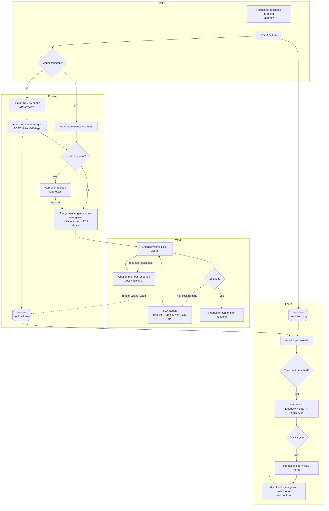

---

## 2. State machines

### 2.1 Ticket lifecycle (PRD 4B.4)

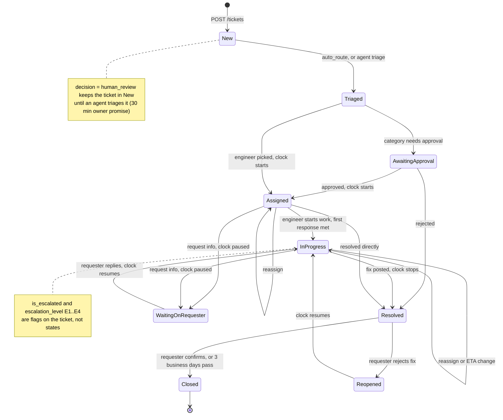

### 2.2 Requester-chosen escalation (PRD 4B.6)

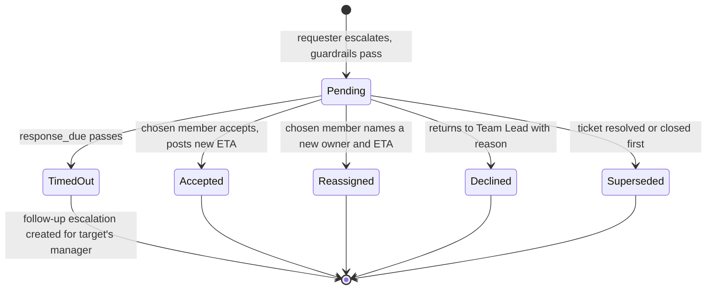

### 2.3 SLA clock

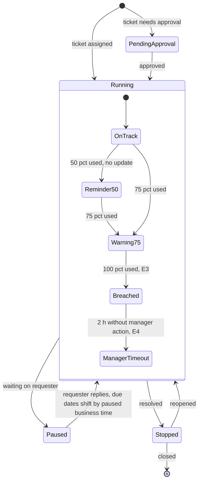

### 2.4 Model lifecycle

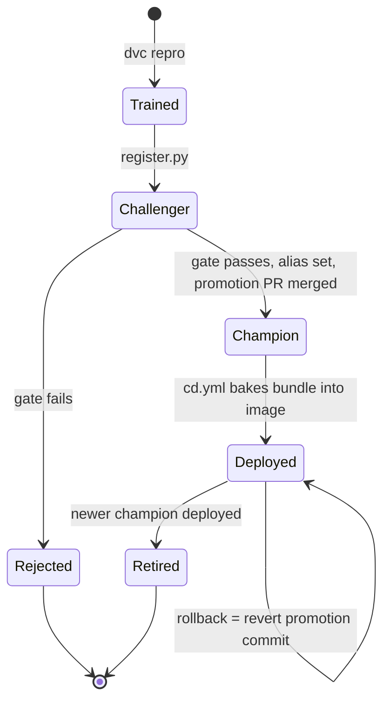

---

## 3. Sequence diagrams

### 3.1 Raise a ticket, auto-routed (FR-08 to FR-11, FR-19 to FR-22)

Screen: `/app/new` → confirmation. Tables: tickets, predictions, assignments, sla_clocks, audit_log, notifications, outbox.

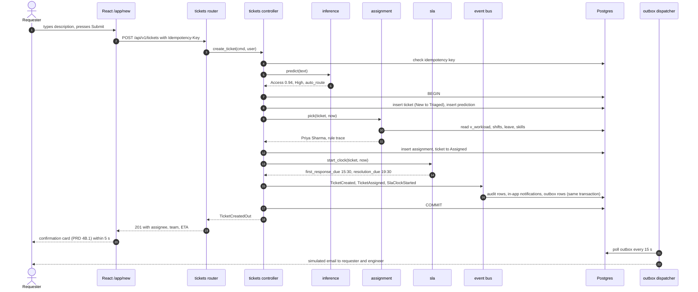

### 3.2 Human review and agent correction (FR-12, FR-20)

Screen: `/desk/review`. Tables: tickets, feedback, assignments, sla_clocks.

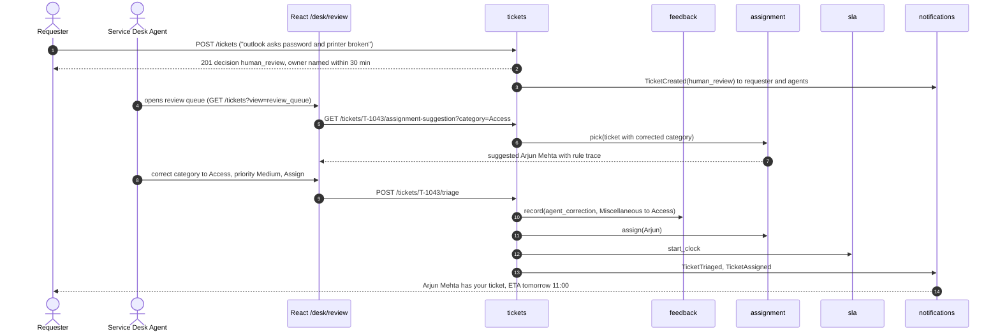

### 3.3 Approval step (FR-30)

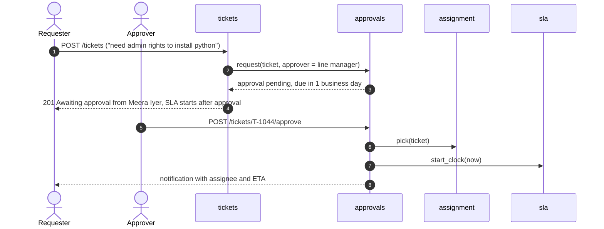

### 3.4 SLA ladder tick, including a host that slept (FR-24)

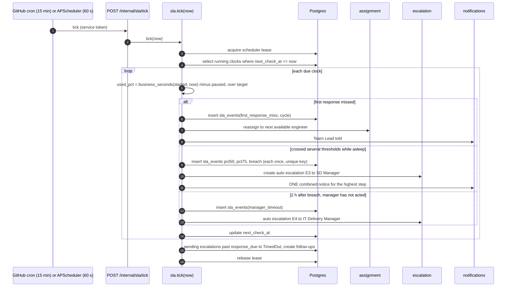

### 3.5 Requester-chosen escalation with response and timeout (FR-25 to FR-27, FR-29)

Screens: `/app/tickets/:id/escalate`, `/escalations/:id`.

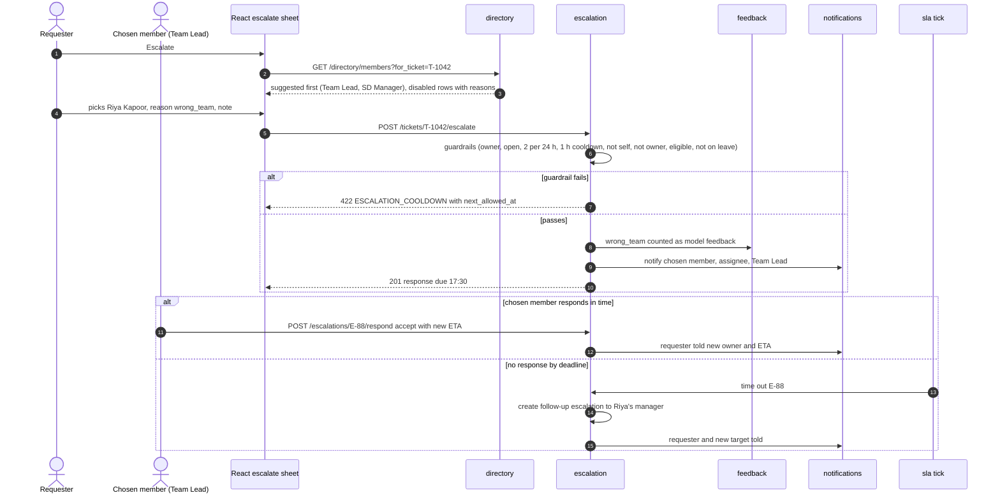

### 3.6 Engineer asks for info, clock pauses, requester replies (FR-21)

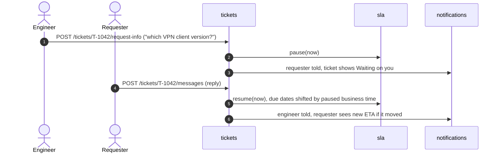

### 3.7 Resolve, confirm or reopen

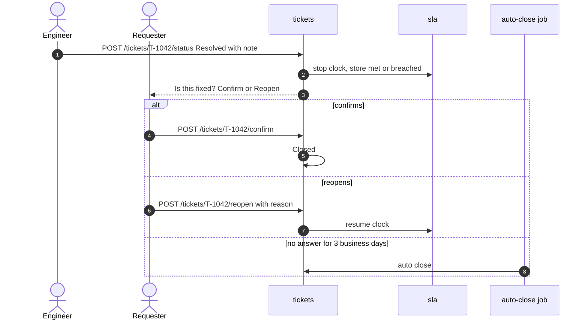

### 3.8 Login and role routing

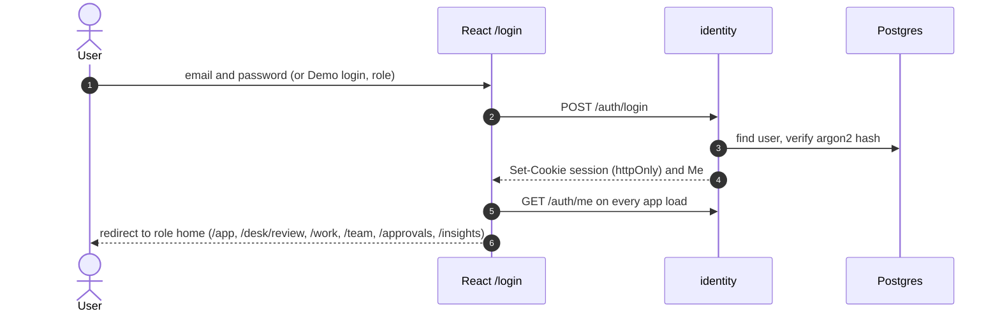

### 3.9 CI/CD release (FR-14, FR-15)

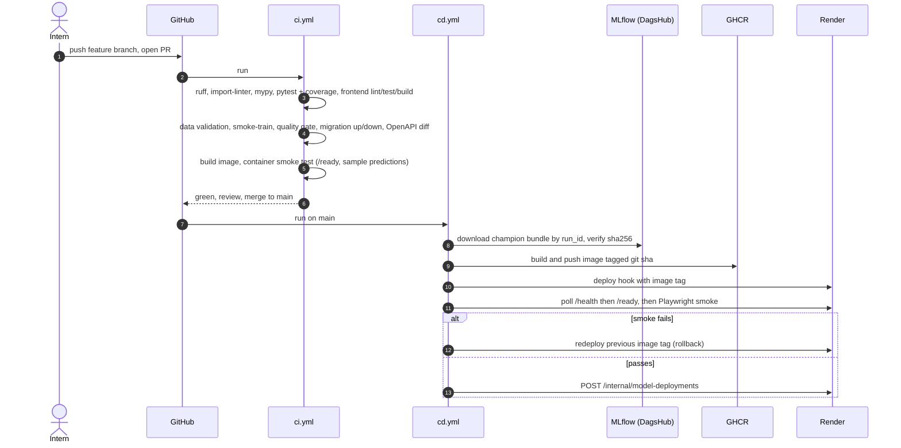

### 3.10 Drift, retrain, promote (FR-16, FR-17)

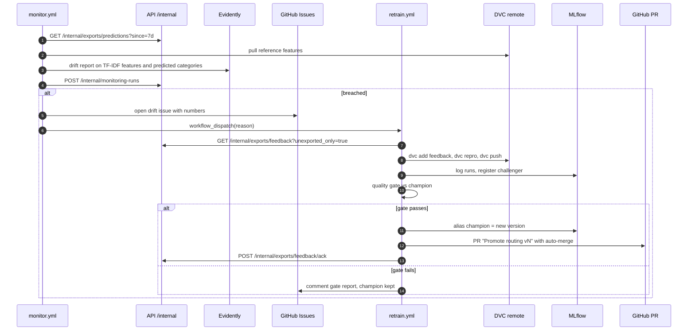

---

## 4. Data-flow diagram and trust boundaries

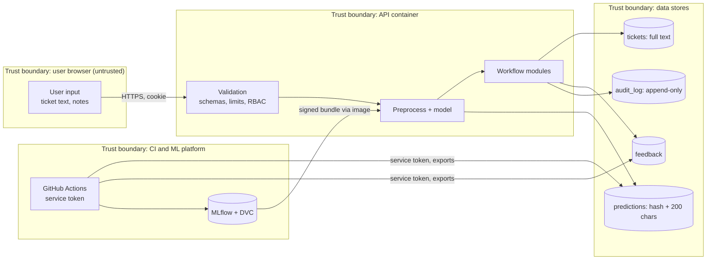

Data classification: ticket text may contain personal data in a real deployment. In this project all data is public or synthetic (PRD 3.2). Even so, the design keeps full text in one table only, logs a hash and a 200-character preview everywhere else, and exports full text only for labelled feedback rows used in training.

---

## 5. Failure modes: how the flow avoids breaking

| Failure | Where | Behaviour | User sees |
| --- | --- | --- | --- |
| Model file missing or corrupt | startup | API starts degraded, `/ready` 503, tickets go to human review | "Our service desk is reviewing this" (normal human-review copy) |
| Model raises on one input | `/tickets` | caught, ticket goes to human review with reason `model_unavailable`, error logged | same as above |
| DB down | any write | 503 `DB_UNAVAILABLE`; SPA keeps the draft in local storage and offers retry (frontend plan 6.4) | "We couldn't save that, try again" |
| Transaction fails half-way | `/tickets` | everything rolls back including audit and notification rows (single transaction) | error, no orphan ticket |
| Double submit | `/tickets`, `/escalate` | idempotency key returns the first response | one ticket |
| Host asleep when a threshold passes | scheduler | derived state + catch-up tick on wake + 15-min external cron; one combined notice | correct current state on next load |
| Two ticks at once | scheduler | lease row + `sla_events` unique key | nothing duplicated |
| Email server down | outbox | retries with backoff, dead-letter after 6 attempts, in-app notification already delivered | in-app notice arrives on time |
| No eligible engineer | assignment | Team Lead assigned and ticket flagged (PRD 4B.2 rule 5) | named owner still shown |
| Chosen escalation member on leave | escalate | 422 with delegate suggestion | "On leave until 24 Oct, suggest Arjun Mehta" |
| Respond and timeout race | escalation | conditional update, loser gets 409 or skips | one outcome |
| Bad config edit | admin | schema validation rejects; version check prevents lost updates; audit shows who changed what | console shows the validation error |
| Migration breaks | deploy | CI tests up/down on both engines; expand-and-contract; CD rollback to previous tag | no outage |
| New model worse in production | after deploy | next monitor run shows it; `git revert` promotion PR redeploys previous bundle | |
| Free-tier cold start | first request | `/health` cheap; SPA shows a "waking up the service" skeleton when the first call takes > 3 s | brief wait, documented (PRD risk table) |
| Training/serving skew | startup | preprocess fingerprint check refuses the bundle | degraded mode, alert in logs |
