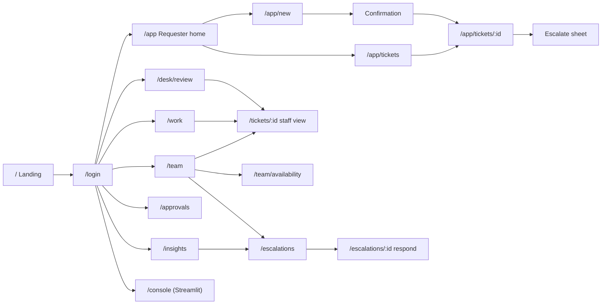

# 06. Wireframes: Frontend and Backend

Part of the production design. Low-fidelity wireframes that tie each screen to the endpoints, modules and tables behind it. Visual styling (Nero, Concrete, Orange, San; Chakra Petch; radii, chips) follows the frontend plan section 3 and is not repeated here. Screen numbers match the frontend plan section 6.

Legend: `[ Button ]` button · `( chip )` chip · `[____]` input · `▓▓▓░░` progress or SLA bar · `●` status dot · `›` row chevron · `⌄` select.

Each wireframe ends with a **Wiring** block: endpoints called → module → tables. This is the "end to end" link between the UI and the backend.

---

## Part A. Screen map



---

## Part B. Frontend wireframes (React)

### B1. Landing `/` (6.1)

```
┌──────────────────────────────────────────────────────────────────────────────┐
│ ▮▮ RouteDesk     About  How it works  Teams  FAQ          Sign in [Raise a ticket]│
├╱╱╱╱╱╱╱╱╱╱╱╱╱╱╱╱╱╱╱╱╱╱╱╱╱╱╱╱╱╱╱╱╱╱╱╱╱╱╱╱╱╱╱╱╱╱╱╱╱╱╱╱╱╱╱╱╱╱╱╱╱╱╱╱╱╱╱╱╱╱╱╱╱╱╱╱╱╱┤
│ ┌                                       │                                   ┐ │
│   ● Live   IT SERVICE DESK / AUTO-ROUTING│  ┌──────────────────────────────┐   │
│                                         │  │ [T-1042] VPN keeps dropping   │   │
│   Every ticket,                         │  │      (Access · 0.94) ───────┐ │   │
│   in the right hands,                   │  │                     ( PS )  ◄┘ │   │
│   in seconds                            │  │      ETA today 7:30 PM        │   │
│                                         │  └──────────────────────────────┘   │
│   Muted paragraph on what it does.      │      animated routing illustration  │
│   [ Raise a ticket ] [ See how routing works ]                                 │
│ └                                       │                                   ┘ │
├╱╱╱╱╱╱╱╱╱╱╱╱╱╱╱╱╱╱╱╱╱╱╱╱╱╱╱╱╱╱╱╱╱╱╱╱╱╱╱╱╱╱╱╱╱╱╱╱╱╱╱╱╱╱╱╱╱╱╱╱╱╱╱╱╱╱╱╱╱╱╱╱╱╱╱╱╱╱┤
│ Auto-route  68% │ Accuracy 92% │ Hours saved 105 │ SLA 94% │ First resp 22 min │
└──────────────────────────────────────────────────────────────────────────────┘
```
**Wiring:** `GET /kpis/public` → kpis → `v_kpi_daily`, `v_hours_saved` (cached 5 min; demo values if empty).

### B2. Login `/login` (6.2)

```
┌──────────────────────────────────────┬───────────────────────────────────────┐
│ ▮▮ RouteDesk                         │ ╭───────────────────────────────────╮ │
│                                      │ │  gradient Orange → Concrete → Nero│ │
│ Welcome back!                        │ │  (Auto-routed) (SLA on track)     │ │
│ Sign in to track or work tickets.    │ │                                   │ │
│                                      │ │  ╭─────────────────────────────╮  │ │
│ Email     [________________________] │ │  │ "68% of tickets routed       │  │ │
│ Password  [____________________ 👁]  │ │  │  automatically this week"    │  │ │
│                      Forgot password?│ │  ╰─────────────────────────────╯  │ │
│ [            Sign in             ]   │ ╰───────────────────────────────────╯ │
│ ─────────────── or ───────────────   │                                       │
│ [ Microsoft ] [ Google ] [ Demo login ⌄ ]                                    │
│ New here? Sign up                    │                                       │
└──────────────────────────────────────┴───────────────────────────────────────┘
```
**Wiring:** `POST /auth/login` or `POST /auth/demo-login` → identity → `users`; then `GET /auth/me` decides the home route. Errors: `AUTH_INVALID` banner, `RATE_LIMITED` lockout message.

### B3. Requester home `/app` (6.3, mobile first)

```
┌──────────────────────────────┐
│ ● All systems on        [🔔3]│
│ Morning, Hitesh!             │
│                              │
│ QUICK HELP                   │
│ ┌────┐ ┌────┐ ┌────┐ ┌────┐  │
│ │ 🔑 │ │ 🛡 │ │ 💻 │ │ ⬇  │  │
│ │PWD │ │VPN │ │HW  │ │SW  │  │
│ └────┘ └────┘ └────┘ └────┘  │
│ OPEN TICKETS            See all│
│ ┌───────────────┐ ┌──────────│
│ │T-1042 (High)  │ │T-1031    │
│ │VPN drops      │ │Monitor   │
│ │(PS) Priya     │ │(AM) Arjun│
│ │▓▓▓▓░░ 4h left │ │▓░░░░ 2d  │
│ └───────────────┘ └──────────│
│ UPDATES                      │
│ T-1042 · Priya posted update ›│
│ T-1031 · ETA changed        ›│
│ HELP  (Access)(Hardware)(HR) │
│                              │
│  ⌂     ☰     ( + )    ?    ◉ │
└──────────────────────────────┘
```
**Wiring:** `GET /auth/me`, `GET /tickets?view=mine&status=open`, `GET /notifications?unread=true`, `GET /health` (status dot) → tickets, notifications → `tickets`, `sla_clocks`, `notifications`.

### B4. Raise ticket, chat mode `/app/new` (6.4)

```
┌──────────────────────────────────────────────┐
│ ← Raise a ticket           ( Chat | Form )   │
│                                              │
│  What's going wrong?                         │
│                                              │
│               ┌──────────────────────────────┐│
│               │ my vpn keeps disconnecting   ││
│               │ every 10 min since morning   ││
│               └──────────────────────────────┘│
│  ┌──────────────────────────────────────────┐ │
│  │ I think this is  Access  ▓▓▓▓▓▓▓▓▓░ 94%  │ │
│  │ Team: Access and Identity · Priority High│ │
│  │ [ Looks right ]   Not quite ⌄            │ │
│  └──────────────────────────────────────────┘ │
│  Before you submit, these might help:        │
│  › Fix VPN drops on Wi-Fi                     │
│  › Reset your VPN profile                     │
│                                              │
│ [📎] [ Describe your problem...      ] [ ➤ ] │
│                               412 / 5000     │
└──────────────────────────────────────────────┘
```
**Wiring:** `POST /predict` (debounced) → inference → `predictions` (source `predict_api`); "Not quite" → `POST /feedback` (kind `requester_not_quite`); Submit → `POST /tickets` with `Idempotency-Key`.

### B5. Confirmation (6.4, PRD 4B.1)

```
┌──────────────────────────────────────────────┐
│ ✓ Ticket T-1042 received                     │
│ ┌──────────────────────────────────────────┐ │
│ │ Category   Access      Priority  (High)  │ │
│ │ Assigned   (PS) Priya Sharma             │ │
│ │            Access and Identity Team      │ │
│ │ First response by   today 3:30 PM        │ │
│ │ Expected resolution today 7:30 PM        │ │
│ └──────────────────────────────────────────┘ │
│ Need it faster?  Escalate                     │
│ [ View ticket ]            [ Back to home ]  │
│                                              │
│ variant human_review:                        │
│ "Our service desk is reviewing this. You'll  │
│  know who owns it by 3:45 PM."               │
│ variant approval:                            │
│ "Awaiting approval from Meera Iyer. The SLA  │
│  clock starts after approval."               │
└──────────────────────────────────────────────┘
```
**Wiring:** response of `POST /tickets` (`TicketCreatedOut`) → no extra call. Rendered within the 5-second target.

### B6. Ticket status page `/app/tickets/:id` (6.6)

```
┌───────────────────────────────────────────────────────────────────────────────┐
│ T-1042  VPN keeps disconnecting   (High) (In progress) (E1)                   │
├───────────────────────────────────────────────┬───────────────────────────────┤
│ New ─ Triaged ─ Assigned ─●In progress ─ Resolved ─ Closed                   │
│                                               │ OWNER                         │
│        ── Ticket assigned to Priya · 10:02 ── │ (PS) Priya Sharma             │
│ ┌────────────────────────────┐                │ Access and Identity Team      │
│ │ Priya: Which VPN client     │                │ First response  ✓ 10:20      │
│ │ version are you on?         │                │ ETA  7:30 PM  ▓▓▓▓▓░░ 3h 10m │
│ └────────────────────────────┘                │ ETA history ›                 │
│                ┌────────────────────────────┐ │ ESCALATION                    │
│                │ You: 5.2.1 on Windows       │ │ ●E1 ○E2 ○E3 ○E4              │
│                └────────────────────────────┘ │ MODEL                         │
│        ── ETA changed to 7:30 PM: needs ──    │ Access 94% · routing:7        │
│           vendor patch · 13:05                │                               │
│ [📎] [ Write a reply...                ] [➤] │ [ Escalate ]                  │
└───────────────────────────────────────────────┴───────────────────────────────┘
 Resolved state banner:  Is this fixed?  [ Confirm ]  [ Reopen ]
```
**Wiring:** `GET /tickets/{id}` (includes timeline, SLA state, escalation eligibility, allowed actions), `GET/POST /tickets/{id}/messages`, `POST /tickets/{id}/confirm`, `POST /tickets/{id}/reopen` → tickets, sla, audit → `tickets`, `ticket_messages`, `sla_clocks`, `eta_changes`, `audit_log`, `predictions`. Polled every 30 s.

### B7. Escalate sheet `/app/tickets/:id/escalate` (6.7)

```
                                 ┌────────────────────────────────────────────┐
                                 │ Escalate T-1042                        ✕   │
                                 │ ┌────────────────────────────────────────┐ │
                                 │ │ VPN keeps disconnecting · High · Priya  │ │
                                 │ │ View full ticket                        │ │
                                 │ └────────────────────────────────────────┘ │
                                 │ Escalate to                                │
                                 │ [ Search people...                    ⌄ ] │
                                 │  SUGGESTED                                 │
                                 │  (RK) Riya Kapoor · Team Lead, Access  ●   │
                                 │  (RV) Rahul Verma · SD Manager         ●   │
                                 │  ALL                                       │
                                 │  (PS) Priya Sharma · current owner  (off)  │
                                 │  (NS) Neha Singh · on leave → Arjun Mehta  │
                                 │ Reason *                                   │
                                 │ (No response)(Wrong team)(Business-critical)│
                                 │ (Deadline at risk)(Other)                  │
                                 │ Note *  [______________________________]   │
                                 │ ┌──────────────────────────────────────┐   │
                                 │ │ ✓ Riya Kapoor will be asked to       │   │
                                 │ │   respond by 5:30 PM. Priya and the  │   │
                                 │ │   Team Lead are notified too.        │   │
                                 │ └──────────────────────────────────────┘   │
                                 │ [          Escalate ticket            ]    │
                                 │ (disabled) You can escalate again at 4:10 PM│
                                 └────────────────────────────────────────────┘
```
**Wiring:** `GET /directory/members?for_ticket=T-1042` → directory → `members`, `member_leave`; eligibility from `GET /tickets/{id}`; submit `POST /tickets/{id}/escalate` → escalation (+ feedback if Wrong team) → `escalations`, `feedback`, `notifications`, `audit_log`. Error codes map to inline text (02 section 5).

### B8. Human Review queue `/desk/review` (6.9)

```
┌──────────────────────────────────────────────────────────────────────────────┐
│ Human Review  (14)         [ Search____ ] (Low confidence)(Multi-issue)(Misc)│
├────────┬───────┬──────────────────────────┬──────────────────┬───────┬───────┤
│ ID     │ In    │ Snippet                  │ Prediction       │ Why   │ Owner │
├────────┼───────┼──────────────────────────┼──────────────────┼───────┼───────┤
│▶T-1043 │ 2m    │ outlook asks password... │ Access ▓▓▓░ 48%  │ multi │ 28m   │
│ T-1047 │ 6m    │ repo access migration... │ IntProj ▓▓▓░ 55% │ low   │ 24m   │
├────────┴───────┴──────────────────────────┴──────────────────┴───────┴───────┤
│ T-1043 ───────────────────────────────────┬─────────────────────────────────┐│
│ "outlook keeps asking password and my     │ PREDICTION                       ││
│  printer is also not working"             │ Access 48% · Hardware 39% · ...  ││
│                                           │ Priority Medium (model)          ││
│ Requester: Ankit · Finance                │ Category [ Access         ⌄ ]    ││
│                                           │ Priority [ Medium         ⌄ ]    ││
│                                           │ Assign   [ Arjun Mehta (sugg.) ⌄]││
│                                           │  why: on shift, skill mfa, load 3││
│                                           │ [ Accept + assign ] [ Resolve ]  ││
│ J/K move · A accept · C correct           │                                  ││
└───────────────────────────────────────────┴─────────────────────────────────┘│
```
**Wiring:** `GET /tickets?view=review_queue`, `GET /tickets/{id}/assignment-suggestion`, `POST /tickets/{id}/triage` → tickets, assignment, feedback, sla → `tickets`, `feedback`, `assignments`, `sla_clocks`.

### B9. Engineer queue `/work` and staff ticket view `/tickets/:id` (6.10)

```
┌──────────────────────────────────────────────────────────────────────────────┐
│ My queue    Open 7 │ Due today 3 │ At risk 1 │ Breached 0                      │
├──────────────────────────────────────────────────────────────────────────────┤
│ T-1042 VPN drops            (High)  (In progress)   ▓▓▓▓▓▓░ 75%  3h 10m   › │
│ T-1038 MFA reset loop       (Med)   (Waiting on req) ⏸ paused              › │
│ T-1029 App access request   (Low)   (Assigned)      ▓░░░░░ 12%  2d       › │
└──────────────────────────────────────────────────────────────────────────────┘
 Staff ticket view adds an action bar:
 [ Update status ⌄ ] [ Change ETA ] [ Request info ] [ Hand back ] [ Audit log ]
```
**Wiring:** `GET /tickets?view=my_queue&sort=sla_risk`, `POST /tickets/{id}/status`, `/request-info`, `/hand-back`, `GET /tickets/{id}/audit` → tickets, sla, assignment, audit.

### B10. Team board `/team` and availability `/team/availability` (6.11, 6.8)

```
┌──────────────────────────────────────────────────────────────────────────────┐
│ Access and Identity Team                         [ Board | Availability ]    │
│ ⚠ SLA WARNINGS: T-1042 (75%, Priya)   T-1050 (82%, Arjun)        [ Reassign ]│
├────────────┬────────────┬─────────────┬───────────────┬──────────────────────┤
│ Assigned 4 │ In prog 6  │ Waiting 2   │ Escalated 1   │ Resolved today 9     │
│ ┌────────┐ │ ┌────────┐ │ ┌─────────┐ │ ┌───────────┐ │                      │
│ │T-1051  │ │ │T-1042  │ │ │T-1038   │ │ │T-1033 E2  │ │                      │
│ └────────┘ │ └────────┘ │ └─────────┘ │ └───────────┘ │                      │
├────────────┴────────────┴─────────────┴───────────────┴──────────────────────┤
│ AVAILABILITY   (PS) Priya  ● on shift  ▓▓▓▓▓░ 5/6  vpn mfa      ★ eligible   │
│                (AM) Arjun  ● on shift  ▓▓▓░░░ 3/6  mfa sso                   │
│                (NS) Neha   ● on leave until 24 Oct  delegate Arjun           │
└──────────────────────────────────────────────────────────────────────────────┘
```
**Wiring:** `GET /tickets?view=team`, `GET /roster/workload?team=`, `POST /tickets/{id}/reassign` → tickets, directory, assignment → `v_workload`, `member_leave`, `assignments`.

### B11. Escalation board `/escalations` and respond `/escalations/:id` (6.8)

```
┌──────────────────────────────────────────────────────────────────────────────┐
│ Escalations  (Requester)(Automatic E2-E4)  Team ⌄  Reason ⌄                  │
├─────────────────┬──────────────┬──────────────┬──────────────┬───────────────┤
│ Awaiting (3)    │ Accepted (5) │ Reassigned(2)│ Declined (1) │ Timed out (1) │
│ ┌─────────────┐ │              │              │              │               │
│ │T-1042 Wrong │ │              │              │              │               │
│ │team → Riya  │ │              │              │              │               │
│ │due 1h 12m   │ │              │              │              │               │
│ └─────────────┘ │              │              │              │               │
└─────────────────┴──────────────┴──────────────┴──────────────┴───────────────┘
 Respond (chosen member):
 ┌──────────────────────────────────────────────────────────────┐
 │ T-1042 · VPN drops · High · owner Priya                       │
 │ Requester says: Wrong team. "This is a client cert problem,   │
 │ not VPN config."                         Respond by 5:30 PM   │
 │ [  Accept  ]   [  Reassign  ]   [  Decline  ]                 │
 │ New ETA [ today 8:30 PM ⌄ ]   Reassign to [ search ⌄ ]        │
 └──────────────────────────────────────────────────────────────┘
```
**Wiring:** `GET /escalations?status=`, `GET /escalations/{id}`, `POST /escalations/{id}/respond` → escalation, assignment, sla → `escalations`, `assignments`, `eta_changes`.

### B12. Approvals `/approvals` (6.12)

```
┌──────────────────────────────────────────────────────────────────────────────┐
│ Pending approvals (2)                                       ( History )      │
│ T-1044 Admin rights for Python · Hitesh · "data science course"  ⏱ 6h left  │
│        [ Approve ]  [ Reject ]                                               │
│ T-1049 27-inch monitor · Riya · new joiner                       ⏱ 1d left   │
└──────────────────────────────────────────────────────────────────────────────┘
```
**Wiring:** `GET /approvals?status=pending`, `POST /tickets/{id}/approve|reject` → approvals → `approvals`, then assignment + sla.

### B13. Insights `/insights` (6.13)

```
┌──────────────────────────────────────────────────────────────────────────────┐
│ Insights   Last 30 days ⌄   All teams ⌄                                      │
│ ┌────────┐┌────────┐┌────────┐┌────────┐┌────────┐┌────────┐┌────────┐┌──────┐│
│ │Auto 68%││Acc 92% ││Ovr 9%  ││Conf .81││SLA 94% ││Esc 6%  ││FR 22m  ││Hrs105││
│ └────────┘└────────┘└────────┘└────────┘└────────┘└────────┘└────────┘└──────┘│
│ ┌───────────────────────────────┐ ┌──────────────────────────────────────────┐│
│ │ Tickets per category  ▇▅▃▂▂▁▁ │ │ Auto-route rate over time  ╱╲╱──╱        ││
│ └───────────────────────────────┘ └──────────────────────────────────────────┘│
│ ┌───────────────────────────────┐ ┌──────────────────────────────────────────┐│
│ │ SLA compliance by team        │ │ Hours saved = N×a×[t−(1−p)×c]            ││
│ │                               │ │ N 5000 a .70 p .92 t [3] c [15] r [10]   ││
│ └───────────────────────────────┘ └──────────────────────────────────────────┘│
└──────────────────────────────────────────────────────────────────────────────┘
```
**Wiring:** `GET /kpis?from=&to=&team=` → kpis → `v_kpi_daily`, `v_ticket_facts`, `v_workload`, `v_hours_saved`.

### B14. Notifications (6.16)

```
┌─────────────────────────────────────────┐
│ Notifications            Mark all read  │
│ TODAY                                   │
│ ● ⏱ T-1042 ETA changed to 7:30 PM   13:05│
│ ● ↑ T-1033 escalated to you         11:40│
│   ✓ T-1029 resolved by Arjun        09:12│
└─────────────────────────────────────────┘
```
**Wiring:** `GET /notifications`, `POST /notifications/{id}/read`, `POST /notifications/read-all` → notifications → `notifications`.

---

## Part C. Backend wireframes

"Backend wireframes" here means the screens and surfaces that operators use to run the backend: the Streamlit ML console, the API's own docs and health surfaces, the message templates the notification service renders, and the CI and monitoring outputs. They are the backend's user interface.

### C1. ML console shell `/console` (6.14)

```
┌───────────────┬──────────────────────────────────────────────────────────────┐
│ ▮▮ ML Console │ Model                                                        │
│               │ ┌──────────────┐┌──────────────┐┌──────────────┐┌───────────┐ │
│ ● Model       │ │Champion v7   ││Macro-F1 0.84 ││Auto-acc 0.93 ││Thr 0.62   │ │
│ ○ Threshold   │ └──────────────┘└──────────────┘└──────────────┘└───────────┘ │
│ ○ Routing map │ Deployed image sha a1b2c3 · loaded 2026-11-03 10:14 · healthy │
│ ○ Roster      │                                                              │
│ ○ SLA policy  │ RUNS (MLflow)                                                │
│ ○ Monitoring  │ run      model       macroF1  wF1   p95ms  alias              │
│ ○ Playground  │ 9f3...   logreg C=4  0.84     0.88  6      champion           │
│               │ 77a...   svm cal     0.83     0.87  4      challenger         │
│ admin: Hitesh │ 12c...   logreg uni  0.79     0.85  5                         │
└───────────────┴──────────────────────────────────────────────────────────────┘
```
**Wiring:** `GET /model-info`, MLflow client `search_runs`, `get_model_version_by_alias`.

### C2. Threshold page

```
┌──────────────────────────────────────────────────────────────────────────────┐
│ Threshold        current 0.62 (v3, set by Hitesh 2026-11-01)                 │
│  1.0 ┤                     accuracy p ────────────────                        │
│      ┤        ╱───────────────────────  p ≥ 0.90 line ‒ ‒ ‒ ‒ ‒ ‒             │
│  0.5 ┤  auto-route a ───────╲________                                        │
│      ┤        net hours saved ╱‾‾‾‾╲___                                      │
│  0.0 ┼──────┬──────┬──────┬──────┬──────┬──────                              │
│     0.50   0.60   0.70   0.80   0.90   0.95                                  │
│ Slider  ──────●─────────  0.62  →  a 71%  p 92.4%  net 108 h/month           │
│ [ Apply threshold ]   (writes app_settings.threshold v4, audited)            │
└──────────────────────────────────────────────────────────────────────────────┘
```
**Wiring:** sweep CSV from the champion's MLflow run; `PUT /admin/config/threshold` with `expected_version` → config → `app_settings`, `audit_log`.

### C3. Routing map and roster pages

```
┌──────────────────────────────────────────────────────────────────────────────┐
│ Routing map (v2)                                                             │
│ Category               Team                          Needs approval          │
│ Access                 [ Access and Identity    ⌄ ]  ☐                       │
│ Administrative rights  [ Access and Identity    ⌄ ]  ☑ line_manager          │
│ Purchase               [ Procurement and Asset  ⌄ ]  ☑ line_manager          │
│ ...                                                                          │
│ [ Save routing map ]                                                         │
├──────────────────────────────────────────────────────────────────────────────┤
│ Roster   Team ⌄   [ Import roster.yaml ]                                     │
│ Name          Team     Role      Skills     Shift        Cap  Leave   Elig   │
│ Priya Sharma  Access   engineer  vpn,mfa    09:00-18:00  6    -       ☑      │
│ Neha Singh    Access   engineer  sso        09:00-18:00  6    20-24 Oct ☑    │
└──────────────────────────────────────────────────────────────────────────────┘
```
**Wiring:** `GET /admin/config`, `PUT /admin/config/routing_map`, `GET /directory/members`, `PATCH /admin/members/{id}`, `POST /admin/roster/import`.

### C4. Monitoring page

```
┌──────────────────────────────────────────────────────────────────────────────┐
│ Monitoring          last run 2026-11-03 06:00 · ⚠ BREACHED      [ Run now ]  │
│ Low-confidence  31% ▲ (limit 25%)  │ Override 17% ▲ (15%) │ Drift 38% ▲ (30%)│
│ Prediction shift PSI 0.27 ▲        │ OOV rate 2.4× ▲                         │
│ Drift issue #12 ›    Retrain run #45: gate PASSED ›   Promotion PR #46 ›     │
│ ┌──────────────────────────────────────────────────────────────────────────┐ │
│ │ embedded Evidently HTML report (gh-pages)                                │ │
│ └──────────────────────────────────────────────────────────────────────────┘ │
│ Champion v7 vs Challenger v8:  macroF1 0.84 → 0.86   Storage F1 0.00 → 0.81  │
└──────────────────────────────────────────────────────────────────────────────┘
```
**Wiring:** `GET /admin/monitoring-runs`, report URL; "Run now" calls the GitHub API `workflow_dispatch` for monitor.yml.

### C5. Playground

```
┌──────────────────────────────────────────────────────────────────────────────┐
│ Playground                                                                   │
│ [ shared drive full, cant save files since morning, whole team blocked    ]  │
│ [ Predict ]                                                                  │
│ { "category": "Storage", "category_confidence": 0.88, "priority": "High",    │
│   "priority_source": "rule", "decision": "auto_route",                       │
│   "routed_team": "Storage and Infrastructure", "model_version": "routing:8" }│
│ Per-class:  Storage ▓▓▓▓▓▓▓▓▓ .88  Hardware ▓ .05  Access .03 ...            │
│ Top terms:  drive · full · save · shared                                     │
└──────────────────────────────────────────────────────────────────────────────┘
```
**Wiring:** `POST /predict` → inference → `predictions` (source `console`).

### C6. API surface: `/docs` and `/ready`

```
┌──────────────────────────────────────────────────────────────────────────────┐
│ RouteDesk API v1 (OpenAPI)                    /docs (disabled in prod unless │
│                                                DOCS_ENABLED=true)            │
│ ▸ identity        5      ▸ tickets       14     ▸ escalations     4          │
│ ▸ inference       4      ▸ approvals      3     ▸ directory       3          │
│ ▸ notifications   3      ▸ kpis           2     ▸ admin           7          │
│ ▸ internal        6      ▸ health         3                                  │
├──────────────────────────────────────────────────────────────────────────────┤
│ GET /ready  →  503                                                           │
│ { "status": "degraded",                                                      │
│   "checks": { "db": "ok", "migrations": "head", "model": "fingerprint_mismatch" },│
│   "model_version": null, "image": "a1b2c3", "uptime_s": 42 }                 │
└──────────────────────────────────────────────────────────────────────────────┘
```

### C7. Notification templates (rendered by the notification service)

```
┌─────────────────────────────── email (Mailpit) ──────────────────────────────┐
│ Subject: [T-1042] Assigned to Priya Sharma · resolution by 7:30 PM           │
│ Hi Hitesh,                                                                   │
│ Your ticket "VPN keeps disconnecting" is with Priya Sharma (Access and       │
│ Identity Team). First response by 3:30 PM, fix expected by 7:30 PM today.    │
│ [ View ticket ]   Need it faster? Escalate from the ticket page.             │
└──────────────────────────────────────────────────────────────────────────────┘
┌─────────────────────────────── webhook (Could) ──────────────────────────────┐
│ :rotating_light: SLA breached T-1050 (High, Access). Owner Arjun Mehta.      │
│ Escalated to Rahul Verma (E3). New committed ETA 10:00 AM tomorrow.          │
└──────────────────────────────────────────────────────────────────────────────┘
```
Templates live in `src/app/modules/notifications/templates/<event>.{txt,html}`; one per PRD 4B.1 event (9 events), plus `review_promise_missed` and `escalation_timed_out`.

### C8. CI and monitoring outputs (GitHub)

```
┌─ PR #46 · Promote routing v8 ───────────────────────────────────────────────┐
│ Quality gate: PASSED                                                        │
│ | metric            | champion v7 | challenger v8 | rule        |           │
│ | macro-F1          | 0.84        | 0.86          | ≥ champion ✓|           │
│ | worst class drop  |             | -0.01 (HR)    | ≤ 0.05 ✓    |           │
│ | auto-route acc    | 0.93        | 0.93          | ≥ 0.90 ✓    |           │
│ | p95 model latency | 6 ms        | 6 ms          | ≤ 50 ms ✓   |           │
│ Data: dvc.lock updated (+812 feedback rows) · MLflow run 77a... ›           │
│ ✓ ci / python  ✓ ci / frontend  ✓ ci / gate  ✓ ci / image-smoke   auto-merge│
└─────────────────────────────────────────────────────────────────────────────┘
```

---

## Part D. Screen → backend traceability

| Screen | Endpoints | Modules | Main tables | PRD |
| --- | --- | --- | --- | --- |
| B1 Landing | kpis/public | kpis | views | FE 6.1 |
| B2 Login | auth/* | identity | users | FE 7 |
| B3 Requester home | tickets, notifications, health | tickets, notifications | tickets, sla_clocks, notifications | FR-22 |
| B4 Raise ticket | predict, feedback, tickets | inference, feedback, tickets | predictions, feedback, tickets | FR-08, 12 |
| B5 Confirmation | (response of POST /tickets) | tickets, assignment, sla | tickets, assignments, sla_clocks | FR-20, 21, 22 |
| B6 Status page | tickets/{id}, messages, confirm, reopen | tickets, sla, audit | tickets, ticket_messages, eta_changes, audit_log | FR-23, 28 |
| B7 Escalate | directory/members, escalate | directory, escalation, feedback | escalations, feedback | FR-25, 26, 29 |
| B8 Human Review | tickets?view=review_queue, assignment-suggestion, triage | tickets, assignment, feedback | tickets, feedback, assignments | FR-12, 20 |
| B9 Engineer | tickets?view=my_queue, status, request-info, hand-back, audit | tickets, sla | tickets, sla_clocks, eta_changes | FR-21 |
| B10 Team | tickets?view=team, roster/workload, reassign | tickets, directory, assignment | v_workload, assignments | FR-31 |
| B11 Escalations | escalations, escalations/{id}/respond | escalation | escalations | FR-27 |
| B12 Approvals | approvals, approve, reject | approvals | approvals | FR-30 |
| B13 Insights | kpis | kpis | views | FR-31, PRD 12 |
| B14 Notifications | notifications | notifications | notifications | FR-22 |
| C1 to C5 Console | model-info, admin/*, predict, MLflow | config, inference, internal | app_settings, monitoring_runs | FR-13, 16 |
| C6 API surface | health, ready, docs | app | | NFR reliability |
| C7 Templates | (outbox) | notifications | outbox | FR-22, 33 |
| C8 CI outputs | (GitHub) | ci/retrain workflows | | FR-14, 17 |
