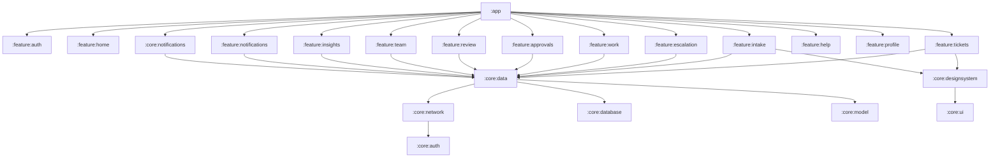
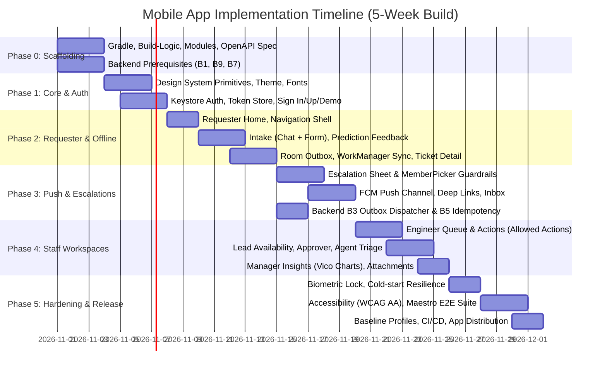
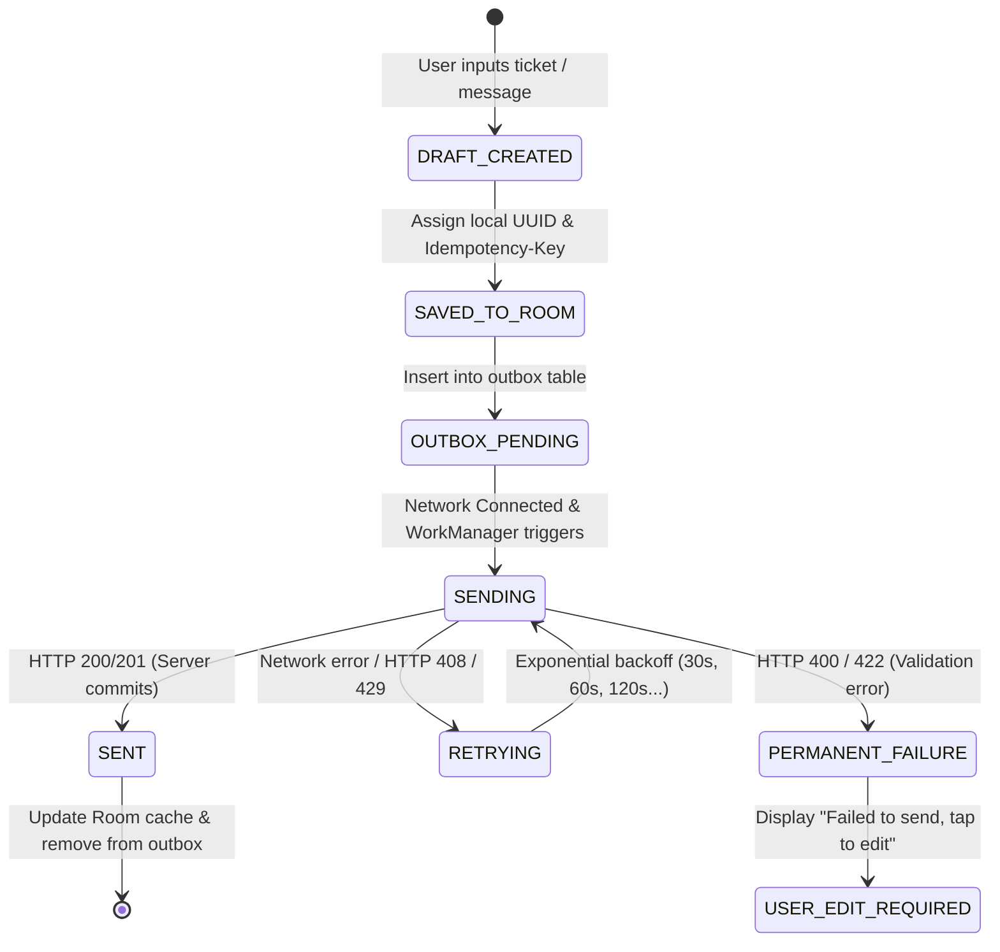

# RouteDesk Mobile App: Phase-Wise Implementation Plan

Companion to [android-app-plan.md](../android-app-plan.md), [backend-changes-for-mobile.md](../backend-changes-for-mobile.md), and [05-end-to-end-flows.md](05-end-to-end-flows.md).

---

## 1. Executive Summary & Architecture Blueprint

The RouteDesk mobile application is a native Android client built with **Kotlin 2.x and Jetpack Compose**, tailored for high-stakes mobile moments: locked-out requesters, urgent escalation responses (30 min for Critical, 2 hr standard), and one-tap approver actions.

### 1.1 Core Principles
1. **Server-Driven Authority**: Routing, SLAs, and escalation eligibility rules are never duplicated on the phone. The UI strictly renders server states (`allowed_actions`, `escalation_eligibility`, `sla_state`).
2. **Offline-Resilient Reads & Queued Writes**: Offline reads via Room; queued writes *strictly* for new tickets and conversation messages with UUID idempotency keys. All status changes and escalations remain online-only.
3. **Zero-Trust Token Security**: Keystore-backed AES-GCM (Tink AEAD) wrapping rotating refresh tokens; biometric re-authentication for staff roles.
4. **Push-First Responsiveness**: FCM HTTP v1 data-only payloads waking high-priority Android notification channels with local fallback sync.

### 1.2 Multi-Module Dependency Graph

---

## 2. Phase-Wise Implementation Roadmap

The implementation is structured into **6 sequential phases** (Phase 0 through Phase 5) spanning 5 focused engineering weeks (post-internship) or executed progressively.

---

### Phase 0: Scaffolding, Tooling & Backend Contracts (Week 1, Days 1–3)

**Objective**: Establish the multi-module build system, contract generator, and core networking foundation so feature development proceeds without blockers.

#### Android Engineering Tasks
1. **Repository Layout**:
   - Initialize `/android` directory inside the repository.
   - Configure Gradle Version Catalog (`gradle/libs.versions.toml`) with Kotlin 2.x, Compose BOM, Coroutines, Room, Retrofit, Hilt, and Roborazzi.
   - Create custom convention plugins in `build-logic`: `android-library`, `android-feature`, `compose`, `hilt`, `room`.
2. **Module Initialization**:
   - Set up core modules: `:core:model`, `:core:network`, `:core:auth`, `:core:database`, `:core:data`, `:core:designsystem`, `:core:ui`, `:core:notifications`, `:core:testing`.
   - Setup initial `:app` shell module with empty `MainActivity`.
3. **OpenAPI Client Generation Pipeline**:
   - Configure `openapi-generator-cli` Gradle task to compile backend `/openapi.json` into typed Kotlin DTOs with `kotlinx.serialization`.
   - Add `:core:network` contract verification step.
4. **Mock Infrastructure**:
   - Build `MockWebServer` dispatcher and mock JSON fixtures mirroring PRD test tickets for independent offline testing.

#### Backend Synchronization Prerequisites
- **B9 (`GET /app-config`)**: Expose min version code, feature flags, status banner, and business hours.
- **B7 (`assetlinks.json`)**: Place digital asset links at `/.well-known/assetlinks.json` for domain verification.

#### Phase 0 Exit Criteria
- `./gradlew assembleDebug testDebugUnitTest` runs clean in CI.
- DTOs auto-generate successfully from `openapi.json`.

---

### Phase 1: Design System Primitives & Authentication (Week 1, Days 3–5)

**Objective**: Build pixel-perfect visual primitives matching references 1 & 4, and implement secure token-based authentication.

#### Android Engineering Tasks
1. **Design System & Theming (`:core:designsystem`)**:
   - **Color System**: Implement `Brand` (Nero `#171717`, Concrete `#594542`, Orange `#FD5323`, San `#EEE2D8`), `Neutral` (Paper `#F8F2ED`, Ink `#360A00`), and `Semantic` (Danger, Attention, Warning, Success, Model).
   - **Typography**: Embed Chakra Petch (Light 300, Regular 400, SemiBold 600) and JetBrains Mono 400 in `res/font`.
   - **Shapes & Elevation**: Custom 10dp, 16dp, 24dp shapes; custom ink-tinted soft shadows.
   - **Core Primitives**:
     - `RdButton` (Primary Nero, Accent Orange, Secondary Paper, Link OrangeText, Loading state).
     - `RdTextField` (San/Nero800 background, 2dp Orange focus ring, counter, helper/error).
     - `RdCard`, `RdTile`, `RdListRow`, `RdChip`, `RdSheet`, `RdTopBar`, `RdBottomBar`.
     - `HatchedDivider`, `CropFrame` canvas elements.
2. **Authentication Core (`:core:auth`)**:
   - Keystore-backed AES-256 GCM (`AndroidKeystore` + Google Tink AEAD) wrapping refresh tokens stored in Proto DataStore.
   - In-memory `AccessTokenHolder` with 15-minute expiry.
   - OkHttp `Authenticator` interceptor: automatically handles HTTP 401 by calling `/auth/refresh` and retrying original request; forces sign-out if refresh fails.
   - Custom OkHttp interceptor: attaches `Authorization: Bearer <token>`, `X-Request-ID`, and `User-Agent: RouteDesk-Android/{version}`.
3. **Auth Feature Screens (`:feature:auth`)**:
   - **Splash**: `core-splashscreen` API with Nero background and Orange logo.
   - **Onboarding Carousel**: 3-page swipeable walkthrough with live stats strip calling `GET /kpis/public` (with fallback demo data).
   - **Sign In / Sign Up**: Collapsible hero card with gradient and glass stats, email/password validation, "Forgot Password" link.
   - **Demo Role Picker Sheet**: Instant login shortcuts for Requester, Engineer, Lead, Approver, Agent, and Manager.
   - **Cold Start Warmup**: Non-blocking ping to `/health` on app launch with "Waking up server..." banner after 5s latency.

#### Backend Synchronization Prerequisites
- **B1 (Token Auth)**: Deploy `POST /auth/token`, `POST /auth/demo-token`, `POST /auth/refresh`, and `POST /auth/logout` with `refresh_tokens` table.

#### Phase 1 Exit Criteria
- Roborazzi screenshot test suite passes for all primitives across Light (San) and Dark (Nero) faces.
- User can sign in via demo login, tokens persist securely, and app launches into role-specific home shell.

---

### Phase 2: Requester Flow, Real-Time Predictions & Offline Outbox (Week 2)

**Objective**: Complete the requester's end-to-end journey: raising tickets with live ML prediction, viewing SLA countdowns, messaging, and offline queuing.

#### Android Engineering Tasks
1. **Requester Home (`:feature:home`)**:
   - Status dot banner (healthy vs degraded mode).
   - Greeting header with unread notification bell.
   - Quick Help action tiles (Password reset, VPN, Hardware, Software).
   - "Open Tickets" horizontal pager with compact SLA bars.
   - "Waiting on you" urgent action rows.
2. **Ticket Intake (`:feature:intake`)**:
   - **Segmented Intake Control**: Toggle between **Chat Intake** and **Form Intake**.
   - **Chat Intake**: Conversational bubble interface with typing animation; single call to `POST /predict` on message completion.
   - **Prediction Card**: Renders predicted Category, Confidence (e.g., 94%), Priority, with **"Looks right"** and **"Not quite"** actions.
   - **Feedback Loop**: "Not quite" triggers category override picker (top 3 suggestions + full list) and queues `POST /feedback`.
   - **FAQ Deflection**: Inline FAQ match suggestions with "Did this fix it?" confirmation before submitting.
   - **Form Intake**: Subject, 5,000-character description counter, `blocking_team` switch, attachment preview.
3. **Ticket Confirmation Screen**:
   - Full-screen animated slide-up card showing Ticket ID (mono font), assigned Engineer, Team, First Response SLA, and Expected Resolution time.
   - Explicit handling for Human Review ("Owner named by 30 mins") and Approval-required states.
4. **My Tickets & Ticket Detail Screen (`:feature:tickets`)**:
   - Paging 3 list with Open, Waiting, and Resolved tabs, search query, and category filter chips.
   - Ticket Detail Header: StatusStepper, Priority chip, live `SlaTimer`.
   - Sticky Summary Card: Assigned owner, first response deadline, expandable ETA change history with reasons.
   - Tabs: **Conversation** (bubbles, system audit events, composer) and **Activity** (visual timeline, escalation ladder).
   - Resolved actions: "Confirm resolution" vs "Reopen ticket" with mandatory reason sheet.
5. **Offline Engine & Outbox (`:core:database`, `:core:data`)**:
   - Room `outbox` table tracking: `id`, `payload_type` (TICKET_CREATE, MESSAGE_POST), `payload_json`, `idempotency_key`, `status` (`PENDING`, `SENDING`, `SENT`, `FAILED`), `retry_count`, `last_error`.
   - WorkManager `OutboxSyncWorker`: executes on `NetworkType.CONNECTED` with exponential backoff (starting at 30s).
   - Instant UI optimistic insertion with "Sending..." badge.
6. **Clock Offset & SLA Countdown Engine**:
   - Capture server time from HTTP `Date` header to calculate local drift (`ClockOffset`).
   - Shared `tickerFlow(1 s)` calculating remaining time to resolution without trusting local device clock.

#### Backend Synchronization Prerequisites
- **B4 (`channel="android"`)**: API records mobile channel for analytics.
- **B5 (Message Idempotency)**: Backend honours `Idempotency-Key` on `POST /tickets/{id}/messages`.

#### Phase 2 Exit Criteria
- Requester can draft and submit a ticket offline; ticket automatically posts upon network reconnection with zero duplicates.
- Full intake -> prediction -> confirmation flow completes in under 5 seconds on 4G network.

---

### Phase 3: Push Notifications, Escalations & Inbox (Week 3)

**Objective**: Deliver instant push-to-action capabilities for escalations and approvals, deep linking, and in-app notifications.

#### Android Engineering Tasks
1. **Escalation Intake Sheet (`:feature:escalation`)**:
   - Sheet modal mirroring reference 6:
     - Ticket context box with direct link.
     - **"Escalate to" Picker**: Dynamic `MemberPicker` sheet calling `GET /directory/members?for_ticket={id}`. Displays Team Lead & SD Manager first; disables self, current owner, and members on leave (with one-tap delegate selection).
     - **Reason Chips**: Choice selection ("No response", "Wrong team", "Business-critical", "Deadline at risk", "Other"). "Wrong team" informs user about routing accuracy feedback.
     - **Note Field**: 10–500 character counter.
     - **Preview Card**: Displays calculated response window (30 min for Critical, 2 hr standard) and who will be notified.
   - Enforce server guardrails (`ESCALATION_COOLDOWN`, `ESCALATION_RATE_LIMIT`) by disabling submit button with exact next available timestamp.
2. **Respond to Escalation Screen**:
   - Prominent deadline countdown header (color-coded by urgency).
   - Ticket context, escalation reason, and previous ladder history.
   - Three primary actions:
     - **Accept**: Opens sheet to provide mandatory new ETA.
     - **Reassign**: Select new owner via `MemberPicker` + new ETA.
     - **Decline**: Mandatory decline reason sheet.
   - Concurrency handler: Displays "Already handled by {name}" if `ESCALATION_ALREADY_RESPONDED` (409) is returned.
3. **FCM Push Notification System (`:core:notifications`)**:
   - `FirebaseMessagingService` implementation processing **data-only** payloads.
   - Setup 5 distinct Android Notification Channels:
     1. `escalations`: High importance (heads-up banner, sound).
     2. `approvals`: High importance.
     3. `sla`: High importance for staff, default for requesters.
     4. `ticket_updates`: Default importance.
     5. `system`: Low importance.
   - Notification builder with `VISIBILITY_PRIVATE` masking sensitive ticket text on the lock screen.
   - Ticket grouping: `setGroup("ticket-T-{id}")` with automatic summary grouping on 3+ notifications.
   - Token Lifecycle: Register device via `POST /devices` on sign-in and token refresh; deregister on sign-out.
4. **App Links & Deep Link Router**:
   - Handle incoming URIs (`https://<host>/app/tickets/{id}`, `https://<host>/escalations/{id}`).
   - Signed-out deep-link interception: cache destination, complete authentication, and route directly to target screen.
5. **In-App Notification Inbox (`:feature:notifications`)**:
   - Chronological list grouped by day with unread indicator dots.
   - "Mark all as read" (`POST /notifications/read-all`).
   - Tapping an item navigates to deep link and sets read status.
   - Fallback WorkManager periodic poll (15-min interval) if FCM is unavailable or notifications are disabled.

#### Backend Synchronization Prerequisites
- **B2 (Device Registry)**: `POST /devices` and `DELETE /devices/{id}` endpoints.
- **B3 (Outbox Push Dispatcher)**: Backend transaction writes to `outbox` table with `channel="push"` and dispatches FCM HTTP v1 messages.

#### Phase 3 Exit Criteria
- Escalation triggered on Device A delivers a high-priority push notification to Device B in < 3 seconds.
- Tapping the notification opens the Respond to Escalation screen with live deadline countdown.

---

### Phase 4: Staff Workspaces & Role-Based Actions (Week 4)

**Objective**: Deliver mobile command centers for Engineers, Team Leads, Approvers, Service Desk Agents, and IT Managers.

#### Android Engineering Tasks
1. **Engineer Workspace (`:feature:work`)**:
   - **My Queue**: KPI risk counters (Due today, At risk, Breached), ticket list sorted by SLA urgency.
   - **Staff Ticket Actions** (strictly populated via `allowed_actions`):
     - *Update Status*: Sheet with transition note.
     - *Change ETA*: Reference 6 style date/time picker (business hours enforced), mandatory reason dropdown, preview card.
     - *Request Info*: Question sheet; moves ticket to "Waiting on Requester" and pauses SLA.
     - *Hand Back*: Reason sheet.
     - *Internal Note*: Concrete-tinted toggle bubble ("Staff only").
   - **Concurrency / Optimistic Locking**: Send `version` with each mutation; show "Ticket state changed" banner on `STALE_VERSION` and refetch state.
2. **Approver Workspace (`:feature:approvals`)**:
   - Pending Approvals list with 1-business-day response timer.
   - Decide Screen: Full requester justification, hardware/software purchase details, one-tap **Approve** (optional note) and **Reject** (mandatory reason).
3. **Team Lead Workspace (`:feature:team`)**:
   - SLA Warnings view highlighting tickets with >75% time consumed.
   - Team ticket list grouped by status.
   - Reassign Action: Reassign ticket with `MemberPicker` and optional ETA update.
   - Team Availability & Workload Radar: View member active tickets, shift status, and skills.
4. **Service Desk Agent Triage (`:feature:review`)**:
   - Review Queue: Confidence score bar, reason badges (`low_confidence`, `multi_issue`, `model_unavailable`), countdown to 30-min SLA promise.
   - Triage Screen: `PredictionPanel` top 3 categories, category/priority override dropdowns, assignment suggestion engine (`GET /assignment-suggestion`), single-tap "Accept and Assign".
5. **Manager Insights (`:feature:insights`)**:
   - 8 KPI tiles in 2-column grid: Auto-route rate, Review accuracy, Override rate, Confidence, SLA compliance, Escalation rate, MTTR, Hours saved.
   - Vico Compose Charts: Auto-route rate over time (line), SLA compliance by team (bar), Escalations by reason (bar).
6. **Ticket Attachments (`:core:ui`, Should - B6)**:
   - System Photo Picker (`PickVisualMedia`) & Camera contract (`TakePicture`) with client-side EXIF stripping.
   - Upload via `POST /tickets/{id}/attachments` (max 10MB, images & PDF).
   - Coil 3 image viewer with zoom sheet.

#### Backend Synchronization Prerequisites
- **B6 (Attachments)**: Multipart file upload to R2/Supabase private bucket with signed URLs.

#### Phase 4 Exit Criteria
- All 6 role home states and action permissions correctly reflect server RBAC.
- Stale version concurrency conflicts gracefully recover without lost form inputs.

---

### Phase 5: Hardening, Polish, Security & Release Readiness (Week 5)

**Objective**: Complete security hardening, WCAG accessibility, performance optimization, automated E2E tests, and release candidate distribution.

#### Android Engineering Tasks
1. **Security & Privacy Hardening**:
   - **Biometric Gate (`androidx.biometric`)**: Default ON for staff roles; prompts for biometric unlock on app launch and after >5 minutes in background.
   - **Window Privacy**: Enable `FLAG_SECURE` on authentication screens containing sensitive credentials.
   - **Zero PII Logging**: Ensure Timber release tree strips info/debug logs; configure Crashlytics to exclude ticket text and user email.
   - **Account Deletion Flow**: In-app "Delete My Account" flow in Profile (`DELETE /auth/me`) complying with Google Play policy.
2. **Resilience & Degraded Mode Handling**:
   - Render cold-start interceptor: ping `/health` on app launch; show friendly waking animation.
   - Handle `MODEL_UNAVAILABLE`: hide prediction card on intake and display "Routing by human review" notice.
   - Handle network dropouts: persistent offline indicator bar with retry trigger.
3. **Accessibility Audit (WCAG 2.2 AA)**:
   - Verify minimum 48dp touch targets on all interactive elements.
   - Validate 200% font scaling reflow without overlapping or truncated text.
   - TalkBack pass: provide meaningful content descriptions on all action icons; merge `TicketCard` semantics into coherent audio summaries.
4. **Performance & Baseline Profiles (`:benchmark`)**:
   - Generate Baseline Profiles using Macrobenchmark to ensure cold start < 1.5s on mid-range devices.
   - Enable R8 full mode shrinking to meet the < 12 MB APK size limit.
5. **Automated Maestro E2E Flows (`/android/maestro/`)**:
   - `flow_1_requester_intake.yaml`: Login -> Chat intake -> Submit -> Verify confirmation details.
   - `flow_2_escalation_lifecycle.yaml`: Escalate ticket -> Push received -> Accept with new ETA -> Verify requester timeline.
   - `flow_3_engineer_triage.yaml`: Filter queue -> Change ETA with reason -> Verify SLA countdown.
   - `flow_4_offline_outbox.yaml`: Airplane mode -> Submit ticket -> Disable airplane mode -> Confirm ticket created.
6. **CI/CD Pipelines & Release Distribution**:
   - Setup GitHub Actions workflows:
     - `android-ci.yml`: Spotless, Detekt, Lint, Robolectric tests, Roborazzi verify, debug APK build.
     - `android-contract.yml`: Trigger on backend OpenAPI changes to ensure client DTO parity.
     - `android-release.yml`: Tagged build, signing via GitHub Secrets keystore, AAB compilation, upload mapping to Crashlytics, and deployment to **Firebase App Distribution**.

#### Backend Synchronization Prerequisites
- **B8 (Account Deletion)**: `DELETE /auth/me` deactivates requester accounts and removes refresh tokens/devices.
- **B10 (ETags - Could)**: Support `If-None-Match` on ticket details.

#### Phase 5 Exit Criteria
- Cold startup time < 1.5s; APK size < 12 MB; zero ANRs.
- Maestro E2E automated test suite passes 100% against staging environment.
- Release candidate AAB distributed to internal testers via Firebase App Distribution.

---

## 3. Backend Synchronization Matrix

| Phase | Backend Item | Endpoint / Component | Effort | Mobile Impact / Fallback if Delayed |
| :--- | :--- | :--- | :--- | :--- |
| **Phase 0** | **B9** App Config | `GET /app-config` | 1 hour | App uses bundled defaults (`min_version=1`, `status="ok"`). |
| **Phase 0** | **B7** Asset Links | `/.well-known/assetlinks.json` | 30 min | Deep links fall back to standard intent chooser instead of direct app open. |
| **Phase 1** | **B1** Token Auth | `POST /auth/token`, `/refresh`, `/demo-token` | 1 day | **Hard Blocker for Mobile Auth**. Can temporarily use Cookie jar in OkHttp for local dev. |
| **Phase 2** | **B4** Mobile Channel | `TicketCreateIn.channel = "android"` | 15 min | Minor; analytics won't distinguish Android source. |
| **Phase 2** | **B5** Idempotency | `Idempotency-Key` on `/tickets/{id}/messages` | 1 hour | Offline message retry risks duplicate comments on flaky networks. |
| **Phase 3** | **B2** Device Registry | `POST /devices`, `DELETE /devices/{id}` | 0.5 day | Push tokens cannot be registered; notifications blocked. |
| **Phase 3** | **B3** Push Outbox | Outbox worker FCM HTTP v1 dispatch | 1 day | App relies on in-app 15-min background sync fallback. |
| **Phase 4** | **B6** Attachments | `POST /tickets/{id}/attachments` (R2/Supabase) | 1.5 days | Attachment buttons hidden via B9 feature flag (`features.attachments: false`). |
| **Phase 5** | **B8** Account Deletion | `DELETE /auth/me` | 0.5 day | Required only for public Google Play release (not required for Firebase App Distribution). |
| **Phase 5** | **B10** ETags | `ETag` / `If-None-Match` (304) | 0.5 day | App always downloads full ticket JSON (minor network overhead). |
| **Phase 5** | **B11** Password Reset | `POST /auth/password-reset/*` | 0.5 day | "Forgot Password" opens web help desk reset page in Chrome Custom Tab. |

---

## 4. Concurrency, Offline & State Machine Mechanics

### 4.1 Offline Outbox State Machine

### 4.2 Error Handling & State Conflict Resolution

| API Error Code | HTTP Status | App Handling & UI Presentation |
| :--- | :--- | :--- |
| `AUTH_REQUIRED` / `AUTH_INVALID` | 401 | Interceptor executes one refresh attempt. If failed, clears session, routes to Sign-In with toast, preserving deep-link. |
| `STALE_VERSION` | 409 | Keeps open mutation sheet; refetches ticket state; shows banner: *"Ticket was updated by another team member. Please verify and retry."* |
| `ESCALATION_ALREADY_RESPONDED` | 409 | Refetches escalation; replaces action buttons with *"Handled by {responder_name} at {time}"*. |
| `ESCALATION_COOLDOWN` / `RATE_LIMIT` | 429 | Disables Escalate button; displays countdown: *"Eligible to escalate again at {formatted_time}"*. |
| `MODEL_UNAVAILABLE` | 503 | Hides prediction card; shows *"Routing automatically via manual review desk"*; allows submission to proceed. |
| Server Cold Start (> 5s) | N/A | Displays animated toast: *"Waking up server instance (free-tier cold start, ~30s)..."*; expands OkHttp timeout to 60s. |

---

## 5. Scope Management & Cut Lines

To guarantee high quality on schedule, features are categorized into strict priority tiers:

### Never Cut (Core MVP)
- Token authentication + Demo Role switcher.
- Requester ticket creation with live ML prediction & "Looks right" / "Not quite" feedback.
- Ticket confirmation with assignee, team, and SLA targets in < 5s.
- Ticket details with live SLA countdown and conversation messages.
- Escalation intake with server guardrails & Respond to Escalation.
- FCM push notifications for escalations and approvals.
- Offline drafting and queued outbox for tickets and messages.

### Should Have (Cut only under heavy delay)
- Photo / Screenshot attachments (B6).
- Biometric lock for staff roles.
- Team Lead availability and workload overview.
- Google Play Store public listing (fallback to Firebase App Distribution).

### Could Have (Cut First if needed)
- Home screen widget ("My Open Tickets" Glance).
- Voice dictation for chat intake.
- Dark theme for main app screens (retain dark face for onboarding/auth only).
- Advanced Manager charts (retain numeric KPI tiles).
- Swipe-to-triage gestures.
- Shared-element transition animations.

---

## 6. Definition of Done (DoD) per Phase

Each phase must satisfy the following checklist before proceeding:
- [ ] **Code Quality**: Detekt, ktlint, and Android Lint report zero errors.
- [ ] **Test Coverage**: >80% line coverage across ViewModels and Repositories; Robolectric tests for all screen states.
- [ ] **UI Fidelity**: Roborazzi screenshot tests match design tokens across Light and Dark faces at 100% and 200% font scales.
- [ ] **Contract Integrity**: OpenAPI client matches backend JSON schema without runtime serialization failures.
- [ ] **Network Gracefulness**: Validated on poor network (3G simulation) and offline transitions.
- [ ] **Documentation**: Updated module READMEs and API integration notes.
