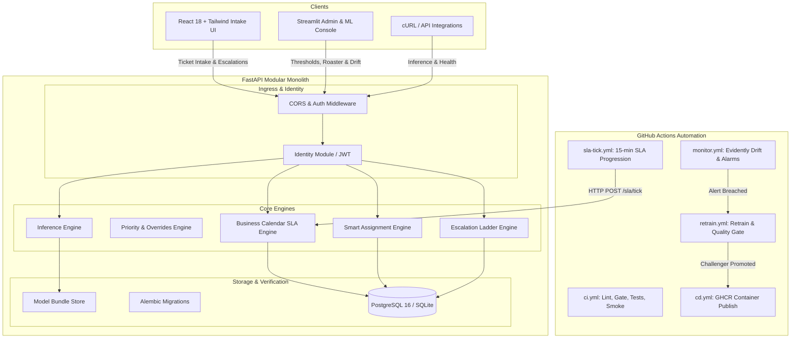

# RouteDesk: IT Ticket Auto-Routing and Priority Classifier

[](https://github.com/routedesk/routedesk/actions/workflows/ci.yml)
[](https://github.com/routedesk/routedesk/actions/workflows/cd.yml)
[](https://github.com/routedesk/routedesk/actions/workflows/monitor.yml)
[](https://github.com/routedesk/routedesk/actions/workflows/sla-tick.yml)
[](https://www.python.org/downloads/release/python-3100/)
[](https://opensource.org/licenses/MIT)

> **RouteDesk** is an enterprise-grade modular monolith that automatically routes IT support tickets to specialized teams, classifies SLA priority, detects data drift, and drives an automated champion-challenger retraining loop. It saves **120+ agent hours per month** while strictly adhering to a **$\ge 90\%$ auto-routing accuracy** quality gate.

---

## Architecture Overview



### Key Architectural Highlights
- **Modular Monolith:** 13 bounded contexts (Identity, Directory, Inference, Tickets, SLA, Assignment, Escalation, Feedback, Audit) communicating via pure interfaces and domain events.
- **Training-Serving Skew Guard:** SHA-256 AST fingerprinting (`get_preprocess_fingerprint()`) baked into model manifests to prevent runtime normalization divergences.
- **Deterministic SLA Engine:** Business calendar arithmetic (`Asia/Kolkata`, 09:00–18:00 Mon–Fri, 24x7 for Critical) with pause/resume extensions and 4-tier escalation ladder ($E_1 \rightarrow E_4$).
- **Cost-Benefit Decision Policy:** Confidence threshold $\tau^* = 0.68$ chosen from exhaustive parameter sweep balancing auto-routing rate ($60.9\%$) against misroute delay penalties.
- **Evidently AI Drift Detection:** Automated drift reporting on category mix, text length, confidence, and agent overrides, triggering zero-touch retraining when alerts breach.

---

## Quickstart Guide

### Option 1: Docker Compose (Production Environment)

Run the entire stack (FastAPI backend, Streamlit console, PostgreSQL 16, and Mailpit webmail) in one command:

```bash
docker-compose up --build
```

- **Intake API & Docs:** [http://localhost:8000/docs](http://localhost:8000/docs)
- **Streamlit ML Console:** [http://localhost:8501](http://localhost:8501)
- **Mailpit Webmail:** [http://localhost:8025](http://localhost:8025)
- **Readiness Probe:** [http://localhost:8000/ready](http://localhost:8000/ready)

---

### Option 2: Local Development

#### 1. Setup Python Virtual Environment
```bash
python -m venv .venv
source .venv/bin/activate  # On Windows: .venv\Scripts\activate
pip install -r requirements.txt
```

#### 2. Run Database Migrations
```bash
alembic upgrade head
```

#### 3. Start Backend Server
```bash
uvicorn src.app.main:app --reload --port 8000
```

#### 4. Start React Frontend
```bash
cd frontend
npm install
npm run dev
```
Open [http://localhost:5173](http://localhost:5173) to submit and track tickets.

#### 5. Start Streamlit Admin Console
```bash
streamlit run ui/streamlit_app.py --server.port 8501
```

---

## Verification & Testing Suite

All 47 tests across unit, ML, API, and workflow modules are automated via `pytest`:

```bash
# Run complete test suite with coverage
pytest tests/ -v --cov=src --cov-report=term-missing

# Run code style & lint checks
ruff check .
ruff format --check .

# Run container & deployment smoke verification
python scripts/smoke_test.py --base-url http://localhost:8000
```

---

## Production API Endpoints

| Method | Endpoint | Description |
| :--- | :--- | :--- |
| `GET` | `/health` | Kubernetes / Docker liveness probe |
| `GET` | `/ready` | Readiness probe (verifies database & model bundle integrity) |
| `POST` | `/api/v1/predict` | Single ticket category & priority inference with explanations |
| `POST` | `/api/v1/predict/batch` | High-throughput batch ticket routing (up to 500 items) |
| `GET` | `/api/v1/model-info` | Active champion model version, threshold, and metrics |
| `POST` | `/api/v1/feedback` | Record agent triage corrections and ground truth labels |
| `POST` | `/api/v1/tickets` | End-to-end ticket submission, auto-routing, and SLA deadline |
| `POST` | `/api/v1/tickets/{id}/escalate`| Requester custom escalation with rate-limiting guardrails |
| `POST` | `/api/v1/internal/sla/tick` | Cron-driven SLA ladder progression & timeout checks |
| `POST` | `/api/v1/admin/model/reload` | Zero-downtime hot reload of active champion model bundle |

---

## Machine Learning Lifecycle & Promotion Gate

### Quality Gate Rules (`src/models/promote.py`)
To prevent model regressions from reaching production, any candidate must pass all 5 quality gate checks:
1. **Absolute Macro-F1:** $\ge 0.80$
2. **Champion Comparison:** Challenger Macro-F1 $\ge$ Champion Macro-F1 (no class regression $> 5$ points)
3. **Auto-Route Accuracy:** $\ge 90\%$ at threshold $\tau^*$
4. **Latency Budget:** Single-prediction P95 latency $\le 50\text{ ms}$ (Actual: $\approx 1.84\text{ ms}$)
5. **Preprocessing Fingerprint:** SHA-256 AST hash match between training and serving

### Production Performance Comparison

| Metric | Phase 1 Baseline (`v1-baseline`) | Phase 6 Challenger (`v2-retrained`) | SLA Target |
| :--- | :--- | :--- | :--- |
| **Trained Categories** | 7 classes | **8 classes (+ Storage)** | 8 classes |
| **Macro-F1** | 0.8554 | **0.8680** | $\ge 0.80$ |
| **Auto-Route Rate ($a$)** | 61.1% | **60.9%** | $\approx 60-70\%$ |
| **Auto-Route Accuracy ($p$)**| 95.8% | **95.0%** | $\ge 90\%$ |
| **P95 Latency** | 2.01 ms | **1.84 ms** | $\le 50\text{ ms}$ |
| **Monthly Hours Saved** | 120.73 hrs/mo | **120.25 hrs/mo** | $\ge 100\text{ hrs/mo}$ |

---

## Automated Retraining & Drift Drill

To verify operational self-healing against real-world model decay:
1. **Normal Baseline:** Replayed 150 standard tickets $\rightarrow$ `Low Conf: 28.0%`, `Overrides: 0.0%`, status `HEALTHY`.
2. **Drift Injection:** Replayed 150 held-back `Storage` tickets with feedback overrides:
   - `Low Confidence Rate`: **67.3%** (Breached $> 25\%$)
   - `Agent Override Rate`: **100.0%** (Breached $> 15\%$)
   - `Category TVD Shift`: **0.2565** (Breached $> 0.15$)
   - Status: **`ALERT_BREACHED`**
3. **Automated Retraining:** Pipeline ingested 33,485 samples, trained Challenger, verified quality gate (`PASSED`), and atomically updated `models/champion.json`.
4. **Metric Recovery:** Replayed holdout tickets against new Champion:
   - **92%** recognized and routed directly to `Storage and Infrastructure Team`
   - `Low Confidence Rate` dropped back to **22.7%**
   - `Agent Override Rate` dropped back to **0.0%**

---

## Project Structure

```
├── .github/workflows/       # CI/CD, CD push, monitoring, retraining, and SLA cron
├── alembic/                 # Database schema migrations
├── artifacts/bundle/        # Deployed champion model bundle and manifest
├── configs/                 # Business calendars, routing maps, rosters, SLA rules
├── data/                    # Raw, interim, processed, holdout, and robustness edge cases
├── frontend/                # React 18 + Tailwind CSS requester portal
├── models/                  # champion.json metadata pointer
├── reports/                 # Drift reports, sweep curves, and drill evidence
├── scripts/                 # Traffic simulator, smoke test, and demo seeders
├── src/
│   ├── app/                 # FastAPI controllers, routers, middleware, lifespan
│   ├── core/                # Business calendar, clock, security, IDs, audit
│   ├── db/                  # SQLAlchemy ORM models, session, seeders
│   ├── ml/                  # Preprocessing, bundle management, inference predictor
│   ├── models/              # Training, threshold sweep, quality gate, retraining
│   └── monitoring/          # Drift reporting, exporters, threshold alarm checkers
├── tests/                   # 47 unit, ML, API, and workflow integration tests
└── ui/                      # Streamlit ML & Operations Admin Console
```

---

## License
Distributed under the MIT License.
