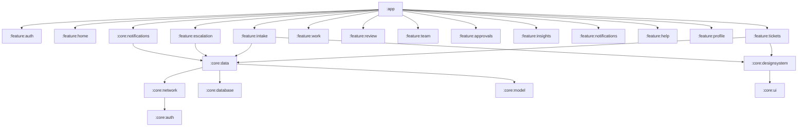
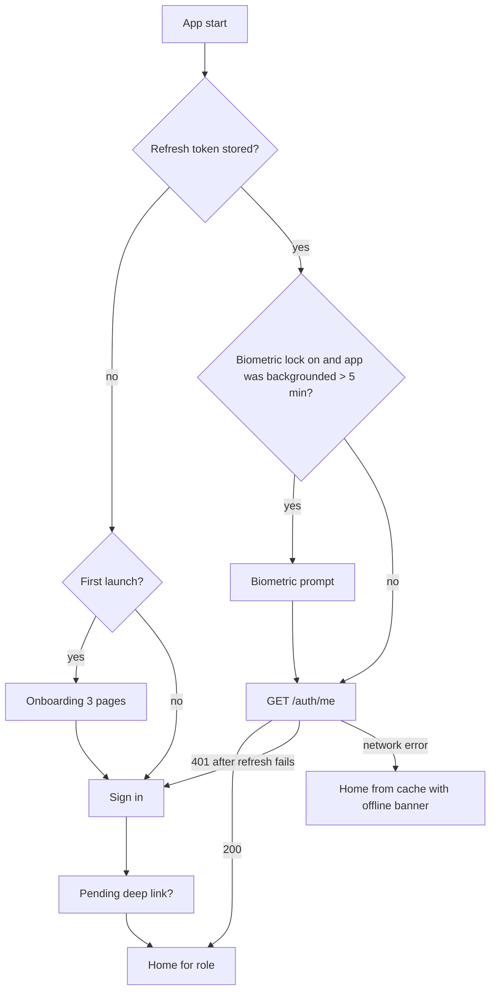
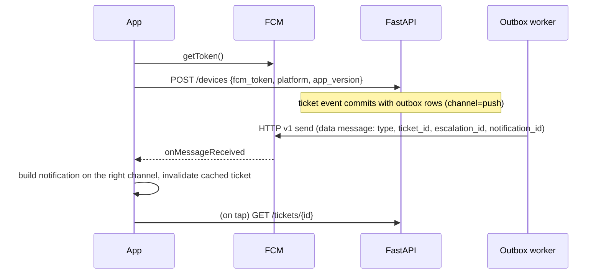

# Android App Plan: IT Ticket Auto-Routing and Priority Classifier

Companion to the PRD (v1.1), the [frontend plan](../frontend/frontend-plan.md) and the [production design](../architecture/README.md) | Draft 1 | October 20, 2026

This plan covers everything needed to build, ship and run a native Android app on top of the existing `/api/v1` backend: scope per role, stack, architecture, design system, every screen, data and offline behaviour, auth and security, push notifications, testing, CI/CD, Play Store release, privacy, schedule and risks. Backend changes the app needs are listed separately in [backend-changes-for-mobile.md](backend-changes-for-mobile.md), because the architecture thread owns that design.

---

## 1. Summary and decisions

**What we are building.** A native Android app, working name **RouteDesk** (same placeholder as the web app), that lets people raise and track IT tickets, escalate to a chosen person, and lets staff act on their queue from their phone. It uses the same backend, the same model, the same rules and the same design language as the React web app. Nothing about routing, SLA or escalation logic is re-implemented on the phone: the app renders what the API returns (`allowed_actions`, `escalation_eligibility`, `sla_state`, `review_reason`).

**Why a phone app is worth it for this product.** The three moments that matter most in the PRD are mobile moments: a requester who is locked out of their laptop and cannot use the web portal (password reset, VPN, hardware failure), a chosen member who must respond to an escalation inside 2 business hours (30 minutes for Critical), and an approver who blocks the SLA clock until they tap Approve. Push notifications and a lock-screen-to-action path cut those response times in a way the web app cannot.

**Decisions taken in this plan** (defaults; change any of them before the build starts):

| # | Decision | Choice | Why |
| --- | --- | --- | --- |
| D1 | Platform and stack | **Native Kotlin + Jetpack Compose**, Material 3 as the base, fully re-themed | Android only was asked for; Compose gives full control to match the references (pill buttons, frosted tiles, floating nav) with no web-view look; first-class FCM, WorkManager, Keystore, App Links and accessibility. Section 3.1 explains why not Flutter or React Native |
| D2 | Where it fits in the schedule | **Post-internship**, a 5-week build after Day 22 | The PRD's 22 days are full and mobile is not in its scope. Only zero-cost groundwork happens during the internship (section 17) |
| D3 | Roles in v1 | Requester (full), Engineer, Team Lead, Approver, chosen escalation member, Agent (light), Manager (read-only KPIs). **Platform Admin stays on the Streamlit console** | Admin work (thresholds, routing map, retraining) is desk work and already has a home |
| D4 | Auth | **Short-lived access token + rotating refresh token** for mobile, alongside the web's cookie session | Cookies work in OkHttp but tokens are the standard, safer model for a native client; needs 3 new endpoints |
| D5 | Real-time | **Firebase Cloud Messaging** (free) for push, plus pull-to-refresh and foreground polling | No WebSocket server on a free tier that sleeps |
| D6 | Offline | **Offline-first reads** (Room cache), **queued writes only for new tickets and messages** (idempotency key already exists); every other action needs a connection | Status, ETA, escalation and approval actions depend on server rules and races; queueing them offline would surprise people |
| D7 | Distribution | **Firebase App Distribution** (free) for testing and the demo; **Google Play** only if the firm wants a public listing (one-time $25 developer fee, outside the PRD's "no paid services" rule) | Keeps the free-tier rule until someone decides otherwise |
| D8 | Min / target SDK | **minSdk 26 (Android 8.0)**, targetSdk = the level Google Play requires at release (API 36 expected for late 2026; confirm in Play Console) | minSdk 26 covers roughly 95%+ of active devices and gives java.time, adaptive icons and notification channels natively |
| D9 | Theme | Dark "Nero" face for splash, onboarding and sign-in; warm light "San" face for the app. A dark app theme is a Could item | Same split as the web app and the references |

---

## 2. Scope

### 2.1 What each role can do on the phone

| Role | On Android v1 | Stays web-only |
| --- | --- | --- |
| **Requester** | Everything: home, raise ticket (chat and form), live prediction with "Not quite", confirmation with assignee and ETA, my tickets, status page with timeline and messages, reply to "request info", confirm or reopen, escalate with guardrails, track escalation, notifications, FAQ | Nothing |
| **Resolver Engineer** | My queue sorted by SLA risk, staff ticket view, update status, change ETA (reason required), request info, hand back, message requester and internal notes, respond to escalations aimed at them | Full audit log search |
| **Team Lead** | SLA-warning list, team tickets, reassign via member picker, escalation board (list form), respond to escalations, team availability and workload | Kanban drag-and-drop board |
| **Approver** | Pending approvals, approve / reject with reason, history | Nothing |
| **Chosen member (any staff role)** | Respond to escalation: Accept with new ETA, Reassign, Decline with reason | Nothing |
| **Service Desk Agent** | Human Review queue as cards, triage (accept, correct category / priority, assign with engine suggestion) | Batch predict, keyboard-driven review |
| **SD / IT Delivery Manager** | KPI tiles and 3 compact charts, breaches list, escalation board | Hours-saved calculator inputs, full chart set |
| **Platform Admin** | Sign-in shows a card linking to the Streamlit console in the browser | All ML console pages |

### 2.2 Mobile-only features (not in the web app)

| Feature | Value | Priority |
| --- | --- | --- |
| Push notifications with action routing (escalation, approval, request info, ETA changed, resolved) | Faster responses to escalations and approvals | Must |
| Deep links and App Links (`https://<host>/app/tickets/T-1042` opens the app) | Email notification links open the right screen | Must |
| Offline ticket draft and send queue | Raise a ticket from a lift, a basement, or with Wi-Fi down, which is often the reason for the ticket | Must |
| Photo or screenshot attachment from camera / gallery | "My screen shows this error" is common for hardware and software tickets | Should (needs backend attachment endpoint) |
| Biometric re-unlock | Staff apps hold internal ticket data | Should |
| Home-screen widget "My open tickets" (Glance) | Glanceable ETA without opening the app | Could |
| Voice input in chat intake (Android speech recogniser, on-device) | Reference 5's mic button; hands-free | Could |
| Quick settings / app shortcuts ("Raise ticket", "My queue") | One tap to the most common action | Could |

### 2.3 Out of scope for v1

iOS app, tablets beyond "it scales" (no dedicated two-pane layouts, though section 9 keeps window-size classes ready), Wear OS, multi-language (PRD is English only), on-device ML (the model stays server-side; the phone never needs it), the admin ML console, payments, chat with a live bot beyond the prediction card.

---

## 3. Technology stack

### 3.1 Why native Kotlin and not cross-platform

| Option | For | Against | Verdict |
| --- | --- | --- | --- |
| **Kotlin + Jetpack Compose** | Google's current default; full control of visuals; best FCM, WorkManager, Keystore, accessibility and Play tooling; easiest path to baseline profiles and small APK | Android only; no code shared with the React app | **Chosen** |
| React Native (Expo) | Could share TypeScript types, zod schemas and API client with the web app | Bridges for FCM, background work and secure storage; harder to reach the reference look precisely; a second JS toolchain on top of Vite | Good choice only if iOS is planned soon |
| Flutter | One codebase for iOS too; strong custom UI | Dart is a third language in a Python + TS project; nothing to share with the web app | Not chosen |
| PWA / Trusted Web Activity | Almost free: wrap the React app | Push on Android works but is weaker; offline drafts and lock-screen actions are limited; does not feel native | Keep as a **fallback** if the native app is cut (section 18) |

If iOS becomes a requirement within 6 months, revisit: Kotlin Multiplatform can share the `core:model`, `core:network` and `core:data` modules later without rewriting the UI decision.

### 3.2 Libraries

Use the latest stable versions at project start, pinned in `gradle/libs.versions.toml`, with Renovate or Dependabot opening update PRs.

| Concern | Choice | Notes |
| --- | --- | --- |
| Language / build | Kotlin 2.x, Gradle Kotlin DSL, version catalog, convention plugins in `build-logic/` | K2 compiler, Compose compiler plugin |
| UI | Jetpack Compose (BOM), Material 3, `material-icons-extended` replaced by a curated icon set (section 5.6) | Material 3 only as the component base; all colours, type and shapes are ours |
| Navigation | Navigation Compose with type-safe routes (`@Serializable` destinations) | Deep links declared on destinations |
| DI | Hilt | `@HiltViewModel`, WorkManager integration |
| Async | Kotlin coroutines + Flow | `StateFlow` UI state, `SharedFlow` one-off events |
| Networking | Retrofit + OkHttp + kotlinx.serialization converter | OkHttp authenticator for token refresh; logging interceptor in debug only |
| API types | Generated from the backend's OpenAPI schema with `openapi-generator` (kotlin, kotlinx-serialization, models only) | Same contract check idea as the web's `openapi-typescript` |
| Local DB | Room (KSP) | Ticket cache, drafts, outbox, notifications |
| Preferences | DataStore (Proto) | Settings, onboarding flags, last role |
| Secrets at rest | Android Keystore + Tink (AEAD) wrapping the refresh token in DataStore | `EncryptedSharedPreferences` is deprecated; do not use it |
| Background work | WorkManager | Sending queued tickets and messages, periodic notification sync fallback |
| Paging | Paging 3 with `RemoteMediator` | Cursor pagination from `GET /tickets` and `/notifications` |
| Images | Coil 3 | Avatars, attachments |
| Push | Firebase Cloud Messaging | Data messages only (section 10) |
| Crash reporting | Firebase Crashlytics | Free; no ticket text in logs or keys |
| Logging | Timber | Release tree drops debug and info |
| Charts (manager screen) | Vico (Compose-native charts) | Small, themeable; three chart types only |
| Widget (Could) | Jetpack Glance | |
| Biometric | `androidx.biometric` | Class 3 or device credential |
| Camera / picker | Photo Picker (`PickVisualMedia`), no storage permission | Camera via `TakePicture` contract |
| Testing | JUnit 5, MockK, Turbine, kotlinx-coroutines-test, Compose UI test, Roborazzi (screenshots), MockWebServer, Maestro (E2E) | Section 13 |
| Static analysis | Android Lint, detekt, ktlint (via Spotless) | Fail CI on new warnings |
| Performance | Baseline Profiles + Macrobenchmark, R8 full mode | Section 12 |

---

## 4. Architecture

### 4.1 Pattern

Unidirectional data flow (MVVM with immutable UI state), following Google's "Now in Android" app architecture:

```
Composable screen  ──events──▶  ViewModel  ──calls──▶  Repository  ──▶  Room (source of truth for reads)
      ▲                             │                       │
      └──── StateFlow<UiState> ◀────┘                       └──▶  Retrofit API (/api/v1)  ──▶  FastAPI
```

- **Screens** are stateless composables taking `UiState` and lambdas; a thin `Route` composable wires the ViewModel. This makes every screen previewable and screenshot-testable.
- **ViewModels** expose one `StateFlow<XUiState>` (sealed: `Loading`, `Content`, `Error`, plus flags like `isRefreshing`) and handle events. No Android framework types in ViewModels except `SavedStateHandle`.
- **Repositories** own caching rules: reads come from Room as a `Flow`, a refresh call updates Room; writes go to the API and then update Room with the server's response.
- **Use cases** only where logic is shared across features (for example `ObserveSlaCountdown`, `ResolveHomeForRole`).
- **Domain models** in `core:model` are plain Kotlin classes mapped from generated API DTOs, so a backend field rename breaks one mapper, not 20 screens.

### 4.2 Module layout



| Module | Contents |
| --- | --- |
| `:app` | `Application`, `MainActivity`, NavHost, role-based shell, Hilt setup, deep-link intake, FCM service registration |
| `:core:model` | Domain models and enums: `Ticket`, `TicketStatus`, `Priority`, `Category` (8), `Prediction`, `Escalation`, `EscalationEligibility`, `Member`, `Team`, `Notification`, `Role`, `AllowedAction` |
| `:core:network` | Retrofit service interfaces per backend module (identity, inference, tickets, approvals, escalations, directory, notifications, kpis), generated DTOs, `ApiError` parsing of `{code, message, field, details, request_id}`, interceptors (auth, request id, user agent, app version) |
| `:core:auth` | Token store (Keystore + Tink), `AuthRepository`, OkHttp `Authenticator` for refresh, session state `Flow`, biometric gate |
| `:core:database` | Room DB, entities, DAOs, migrations, outbox table for queued writes |
| `:core:data` | Repositories, mappers, sync workers, `ClockOffset` (server time from `Date` header) |
| `:core:designsystem` | Theme (colour, type, shape, spacing tokens), primitives (section 5.4) |
| `:core:ui` | Domain composables (TicketCard, SlaTimer, StatusStepper, PredictionPanel, MemberPicker, ...), error-to-message mapping, preview data |
| `:core:notifications` | `FirebaseMessagingService`, channel setup, notification builders, device-token registration worker |
| `:core:testing` | Fakes for repositories, test dispatchers, fixture JSON copied from the PRD sample tickets |
| `:feature:*` | One per area; each has `navigation/`, `ui/`, `XViewModel` and its tests |
| `build-logic` | Convention plugins: `android-library`, `android-feature`, `compose`, `hilt`, `room`, `jacoco` |
| `:benchmark` | Macrobenchmark and baseline-profile generator |

Feature modules never depend on each other; cross-feature navigation goes through route objects defined in each feature's `navigation` package and wired in `:app`.

### 4.3 Repository layout (new repo or `android/` folder)

Default: an **`android/` folder in the same monorepo** as the API and web app, so the OpenAPI contract check and CI live together. Gradle only runs when `android/**` changes (path filter in the workflow).

```
android/
  app/
  build-logic/
  core/{model,network,auth,database,data,designsystem,ui,notifications,testing}/
  feature/{auth,home,intake,tickets,escalation,work,review,team,approvals,insights,notifications,help,profile}/
  benchmark/
  gradle/libs.versions.toml
  config/detekt.yml
  maestro/             # E2E flows
  README.md
```

---

## 5. Design system in Compose

All tokens match the web plan section 3 so both apps read as one product. The phone references (4, 5, 6) are already mobile mockups, so they translate almost one to one.

### 5.1 How each reference is used on Android

| # | Reference | Android use |
| --- | --- | --- |
| 1 | Login / signup (dark split screen) | Single-column dark sign-in on Nero. The right-hand visual becomes a **top hero card** (Orange → Concrete → Nero gradient, rotated rounded squares, two tags, a glass stat card) that collapses when the keyboard opens. Social buttons become Microsoft / Google SSO (later) and **Demo login** |
| 2 | Typography | Chakra Petch 300 / 400 / 600 bundled in `res/font`, JetBrains Mono 400 for IDs and timers; ink `#360A00` on Paper for display headings |
| 3 | Colour palette | `RouteDeskColors` tokens (5.2) |
| 4 | Mobile dashboard | **Home** for every role: status dot line, greeting, Nero bell button with Orange badge, tile row, horizontal card row, list rows with chevrons, chip row, and the **floating bottom bar with the Orange centre "+"** |
| 5 | Chat + FAQ | **Chat intake**, ticket **conversation** tab, attachment rows, FAQ rows; the header pill becomes a ticket switcher on the conversation screen |
| 6 | New automation form | **Escalate** bottom sheet / full screen, **Respond to escalation**, **Change ETA**, and the preview card with a check; also the pattern for Approve / Reject and Reassign forms |
| 7 | Hero section | **Onboarding** (3 swipeable pages on Nero with the hatched divider and crop marks) and the splash; the stats strip becomes the onboarding's last page ("68% routed automatically") using `GET /kpis/public` |

### 5.2 Colour tokens

```kotlin
// core/designsystem/theme/Color.kt
object Brand {
    val Nero = Color(0xFF171717)
    val Concrete = Color(0xFF594542)
    val Orange = Color(0xFFFD5323)
    val San = Color(0xFFEEE2D8)
}
object Neutral {
    val Paper = Color(0xFFF8F2ED)      // cards on San
    val Ink = Color(0xFF360A00)        // display headings on light
    val Nero800 = Color(0xFF202020)    // inputs and cards on dark
    val Nero700 = Color(0xFF2A2A2A)    // borders, hatch strokes on dark
    val MutedLight = Color(0xFF6B5A55)
    val MutedDark = Color(0xFFA8958E)
    val LineLight = Color(0xFFE2D3C7)
    val OrangeText = Color(0xFFB83A12) // orange text or links on light (5.2:1 on Paper)
}
data class StatusColor(val fg: Color, val tint: Color)
object Semantic {
    val Danger = StatusColor(Color(0xFFB42318), Color(0xFFF9E1DC))   // Critical, breached, decline
    val Attention = StatusColor(Neutral.OrangeText, Color(0xFFFDE3D8)) // High, escalated
    val Warning = StatusColor(Color(0xFF8A5A00), Color(0xFFF6E7C8))  // at risk, awaiting approval
    val Success = StatusColor(Color(0xFF2E7D32), Color(0xFFDDEBDD))  // resolved, on track, auto-routed
    val Model = StatusColor(Color(0xFF7D5A9B), Color(0xFFE9E0F0))    // prediction chips
    val Neutral = StatusColor(Brand.Concrete, Brand.San)              // Low, closed, off shift
}
```

Mapped into a Material 3 `lightColorScheme` (background San, surface Paper, primary Nero, onPrimary San, secondary Concrete, tertiary Orange, error Danger.fg) and a `darkColorScheme` for the Nero face, plus a `LocalRouteDeskColors` composition local for tokens Material has no slot for. **Dynamic colour (Material You) is off**: the brand must look the same on every phone.

Contrast rules carried over from the web plan: Orange is a fill, never text on light (use `OrangeText`); text on Orange fills is Nero; white on Orange only for the "+" icon and bold 19sp+; every status colour comes with an icon or label.

Priority, decision and SLA mappings are identical to the web: Critical = Danger, High = Attention, Medium = Warning, Low = Neutral; `auto_route` = Success "Auto-routed", `human_review` = Model "In review"; SLA bar green < 50%, amber 50 to 75%, orange 75 to 100%, red breached.

### 5.3 Typography, shape, spacing

| Style | Font / weight | Size / line height (sp) | M3 slot |
| --- | --- | --- | --- |
| Display (onboarding headline) | Chakra Petch Light 300 | 40 / 44 | `displayMedium` |
| Screen title | Chakra Petch SemiBold 600 | 28 / 34 | `headlineMedium` |
| Section title | SemiBold 600 | 20 / 28 | `titleLarge` |
| Card title | SemiBold 600 | 17 / 24 | `titleMedium` |
| Body | Regular 400 | 15 / 22 | `bodyLarge` |
| Body small, helper | Regular 400 | 14 / 20 | `bodyMedium` |
| Label, overline | Regular 400 | 13 / 18 (overline uppercase, +0.06em) | `labelLarge` / `labelSmall` |
| KPI number | SemiBold 600, tabular figures (`fontFeatureSettings = "tnum"`) | 28 / 32 | custom |
| Ticket ID, timer, tag | JetBrains Mono 400 | 13 / 18 | custom `mono` |

- Fonts are **bundled**, not downloadable fonts, so the first launch offline still looks right (about 400 KB total for 4 files; subset to Latin).
- All sizes are in `sp` and the layout is tested at 200% font scale (section 11).
- Shapes: `small` 10dp (inputs, small chips), `medium` 16dp (cards, tiles, list rows), `large` 24dp (sheets, hero card), `full` pill (buttons, chips, nav bar).
- Spacing scale: 4, 8, 12, 16, 20, 24, 32, 40, 56 dp; screen gutter 16dp (20dp at 600dp+ width).
- Elevation: on light, a soft shadow (`0 1 2 / 0 4 16` at 6% Ink) drawn with `Modifier.shadow` tinted Ink; on dark, no shadow and a 1dp Nero700 border.
- Minimum touch target 48dp everywhere, including chips and icon buttons (reference 4's 44px icons get 48dp hit areas).

### 5.4 Primitives (`:core:designsystem`)

| Composable | Variants | Reference |
| --- | --- | --- |
| `RdButton` | `Primary` (Nero fill, San text, pill), `Accent` (Orange, Nero text), `Secondary` (Paper, 1dp line), `Ghost`, `Link` (OrangeText), `LightPill` (on dark); heights 40 / 48 / 56; loading state with spinner and kept width | 1, 6, 7 |
| `RdIconButton` | Square 48dp, radius 14, Paper; `Dark` (Nero, like the bell); `badge` dot or count | 4, 5 |
| `RdFab` | 56dp Orange circle, white "+" | 4 |
| `RdBottomBar` | Floating pill bar, 5 slots, centre slot is `RdFab`; respects gesture-nav insets | 4 |
| `RdTextField` | Filled (San on light, Nero800 on dark), no border until focus, 2dp Orange focus ring, label above, helper / error / counter below | 1, 6 |
| `RdDropdown` / `RdPicker` | Pill trigger with chevron opening a bottom sheet list | 6 |
| `RdChip` | Semantic tinted chip with leading icon; `Tag` (small rectangle); `Choice` (segmented reason chips) | 1, 4 |
| `RdCard` | Paper, radius 16, soft shadow, `onClick` variant with ripple in Concrete at 8% | 4 |
| `RdTile` | Square card, circular coloured icon, uppercase label | 4 |
| `RdListRow` | Title, meta, trailing chevron or arrow-up-right | 4, 5 |
| `RdSegmented` | Pill segments on San | |
| `RdSheet` | `ModalBottomSheet` restyled: Paper, radius 24 top, drag handle in LineLight | 6 |
| `RdSnackbar` | Nero surface, San text, Orange left bar for important events | |
| `RdAvatar`, `RdAvatarStack` | Initials on Concrete, presence dot (green on shift, grey off shift, amber on leave) | 6 |
| `RdProgressBar` | 6dp track on San, semantic fill | |
| `RdDividerWithLabel` | "or" divider | 1 |
| `HatchedDivider`, `CropFrame` | Canvas-drawn, for onboarding and splash | 7 |
| `RdEmptyState`, `RdErrorState` | Line icon, one sentence, one action | |
| `RdSkeleton` | Shimmer on San (disabled when "Remove animations" is on) | |
| `RdTopBar` | Back icon button (Paper square), centred title or pill switcher, trailing action (Nero "+" square) | 5, 6 |

### 5.5 Domain components (`:core:ui`)

Same names and content as web plan 4.2 so the two teams talk about the same things: `TicketCard`, `PredictionPanel`, `AssignmentSummary`, `SlaTimer`, `StatusStepper` (horizontal compact on phones, with side-state badges), `ActivityTimeline`, `EscalationLadder` (E1 to E4), `EscalationCard`, `MemberPicker` (full-screen searchable list in a sheet, suggested pinned first, disabled rows with reasons), `TeamAvailabilityList`, `KpiTile`, `ChatBubble`, `ChatComposer`, `AttachmentRow`, `FaqItem`, `NotificationItem`. Each has `@Preview`s for every state, which double as screenshot tests.

### 5.6 Icons, motion, imagery

- **Icons:** one line icon set as vector drawables (Lucide or Tabler, MIT, exported to `res/drawable` via a script), 24dp, 1.75 stroke, so they match the web's icons. One icon per category (8) and per notification event.
- **App icon:** adaptive icon, Orange background with the two rounded Nero bars mark from the web landing page; monochrome layer for Android 13+ themed icons.
- **Splash:** `core-splashscreen` API, Nero background, the mark in Orange; hold only until the session check finishes (max 1 s).
- **Motion:** 150 to 250 ms standard easing; shared-element transition from `TicketCard` to the ticket screen; FAB morphs into the intake screen; the prediction card types in. Every animation checks `Settings.Global.ANIMATOR_DURATION_SCALE` and is skipped when animations are off.
- **Haptics:** light tick on chip selection, confirm haptic on successful escalate / approve.
- **Edge to edge:** enabled from day one (required behaviour on targetSdk 35+); all screens handle `WindowInsets`.

---

## 6. Navigation and role shells

### 6.1 Start flow



A deep link opened while signed out is saved and replayed after sign-in.

### 6.2 Bottom bar per role

The floating bar from reference 4 has five slots; the centre is the role's main action.

| Role | Slot 1 | Slot 2 | Centre (Orange) | Slot 4 | Slot 5 |
| --- | --- | --- | --- | --- | --- |
| Requester | Home | My tickets | **+ Raise ticket** | Help | Inbox |
| Engineer | My queue | Escalations to me | **Status update** (opens the ticket picker of my queue) | Team | Inbox |
| Team Lead | Team | Escalations | **Reassign** (opens SLA-warning list) | Availability | Inbox |
| Approver | Pending | History | **Approve next** (opens the oldest pending) | Help | Inbox |
| Agent | Review queue | All tickets | **+ Raise for user** | Directory | Inbox |
| Manager | Insights | Breaches | **Escalations** | Teams | Inbox |

Profile and settings sit behind the avatar in the top bar of each home. A person has one role in v1 (backend design section 8), so no role switcher is needed; demo mode adds a "Switch demo role" item in Profile.

### 6.3 Destinations and deep links

| Destination | Route | Deep link (App Link) | Roles |
| --- | --- | --- | --- |
| Onboarding | `onboarding` | | all |
| Sign in / Sign up / Demo role picker | `auth/signin`, `auth/signup`, `auth/demo` | | all |
| Forgot password | `auth/forgot` | `/reset?token=` | all |
| Home | `home` | `/app` | requester (other roles land on their own home) |
| Raise ticket | `intake?mode=chat|form&hint=` | `/app/new` | requester, agent |
| Ticket confirmation | `tickets/{id}/created` | | requester, agent |
| My tickets | `tickets?tab=open|waiting|resolved` | `/app/tickets` | requester |
| Ticket (requester) | `tickets/{id}` | `/app/tickets/{id}` | owner |
| Escalate | `tickets/{id}/escalate` | `/app/tickets/{id}/escalate` | owner |
| Staff ticket | `staff/tickets/{id}` | `/tickets/{id}` | staff |
| Change ETA / Update status / Request info / Hand back | sheets on the staff ticket | | engineer, lead, agent |
| My queue | `work` | `/work` | engineer |
| Review queue / triage | `review`, `review/{id}` | `/desk/review` | agent |
| Team | `team` | `/team` | lead |
| Availability | `team/availability` | `/team/availability` | lead, manager |
| Escalation board / respond | `escalations`, `escalations/{id}` | `/escalations/{id}` | lead, manager, chosen member |
| Approvals / decide | `approvals`, `approvals/{ticketId}` | `/approvals` | approver |
| Insights | `insights` | `/insights` | manager, lead |
| Inbox | `notifications` | `/notifications` | all |
| Help / FAQ article | `help`, `help/{slug}` | `/help` | all |
| Profile and settings | `profile`, `settings` | | all |

App Links reuse the web paths, so an email link `https://<host>/app/tickets/T-1042` opens the app when installed and the web page otherwise. This needs `/.well-known/assetlinks.json` on the API host (backend changes, item B7).

---

## 7. Screen specifications

Each screen lists layout, data, states and the requirement it covers. "Sheet" means a `ModalBottomSheet` that becomes full screen when content is long.

### 7.1 Splash and onboarding (reference 7)

- Splash: Nero, Orange mark, no text.
- Onboarding (first launch only, skippable): three pages on Nero with the hatched divider and crop marks. Page 1 "Describe it once" (headline in Light 300), page 2 "We route it to the right person in seconds" (animated ticket → prediction chip → team avatar), page 3 live stats strip from `GET /kpis/public` (fallback demo values labelled "demo data"). Buttons: LightPill "Get started", Link "I already have an account".
- Notification permission is **not** asked here; it is asked in context (7.4).

### 7.2 Sign in, sign up, demo login, forgot password (reference 1)

- Nero screen, single column. Collapsible hero card at the top (gradient, rotated squares, tags "Auto-routed" and "SLA on track", glass stat card). Below: logo, "Welcome back!", subtitle, Email (`KeyboardType.Email`, autofill hint `emailAddress`), Password (show / hide, autofill hint `password`), "Forgot password?" link, full-width "Sign in" (Nero800, turns Orange when the form is valid), "or" divider, **Demo login** button opening a role sheet (Requester, Agent, Engineer, Team Lead, Approver, Manager). SSO buttons are hidden until SSO exists (open question).
- Footer "New here? **Sign up**" in Orange.
- Sign up: name, work email, department (picker), password with strength hint, confirm. New accounts are Requesters (PRD 4A.1).
- Supports **Credential Manager** for saved passwords and passkeys later.
- Calls: `POST /auth/token` (mobile login, B1), `POST /auth/signup`, `POST /auth/demo-token` (B1), `GET /auth/me`.
- States: field errors under inputs, banner for `AUTH_INVALID`, lockout message after 5 attempts, "Waking up the server, this can take up to a minute" after 5 s with no response (free-tier cold start, section 8.6), offline banner.
- Admin role: after sign-in shows "The ML console is on the web" card with an "Open console" button (Custom Tab).

### 7.3 Requester home (reference 4)

- Header: status dot line ("All systems on" in green, or "Known issue: VPN degraded" in amber from B9 app config, or "Routing in degraded mode, tickets still accepted" when `/ready` reports the model down), greeting "Morning, {first name}!" by local time, Nero bell button with Orange unread badge.
- **Quick help** tiles (4): Password reset, VPN access, New hardware, Software install → intake with a hint.
- **Open tickets**: horizontal `TicketCard` row (ID, title, assignee avatar, ETA, SLA bar). Tap → ticket screen.
- **Waiting on you**: list rows for tickets where an engineer requested info, highlighted with Warning tint; the SLA is paused until they reply.
- **Recent updates**: `ListRow`s from notifications ("T-1042 · Priya changed the ETA to 4:30 PM").
- **Help topics**: chip row linking to FAQ categories.
- Pull to refresh. Empty state: "No open tickets. Need help? Raise a ticket or browse FAQs."
- Data: `GET /tickets?view=mine&status=open`, `GET /tickets?view=waiting_on_me`, `GET /notifications?cursor=`.

### 7.4 Raise ticket: chat and form (reference 5) (FR-1..3, FR-12, PRD 3.3, 4B.1)

Segmented control at the top: **Chat** (default) and **Form**.

- **Chat:** top bar with back, title pill "New ticket", trailing "+" (start over). The assistant greets ("What's going wrong?"). The requester types (and in the Could version, dictates via the mic button using the on-device `SpeechRecognizer`). On send, `POST /predict` is called once (not per keystroke) and a **prediction card** appears: "I think this is **Access** (94%) for the **Access and Identity Team**, priority **High**", with **Looks right** and **Not quite**. "Not quite" opens a category picker (top 3 from `top_categories` first, then all 8) and records `POST /feedback` after the ticket is created. The assistant then shows up to 3 matching FAQ rows (self-help deflection; opening one shows "Did this fix it?" and "No, raise the ticket"). Attachments appear as reference 5's file rows.
- **Form:** Subject, Description with a 5,000-character counter, "This is blocking my whole team" switch (`blocking_team`), attachments (photo picker, camera; Should, needs B6).
- **Submit:** `POST /tickets` with a client-generated `Idempotency-Key` (UUID stored with the draft). Target: confirmation on screen within 5 s on a good connection (PRD 3.3).
- **Offline or server asleep:** the draft is saved to Room immediately; if the send fails it goes into the outbox and WorkManager sends it with network constraint and backoff. The screen says "Saved. We'll send it as soon as you're back online," and the ticket appears in My tickets with a "Sending" chip. Because the idempotency key is reused, a retry can never create two tickets.
- **Notification permission (Android 13+):** asked right after the first successful submit, with a primer sheet "Get told when someone is assigned or your ETA changes." If declined, the app never asks again from this screen; Settings shows a row to enable it.
- Errors: `TEXT_EMPTY`, `TEXT_TOO_LONG` inline; `RATE_LIMITED` as a snackbar with retry time; `MODEL_UNAVAILABLE` on `/predict` hides the prediction card and says "We'll route this by hand" (the ticket still goes through).

### 7.5 Ticket confirmation (PRD 4B.1)

Full-screen card that slides up after submit, built from `TicketCreatedOut`:

- Auto-routed: check animation, ticket ID (mono), Category chip, Priority chip, **Assigned to** (avatar, name, team), **First response by**, **Expected resolution by** (local time with day), "Escalate" link (only when `can_escalate`), buttons "View ticket" and "Done".
- Human review: "Our service desk is reviewing this. An owner will be named by {review_promise_by}."
- Approval category: "Waiting for {approver} to approve. Your SLA clock starts after approval." (FR-30).
- Add to calendar is **not** offered (ETA can change).

### 7.6 My tickets

Tabs: Open, Waiting on me (badge count), Resolved. Search field (local filter on cached tickets plus server `q` when online). `TicketCard` list with Paging 3. Filter chips: priority, category. Offline: cached list with "Last updated 10:42" line.

### 7.7 Ticket screen, requester (FR-22, FR-23, 4B.4)

- Top bar: back, mono ID, overflow menu (Copy ID, Share link).
- Header card: title, priority chip, status chip, escalation level chip (E1 to E4), compact `StatusStepper`.
- **Summary card** (sticky, collapses on scroll): owner avatar and name, team, first response by, `SlaTimer` countdown to resolution, "ETA changed 2 times" expandable with reasons.
- Tabs: **Conversation** (reference 5 bubbles; system events as small centred lines; composer with attach and send; a reply while "Waiting on requester" resumes the SLA clock and shows a toast saying so) and **Activity** (`ActivityTimeline`, `EscalationLadder`, read-only prediction).
- Bottom action: **Escalate** (Secondary, OrangeText) driven by `escalation_eligibility`: enabled, or disabled with "You can escalate again at 4:10 PM".
- Resolved: banner "Is this fixed?" with **Confirm** (`POST /tickets/{id}/confirm`) and **Reopen** (reason sheet, `POST /tickets/{id}/reopen`).
- Data: `GET /tickets/{id}`, `GET /tickets/{id}/messages`, `POST /tickets/{id}/messages`. Messages typed offline are queued like new tickets (with an idempotency key, B5).

### 7.8 Escalate (reference 6) (FR-25, FR-26, 4B.6)

Full-screen sheet laid out exactly like reference 6:

1. Title "Escalate ticket", trailing Nero "+" replaced by a close icon.
2. **Ticket** box (reference 6's "Task goal"): title and snippet, Orange link "View full ticket".
3. **Escalate to** (reference 6's "Designated Agent" picker): opens `MemberPicker` from `GET /directory/members?for_ticket={id}`; suggested first (Team Lead, SD Manager); each row has avatar, name, role, team, availability dot; disabled rows with reasons ("You", "Current owner", "On leave until 24 Oct, suggest delegate: Arjun Mehta", tap the delegate to pick them).
4. **Reason** (required): choice chips No response, Wrong team, Business-critical, Deadline at risk, Other. "Wrong team" shows "This also helps improve routing" (FR-29).
5. **Note** (10 to 500 characters, counter).
6. **Preview card** (reference 6's bottom card with check): "Riya Kapoor (Team Lead, Access) will be asked to respond by 5:30 PM. Priya Sharma will also be notified." Response window: 2 business hours, 30 minutes for Critical.
7. Full-width Nero **Escalate ticket**.

Online only. Error codes map to inline messages (section 8.5). On success: haptic, snackbar, the ticket screen shows the new `EscalationCard` with the response countdown.

### 7.9 Engineer: my queue and staff ticket (FR-21, FR-22, FR-28)

- **My queue:** counters row (Open, Due today, At risk, Breached) as tiles; list sorted by SLA risk; chips for priority and side states (Waiting on requester, Escalated, Reopened). Data: `GET /tickets?view=my_queue`.
- **Staff ticket:** requester view plus an **Actions** bar built only from `allowed_actions`: Update status (sheet: next status, note), Change ETA (sheet in reference 6 style: date and time pickers in business hours, reason required, preview "Requester will be notified"), Request info (sheet: question; moves to Waiting on requester), Hand back (reason), Internal note toggle in the composer (Concrete-tinted bubble, "Only staff can see this"). Audit tab shows `GET /tickets/{id}/audit`.
- Conflicts: on `STALE_VERSION` the sheet stays open, the ticket refreshes underneath and a banner says "This ticket changed. Check the new state and try again."

### 7.10 Respond to escalation (FR-27)

Reached from a push notification, the inbox, or "Escalations to me".

- Header with a large live countdown to the response deadline (mono, colour by time left).
- Ticket summary, requester's reason chip and note, current owner, ETA, ladder.
- Three large actions: **Accept** (sheet asks for a new ETA), **Reassign** (`MemberPicker` + new ETA), **Decline** (reason required).
- `POST /escalations/{id}/respond`. `ESCALATION_ALREADY_RESPONDED` shows "Already handled by {name} at {time}" and refreshes.
- After the deadline: read-only "Timed out, moved to the Service Desk Manager."

### 7.11 Team Lead: team, escalations, availability

- **Team:** "SLA warnings" section at the top (75%+ used), then tickets grouped by status as collapsible sections (the web's kanban does not fit a phone). Row overflow: Reassign (MemberPicker + reason + optional new ETA, `POST /tickets/{id}/reassign`).
- **Escalation board:** segmented filter Awaiting / Accepted / Reassigned / Declined / Timed out; `EscalationCard` list; filters for team, reason and level in a sheet. `GET /escalations`.
- **Availability:** one card per team (lead sees own team first): members with presence dots, workload vs capacity bars, skill tags, eligible marker; search "Who can take this now?" by skill. `GET /roster/workload`, `GET /directory/members`.

### 7.12 Approver (FR-30)

- **Pending** list: requester, item, category chip (Administrative rights / Purchase), justification snippet, 1-business-day timer.
- **Decide** screen: full justification, requester details, **Approve** (optional note) and **Reject** (reason required). `GET /approvals?status=pending`, `POST /tickets/{id}/approve|reject`.
- Push notification for a new approval opens the decide screen directly. After biometric unlock if enabled.

### 7.13 Service Desk Agent: review queue and triage

- Cards: ID, received time, snippet, predicted category with confidence bar, priority, reason chip (`low_confidence`, `multi_issue`, `miscellaneous`, `model_unavailable`), countdown to the 30-minute owner promise.
- **Triage** screen: full text, `PredictionPanel` with top 3 categories, Correct category / Correct priority pickers, **Assign** using `GET /tickets/{id}/assignment-suggestion` (shows the engine's pick and runner-ups), "Accept and assign" → `POST /tickets/{id}/triage`. Swipe right on a card = accept prediction (with undo snackbar).

### 7.14 Manager: insights (FR-31, PRD 12)

- Date range chips (Today, 7 days, 30 days) and team filter.
- 8 `KpiTile`s in a 2-column grid: auto-route rate, accuracy on reviewed, override rate, average confidence, SLA compliance, escalation rate, mean time to first response, hours saved.
- Three charts (Vico): auto-route rate over time (line), SLA compliance by team (bar), escalations by reason (bar). Orange for the highlighted series, Concrete tints for others.
- Breaches list and escalation board link. `GET /kpis`.

### 7.15 Inbox (notifications)

- Grouped by day; `NotificationItem` with event icon, sentence, ticket link, time, unread dot. "Mark all read" (`POST /notifications/read-all`). Tapping marks read and deep-links.
- The badge count on the bell and the launcher icon (where supported) comes from the unread count.
- Synced on app open, on pull to refresh, on every push, and every 15 minutes by WorkManager only when push is unavailable (section 10.5).

### 7.16 Help and FAQ (reference 5)

Search, category chips (8), `FaqItem` accordion rows, article screen ending with "Still stuck? Raise a ticket" (intake with category hint). FAQ content ships as `assets/faq.json` generated from the web's `src/content/faq.json` at build time, so both apps show the same articles and the FAQ works fully offline.

### 7.17 Profile and settings

Name, email, role, team, avatar initials. Settings: notification categories (deep-links to the system channel settings), biometric lock toggle, theme (Could), "Send diagnostics" toggle (Crashlytics opt-out), app version and build, open-source licences, privacy policy, **Delete my account** (Play policy requirement, B8), Sign out (revokes the refresh token, clears Room and the FCM registration).

---

## 8. Data layer

### 8.1 Caching rules

| Data | Source of truth on device | Freshness |
| --- | --- | --- |
| Me (`/auth/me`) | Room + memory | On app start and every foreground after 10 min |
| Ticket lists | Room via Paging `RemoteMediator` | Refresh on open, pull to refresh, push for that ticket |
| Ticket detail, messages | Room | Refresh on open; push with that ticket id invalidates it |
| Directory, teams | Room | 24 h, or on picker open if older than 1 h |
| Workload | Memory only | Always fetched (changes minute to minute) |
| KPIs | Memory with 5 min TTL | |
| Notifications | Room | As 7.15 |
| FAQ | Bundled asset | App update |

Cache size: keep the last 200 tickets per user and messages for those tickets; prune on sign-out and weekly. All Room data is cleared on sign-out and on account switch.

### 8.2 Offline writes

Only two writes are queued: **new ticket** and **new message**. Both carry an idempotency key generated when the draft is created. An `outbox` Room table holds them with state `pending → sending → sent | failed`; a unique WorkManager job (`ExistingWorkPolicy.KEEP`, network constraint, exponential backoff starting at 30 s) drains it. Failed items with a 4xx other than 408/429 stop and show "Couldn't send: {message}. Edit and retry."

Every other action (status, ETA, reassign, escalate, respond, approve, triage, confirm, reopen) is **online only**: the button shows "You're offline" and is disabled. These depend on server-side rules (guardrails, state machine, races) that the phone cannot check.

### 8.3 Time and SLA countdowns

- All timestamps arrive in UTC (backend design section 5) and are parsed into `Instant` with kotlinx-datetime / java.time.
- Displayed in the **device time zone** with relative day ("today 4:30 PM", "tomorrow 10:00 AM"). If the device zone differs from the business calendar (Asia/Kolkata by default), the ticket screen adds "(IST)" next to SLA times, because business hours are defined there.
- Countdowns never trust the phone clock alone: `ClockOffset` is computed from the HTTP `Date` header on each response, and one shared `tickerFlow(1 s)` drives all visible `SlaTimer`s (paused when the app is in the background).
- The phone **never computes business-hours math**. It shows `first_response_due`, `resolution_due`, `used_pct`, `sla_state` from the server and counts down to the due instant; a paused clock shows "Paused, waiting on you".

### 8.4 Concurrency

Mutations send the ticket `version` the server returned (optimistic lock, backend 05 section 5). `STALE_VERSION` → refetch and show the banner from 7.9. `ESCALATION_ALREADY_RESPONDED` → refetch, show who won. Double taps are prevented by disabling buttons while a request is in flight and by idempotency keys on create endpoints.

### 8.5 Error mapping

One `ApiError → UiMessage` mapper in `:core:ui`, using the server `message` when no specific copy exists. Every error shown to a user includes a "Copy details" action that copies the `request_id` for support.

| Code | Mobile behaviour |
| --- | --- |
| `AUTH_REQUIRED`, `AUTH_INVALID` | Try refresh once; if it fails, clear session and go to sign-in with "Please sign in again"; keep the pending deep link |
| `FORBIDDEN_ROLE`, `NOT_TICKET_OWNER`, `NOT_FOUND` | "This ticket isn't available to you" screen with Back |
| `INVALID_TRANSITION` | Snackbar with the server message, refresh ticket |
| `STALE_VERSION` | Banner as 7.9 |
| `ESCALATION_TARGET_SELF / OWNER / INELIGIBLE` | Inline under the picker |
| `ESCALATION_TARGET_ON_LEAVE` | Inline with a "Pick {delegate}" chip from `details.delegate` |
| `ESCALATION_RATE_LIMIT`, `ESCALATION_COOLDOWN` | Disable the button with "You can escalate again at {next_allowed_at}" |
| `ESCALATION_ALREADY_RESPONDED` | As 7.10 |
| `VALIDATION_ERROR` | Inline on `field` |
| `TEXT_EMPTY`, `TEXT_TOO_LONG` | Inline on description |
| `RATE_LIMITED` | Snackbar "Too many requests, try again in a moment", honour `Retry-After` |
| `MODEL_UNAVAILABLE` | Hide prediction card, explain manual routing |
| Network error | Offline banner; queued writes as 8.2 |
| 5xx | "Something went wrong on our side" with Retry and request id |

### 8.6 Free-tier cold starts

The default host (Render free) sleeps after inactivity and can take 30 to 60 s to wake. The app sets OkHttp timeouts to connect 15 s / read 60 s for the first call, shows "Waking up the server" after 5 s, and fires a `GET /health` warm-up on app start in parallel with the session check. Push notifications are unaffected because FCM delivers them, but the backend itself must be awake to **send** them; the 15-minute GitHub cron that already calls the SLA tick (architecture decision 5) keeps that path working.

---

## 9. Adaptive layout

- Phones in portrait are the design target (360 to 430 dp wide).
- Landscape and foldables: content max width 600dp, centred; lists stay single column.
- Window size classes are read in `:app` so that a later tablet layout (list-detail with `ListDetailPaneScaffold`) is a contained change; not built in v1.
- Keyboard: `imePadding` on composers and forms; the hero card on sign-in collapses when the keyboard opens.
- Predictive back gesture supported (Android 14+), sheets dismiss with it.

---

## 10. Push notifications

### 10.1 Flow



### 10.2 Channels (user can tune each in system settings)

| Channel id | Name | Importance | Events |
| --- | --- | --- | --- |
| `escalations` | Escalations to you | High (heads-up, sound) | Escalation assigned to me, response deadline 50% and 90%, escalation outcome on my ticket |
| `approvals` | Approval requests | High | New approval pending, 75% of approval window |
| `sla` | SLA warnings | High for staff, default for requesters | 75% used, breached, ladder step (E2 to E4) |
| `ticket_updates` | Ticket updates | Default | Assigned, ETA changed (with reason), status changed, message received, info requested, resolved |
| `system` | Service status | Low | Known issues, degraded mode |

Every PRD 4B.1 event has a title and body template shared with the web inbox, for example "T-1042 · ETA moved to today 6:00 PM (waiting for vendor)".

### 10.3 Content and privacy

- **Data messages only.** The server sends ids and the event type; the app builds the text from a short server-provided `title` and `body` that never include the ticket description, only the ID, subject truncated to 40 characters, and the event.
- Lock screen visibility `VISIBILITY_PRIVATE` with a public version "RouteDesk: 1 update" for staff channels.
- Notifications are grouped per ticket (`setGroup("ticket-T-1042")`) with a summary when 3+ arrive.

### 10.4 Taps and actions

- Tap opens the target screen via the same deep-link routing (`PendingIntent` with the App Link URI), going through biometric unlock if enabled.
- Action buttons: "Mark read" on all; "Reply" (inline `RemoteInput`) on message-received for requesters, sent through the outbox. **No** inline Accept / Approve: both need an ETA or a deliberate look at the ticket, so they open the screen.

### 10.5 Reliability

- The token is registered on sign-in, on `onNewToken`, and re-sent on app update; deleted with `DELETE /devices/{id}` on sign-out.
- If Google Play services are missing or the user denied notification permission, the app falls back to a periodic WorkManager sync (15 min, battery-not-low) of `/notifications?unread=true` and shows an in-app banner "Notifications are off; you may miss escalations" for staff roles.
- Delivery on the backend uses the existing outbox with retries; FCM `UNREGISTERED` responses delete the device row.
- Email notifications stay as they are; push is an extra channel, never the only one for escalations and approvals.

---

## 11. Accessibility and content

- Target **WCAG 2.2 AA** equivalents and Google's Android accessibility guidance.
- Contrast rules from 5.2; Orange never carries meaning alone; every chip has text.
- TalkBack: content descriptions on every icon button; `TicketCard` merges semantics into one sentence ("T-1042, VPN not connecting, High priority, assigned to Priya, due today 6 PM, 40% of time used"); `SlaTimer` announces at most once a minute (`liveRegion = Polite` with throttling); custom actions on cards ("Reassign", "Open").
- Font scale to 200%: layouts reflow, tiles wrap, no truncated critical text; screenshot tests at 1.0, 1.3 and 2.0.
- Touch targets 48dp, focus order checked with a keyboard and Switch Access.
- Reduced motion respected (5.6).
- All strings in `strings.xml` with plurals; English only (PRD), but no concatenated sentences so translation is possible later. Dates and numbers formatted with the device locale.
- Copy follows the web plan's sample copy (Appendix B) so both apps use the same words.

---

## 12. Performance, size and quality targets

| Metric | Target | How |
| --- | --- | --- |
| Cold start to first frame of Home (mid-range phone, warm server) | < 1.5 s | Baseline profile, lazy Hilt bindings, no blocking IO on main |
| Ticket submit to confirmation (warm server, 4G) | < 5 s (PRD 3.3) | One request; prediction already cached from chat |
| Scroll jank | < 1% janky frames on lists | Stable keys, `@Immutable` UI models, Macrobenchmark |
| APK download size | < 12 MB | R8 full mode, resource shrinking, font subsetting, no Material icons extended |
| Crash-free sessions | ≥ 99.5% | Crashlytics |
| ANR rate | < 0.47% (Play bad-behaviour threshold) | StrictMode in debug |
| Battery | No wake locks; background work only via WorkManager and FCM | |
| Network | gzip, `ETag` / `If-None-Match` where the API supports it (B10), page size 20 | |

---

## 13. Testing plan

| Level | What | Tool | Where |
| --- | --- | --- | --- |
| Unit | Mappers (DTO → domain), error mapper, SLA colour and countdown formatting, relative time, role → home, outbox state machine, idempotency reuse | JUnit 5, MockK, kotlinx-coroutines-test | every PR |
| ViewModel | Each screen's state transitions with fake repositories; Flow emissions | Turbine | every PR |
| Repository | Room + MockWebServer: cache-then-network, pagination, refresh on 401, `STALE_VERSION` handling | Robolectric, MockWebServer, in-memory Room | every PR |
| Contract | Generated Kotlin models compile against the live OpenAPI schema; a fixture test decodes real responses saved from the staging API | openapi-generator + Gradle check | every PR touching `android/` or the API |
| Compose UI | MemberPicker disabled rules, Escalate form validation, guardrail disabled state, PredictionPanel decisions, SlaTimer states | Compose UI test (Robolectric) | every PR |
| Screenshot | Every primitive and key screen in light / dark face, font scale 1.0 and 2.0, small (360dp) and large (430dp) widths | Roborazzi | every PR, diff review |
| Accessibility | `AccessibilityChecks.enable()` in Espresso/Compose tests; manual TalkBack pass on the 3 E2E flows each release | ATF, manual | every PR / release |
| Migration | Room schema export and `MigrationTestHelper` for each version | Room testing | every PR that changes the schema |
| End to end | (1) requester raises a ticket and sees assignee and ETA; (2) requester escalates, chosen member accepts on a second device / account, requester sees the new owner; (3) engineer requests info, requester replies from the notification, clock resumes; (4) offline ticket draft sends after reconnect | Maestro against staging with demo accounts | nightly and before release |
| Push | Send test FCM messages per event type; verify channel, text, deep link | Firebase console test send + an internal `/internal/push/test` (dev only) | release checklist |
| Performance | Startup and list scroll | Macrobenchmark on a physical mid-range device | weekly |
| Devices | API 26 emulator, API 30, API 34, API 36; one small phone (360dp), one large, one Samsung (One UI) and one Pixel physical device | Emulators in CI (Gradle Managed Devices), physical before release | |

Coverage goal: 80% lines on `:core:data` and ViewModels; no target on composables (screenshot tests cover them).

---

## 14. CI/CD and release

### 14.1 Workflows (GitHub Actions, free for public repos and within free minutes for private)

| Workflow | Trigger | Steps |
| --- | --- | --- |
| `android-ci.yml` | PR touching `android/**` or the OpenAPI schema | Set up JDK 17+, Gradle cache, `spotlessCheck`, `detekt`, `lint`, unit and Robolectric tests, Roborazzi verify, `assembleDebug`, upload reports |
| `android-contract.yml` | PR touching the API | Regenerate models from `openapi.json`, compile `:core:network` |
| `android-nightly.yml` | Nightly | Gradle Managed Device instrumented tests (API 30, 36), Maestro flows against staging, Macrobenchmark smoke |
| `android-release.yml` | Tag `android-v*` | Bump `versionCode` from the run number, build signed **AAB** and APK with R8, upload mapping file to Crashlytics, distribute to testers via Firebase App Distribution, optionally upload to Play internal track with the Play Developer API |

### 14.2 Signing and secrets

- Upload keystore stored as a base64 GitHub secret, passwords as secrets, decoded only in the release job; **Play App Signing** holds the app signing key if Play is used.
- `google-services.json` for each environment kept out of the repo, injected from secrets.
- Build variants: `dev` (local API at `10.0.2.2:8000`, cleartext allowed for that host only), `staging`, `prod`. `applicationIdSuffix` per variant so all three install side by side.
- `BuildConfig.API_BASE_URL` per variant; no secrets in the app (it has none to hold; the server owns all keys).

### 14.3 Versioning and releases

- Semantic version name (`1.0.0`), monotonically increasing `versionCode`.
- Changelog from conventional commits for App Distribution release notes.
- Minimum supported app version enforced through B9 app config: below `min_supported` the app shows a blocking "Update required" screen (Play in-app updates API when installed from Play).
- Staged rollout on Play (10% → 50% → 100%) with a crash-free gate at each step.

### 14.4 Play Store readiness checklist (if a public listing is wanted)

- Developer account ($25 one-time) and organisation verification.
- Store listing: name, short and full description, 512 px icon, feature graphic, 4 to 8 phone screenshots (generated from Roborazzi / Maestro runs), category Business.
- **Data safety form** (section 15), privacy policy URL, content rating questionnaire, target audience (adults, not for children).
- **Account deletion**: in-app path and a web URL (B8). Required for apps with account creation.
- Target API level at the current Play requirement; foreground service declarations not needed (none used).
- Closed testing requirement for new personal developer accounts (at least 12 testers for 14 days before production access): plan for it, or publish from an organisation account.
- Demo credentials for Play review (a demo requester account, since demo login exists).

---

## 15. Security and privacy

Follows **OWASP MASVS** level L1, with these specifics:

| Area | Control |
| --- | --- |
| Transport | HTTPS only; `network_security_config.xml` blocks cleartext except the dev emulator host; no certificate pinning (free-tier hosts rotate certificates; pinning would brick the app; revisit with a custom domain) |
| Tokens | Access token in memory only; refresh token encrypted with a Tink AEAD key held in Android Keystore, stored in DataStore; excluded from backup (`dataExtractionRules`, `fullBackupContent`) |
| Session | Access token 15 min, refresh token 30 days rotating, revoked on sign-out, password change or account deletion; reuse of a rotated token revokes the whole family (B1) |
| Biometric | Optional lock for all users, **default on for staff roles**; `BIOMETRIC_STRONG or DEVICE_CREDENTIAL`; re-prompt after 5 min in background |
| Screens | `FLAG_SECURE` not set by default (people need screenshots for tickets); set on the sign-in password field's screen only |
| Logs | No ticket text, names or tokens in Logcat or Crashlytics; OkHttp logging only in debug and with `Authorization` redacted |
| Intents | Only `MainActivity` exported; deep links validated against the route table; ticket ids matched with `^T-\d+$` |
| WebViews | None. FAQ and the admin console open in Custom Tabs |
| Clipboard | "Copy ticket ID" only; sensitive fields marked `IS_SENSITIVE` on Android 13+ |
| Code | R8 obfuscation; dependency scanning with Dependabot and `gradle dependency-check` nightly |
| Server-side truth | Every rule (RBAC, guardrails, transitions) stays on the server; the app hides buttons using `allowed_actions` but never relies on that for security |
| Data stored on device | Cached tickets and messages in app-private storage; wiped on sign-out; device encryption covers rest |
| Data safety declaration | Collected: name, email (account), app interactions (ticket content provided by the user), crash logs, device ids (FCM token). Not sold, not shared for ads; encrypted in transit; deletion on request |

---

## 16. Observability and product analytics

- Crashlytics with custom keys: role, app version, screen, last API `request_id` (no personal data). Non-fatal reports for unexpected API error codes.
- Every request carries `X-Request-ID` (generated on the phone) and `User-Agent: RouteDesk-Android/{version} ({sdk}; {device})`, so a phone report can be matched to backend logs.
- Product analytics kept minimal and first-party: the backend already records ticket events; the app adds `channel = "android"` on `POST /tickets` (B4) so KPIs can split web vs mobile. No third-party analytics SDK in v1.
- Mobile KPIs for the business report: share of tickets raised on Android, median escalation response time on Android vs web, approval turnaround from push, push open rate (from `notifications.read_at` vs push sent).

---

## 17. Schedule

### 17.1 Where it fits

The PRD's 22 working days are fully planned (8 phases) and a mobile app is not in its scope or Definition of Done. Building it inside the internship would put Must items (pipeline, monitoring, the escalation workflow) at risk. So:

- **During the internship (zero or near-zero cost):** keep the API mobile-ready. Concretely: publish `openapi.json` from CI (already implied by the web contract check), accept `Authorization: Bearer` alongside the cookie (B1 is about half a day and is optional), and use stable error codes (already designed). Nothing on Android is built.
- **After Day 22: a 5-week Android build** (25 working days for one developer who knows Kotlin; add 1 to 2 weeks for someone learning Compose), plus the backend changes in [backend-changes-for-mobile.md](backend-changes-for-mobile.md) (about 4 to 5 days, done in week 1 in parallel or by the backend owner).
- If the mentor wants something on a phone **for the Day 22 demo**, the cheap option is the web app installed as a **PWA** (manifest and icons on the React build, about half a day); the web plan's mobile layouts already exist.

### 17.2 Milestones (post-internship)

| Week | Android work | Backend work (B-items) | Exit check |
| --- | --- | --- | --- |
| M1 | Project setup, build-logic, CI, design system primitives and screenshot tests, theme, fonts, icons, onboarding and sign-in (demo login), session and token store | B1 token auth, B2 device registry, B9 app config, B7 assetlinks | Sign in as each demo role and land on the right home; CI green |
| M2 | Requester: home, intake (form first, then chat), confirmation, my tickets, ticket screen with messages, offline drafts and outbox | B4 channel field, B5 message idempotency | Raise a ticket on a phone and see assignee and ETA in < 5 s; offline draft sends after reconnect |
| M3 | Escalate flow with guardrails, respond to escalation, FCM end to end with channels and deep links, inbox | B3 push channel in outbox | Escalation push reaches the chosen member's phone and Accept with ETA updates the requester's screen |
| M4 | Engineer queue and actions, Team Lead team / escalations / availability, Approver screens, Agent triage | B6 attachments (Should) | All PRD 4B flows doable on a phone |
| M5 | Manager insights, help / FAQ, settings, account deletion, biometric lock, accessibility pass, baseline profiles, Maestro suite, release pipeline, App Distribution build, store assets | B8 account deletion, B10 ETags (Could) | Release candidate passes the test plan; demo video recorded |

### 17.3 Cut line

1. **Could (cut first):** home-screen widget, voice input, app shortcuts, dark app theme, manager charts (keep tiles), ETag support, swipe to triage, shared-element transitions.
2. **Should:** attachments, biometric lock (keep for staff if anything), Agent triage on mobile (agents work at desks), Team Lead availability screen, Play Store listing (keep App Distribution).
3. **Never cut:** sign-in with roles, raise ticket with prediction, confirmation with assignee and ETA, ticket screen with timeline and messages, escalate with guardrails, respond to escalation, approvals, push notifications for escalations and approvals, offline draft for new tickets, account deletion (if published on Play).

---

## 18. Risks and mitigations

| Risk | Impact | Mitigation |
| --- | --- | --- |
| Free-tier backend sleeps | First call takes up to a minute; pushes are late if the server is asleep when an event is due | Warm-up call, clear "waking up" message, the 15-minute cron keeps SLA ticks and outbox moving; recommend an always-on tier if the app goes to real users |
| API changes after the app ships | Old app versions break | `/api/v1` stays backwards compatible; additive changes only; `min_supported` gate (B9); contract check in CI |
| FCM not available (no Play services) or permission denied | Missed escalations | Periodic sync fallback, in-app banner, email stays on |
| Time zone confusion | Wrong ETAs read by remote staff | UTC on the wire, device-local display with "(IST)" marker on SLA times |
| Scope creep into re-implementing rules on the phone | Inconsistent behaviour vs web | Hard rule: buttons from `allowed_actions`, eligibility from the server, errors from server codes |
| Play policy (closed testing, data safety, account deletion) | Release delay of 2+ weeks | Start closed testing in M3; ship through App Distribution meanwhile |
| One developer, new to Compose | Schedule slip | Start from the Now in Android template structure; keep v1 to the Never-cut list first |
| Token theft from a lost phone | Unauthorised access to tickets | Short access tokens, Keystore-bound refresh token, biometric lock for staff, server-side revoke of all sessions from the web profile page (B1) |

---

## 19. Open questions

1. **Is the app in scope at all for the internship review**, or a post-internship item as proposed? (Recommendation: post-internship; PWA for the Day 22 demo if a phone is wanted.)
2. **Distribution:** internal testers only (Firebase App Distribution, free) or a Play Store listing ($25, outside the free-tier rule)?
3. **iOS later?** If yes within 6 months, consider Kotlin Multiplatform for the data layer or reconsider React Native before M1.
4. **SSO:** Microsoft or Google sign-in for staff? Affects M1 (AppAuth + backend OIDC).
5. **Attachments:** the backend design has no attachment endpoint or storage; do we add one (B6), and where are files stored on a free tier?
6. **Biometric lock** default on for staff: acceptable?
7. **Product name and icon:** "RouteDesk" is a placeholder in both apps.
8. **Push content:** is showing the ticket subject (truncated) on the lock screen acceptable, or IDs only?

---

## Appendix A: Theme sketch

```kotlin
// core/designsystem/theme/Theme.kt
private val LightScheme = lightColorScheme(
    primary = Brand.Nero, onPrimary = Brand.San,
    secondary = Brand.Concrete, onSecondary = Neutral.Paper,
    tertiary = Brand.Orange, onTertiary = Brand.Nero,
    background = Brand.San, onBackground = Brand.Nero,
    surface = Neutral.Paper, onSurface = Brand.Nero,
    surfaceVariant = Brand.San, onSurfaceVariant = Brand.Concrete,
    outline = Neutral.LineLight, error = Semantic.Danger.fg,
)
private val NeroScheme = darkColorScheme(
    primary = Brand.San, onPrimary = Brand.Nero,
    tertiary = Brand.Orange, onTertiary = Brand.Nero,
    background = Brand.Nero, onBackground = Brand.San,
    surface = Neutral.Nero800, onSurface = Brand.San,
    onSurfaceVariant = Neutral.MutedDark, outline = Neutral.Nero700,
)

val ChakraPetch = FontFamily(
    Font(R.font.chakra_petch_light, FontWeight.Light),
    Font(R.font.chakra_petch_regular, FontWeight.Normal),
    Font(R.font.chakra_petch_semibold, FontWeight.SemiBold),
)
val JetBrainsMono = FontFamily(Font(R.font.jetbrains_mono_regular))

enum class Face { Nero, San }

@Composable
fun RouteDeskTheme(face: Face = Face.San, content: @Composable () -> Unit) {
    MaterialTheme(
        colorScheme = if (face == Face.Nero) NeroScheme else LightScheme,
        typography = RouteDeskTypography,   // built on ChakraPetch, section 5.3
        shapes = Shapes(
            small = RoundedCornerShape(10.dp),
            medium = RoundedCornerShape(16.dp),
            large = RoundedCornerShape(24.dp),
        ),
    ) {
        CompositionLocalProvider(LocalRouteDeskColors provides RouteDeskColors.default, content = content)
    }
}
```

## Appendix B: Requirement coverage on Android

| PRD item | Android screen |
| --- | --- |
| FR-1..3 predict category and priority | 7.4 prediction card |
| FR-12 feedback | 7.4 "Not quite", 7.13 triage |
| PRD 3.3 confirmation within 5 s | 7.4, 7.5 |
| PRD 4B.1 requester sees assignee, team, ETA | 7.5, 7.7 |
| FR-20 assignment engine | 7.13 suggestion, 7.11 reassign |
| FR-21, 22 ETA and changes with reasons | 7.7 ETA history, 7.9 Change ETA |
| FR-23 timeline | 7.7 Activity tab |
| FR-24 SLA ladder | 7.7 ladder, 10.2 `sla` channel |
| FR-25, 26 requester escalation with guardrails | 7.8 |
| FR-27 respond to escalation | 7.10 |
| FR-28 audit | 7.9 Audit tab |
| FR-29 wrong-team signal | 7.8 note on "Wrong team" |
| FR-30 approvals | 7.5 approval copy, 7.12 |
| FR-31 KPIs | 7.14 |
| FR-13 Streamlit demo UI | not on mobile (admin console stays web) |
